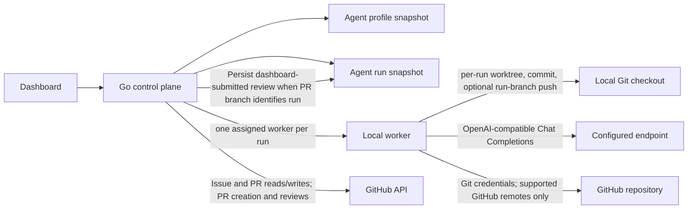

# Architecture checkpoint

This is a review checkpoint, not an approved target design. The current code is a local prototype. Its data structures
and execution contracts may change after the product and agent model are agreed.

## Confirmed requirements

- Coordinate work across multiple projects through a dashboard for developers and non-developers. Projects use Git and
  are available on local development machines.
- Make proposed code changes reviewable as a local branch and pull request. People can review the pull request, leave
  comments or request changes, and have the control plane continue from that feedback. Show issues and review state in
  the dashboard.
- Build the dashboard alongside backend capabilities and keep the dashboard available for live review during
  development.
- Use OpenAI-compatible Chat Completions for the first model-call integration. This selects a request protocol only; it
  does not settle the agent, tool, or workflow model.
- Use GitHub OAuth for dashboard user sign-in. User OAuth identity stays separate from GitHub App credentials used by
  the control plane for repository operations.

## Bootstrap milestone accepted

Start with the Go control-plane API, a local worker, project discovery, and a live dashboard preview. Prove the API and
worker exchange real project and worker state and that the dashboard renders it. Keep this milestone independently
useful while later architecture decisions remain open.

## Architecture not yet agreed

- Deployment topology: where the dashboard and control plane run, where project checkouts live, and how remote workers
  connect.
- Agent definition and execution: what an agent is, how prompts, tools, models, policies, and history relate, and what
  the execution lifecycle is.
- Work tracking: whether objectives, workflows, tasks, sessions, runs, and attempts are needed and how they relate.
- Project identity and ownership: organization, workspace, product, project, repository, and checkout boundaries.
- Review lineage: how a local change, branch, pull request, review thread, and follow-up work are connected.
- Organization/team authorization, per-worker enrollment, durable sessions, secret rotation, and audit requirements for
  a hosted control plane. The first remote-worker prototype uses a username allowlist and shared worker bearer secret.

## Contracts in the prototype today

- An **agent profile** currently stores prompts, model/provider labels, tool allowlists, enabled state, and a version.
- An **agent run** snapshots a profile and binds a prompt to one project and one worker. It receives a generated local
  branch and runs in a per-run worktree. Dashboard feedback can be recorded on the run and an eligible request for
  changes can requeue that same run.
- The worker owns model calls, repository access, local commits, and optional run-branch publication. When publication
  is requested for a successful non-empty run on a supported GitHub checkout, it verifies the push remote and pushes
  only the generated branch with the workstation's Git credentials. The control plane can then create or reuse the
  pull request and persist its link using its own GitHub App installation token or personal-token fallback; provider
  credentials are not sent to the worker.
- The Reviews dashboard can submit a top-level GitHub comment or request changes. The control plane uses the pull
  request head branch to associate feedback with a run-created PR and persist it on that run. A request queues another
  pass only when the run has capacity and the assigned worker is online with the required runtime and write tool.
  Feedback submitted directly on GitHub is not imported, and this prototype does not support inline review comments,
  approval, or merge.

These are descriptions of existing prototype behavior, not decisions that the eventual system must preserve.

## Gate before extending provisional models

Agree the relevant identities and relationships before extending agent execution, workflow execution, PR creation,
provider-feedback handoff, or multi-agent coordination. Until then, keep current implementation details labeled as
prototype behavior and avoid adding cross-system relationships that rely on guessed branch names or run identity.
