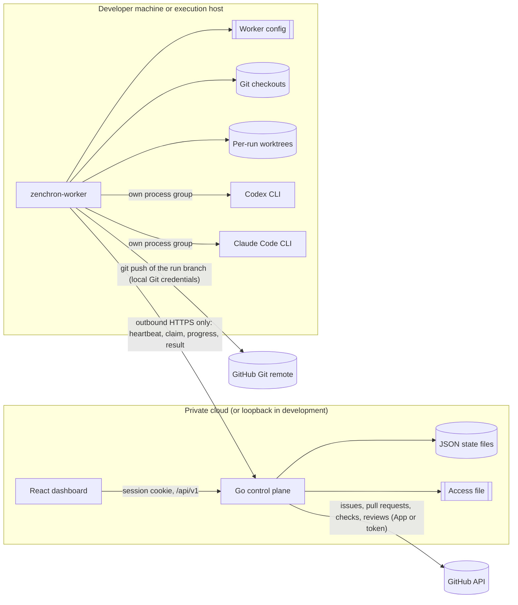
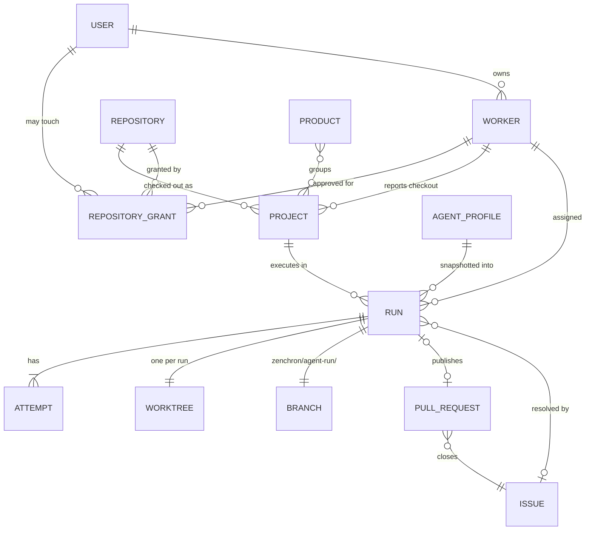

# Backend architecture and decisions

This records what the backend is after the autonomous-runtime work, why each existing component was kept, changed,
or deferred, and which parts of the private-cloud target are implemented versus still open. It supersedes the open
questions in the [architecture checkpoint](architecture-checkpoint.md) for the areas listed here. Feature behavior
lives in [Issue to pull request](../features/issue-to-pull-request.md) and
[Worker enrollment and project access](../features/worker-enrollment-and-project-access.md).

## Shape

One Go module, two processes, one shared wire contract:

- `cmd/zenchron` is the control plane: a modular monolith that owns identity, authorization, GitHub, run state, and
  the dashboard API. It never touches a developer's filesystem or processes.
- `cmd/zenchron-worker` is the local worker: it owns checkouts, worktrees, provider processes, verification, commits,
  and pushes. It makes no authorization decisions beyond refusing work outside its own configuration.
- `internal/workerapi` is the only definition of what the two exchange.

Nothing connects inward to a worker. The control plane holds the GitHub API credential; the worker holds Git push
credentials and the provider sign-ins. Neither side receives the other's secrets.

## Ownership

| Responsibility | Owner | Where |
|---|---|---|
| User identity (GitHub OAuth, sessions) | Control plane | `auth.go` |
| Worker identity, repository access for users and workers | Control plane | `access.go`, applied in `auth.go` |
| Product, objective, workflow, agent profile definitions | Control plane | `products.go`, `objectives.go`, `workflows.go`, `agents.go` |
| GitHub provider integration | Control plane | `github*.go`, `github_delivery.go` |
| Worker registration and presence | Control plane | `workers.go` |
| Run orchestration, leases, attempts, persistence | Control plane | `agent_runs.go`, `agent_run_results.go`, `agent_run_progress.go` |
| Issue snapshot, pull-request status, review import | Control plane | `agent_run_issues.go`, `agent_reviews.go` |
| Checkout discovery and repository allowlist | Worker | `projects.go`, `verification.go` (`workerConfig`) |
| Worktree creation (only by the run pipeline), locking, cleanup | Worker | `worktrees.go`, `worktree_owner.go` |
| Run execution pipeline | Worker | `agent_runner.go` |
| Agent execution: the CLI process runner and its two adapters, the only implementation | Worker | `cli_provider.go`, `cli_adapters.go` |
| Verification and evidence | Worker | `verification.go`, `agent_run_progress.go` |

## Identities and relationships

- **Repository** is identified by its sanitized locator, for example `github.com/acme/api`. It is the unit of
  authorization.
- **Project** is one worker's checkout of a repository. Its id is derived from the worker id and the local path, which
  never leaves the worker.
- **Worker** has a stable id derived from its hostname and configuration directory, an owner, and approved repositories.
- **Run** stores its repository, issue number, worker, profile snapshot, provider and version, base commit, branch,
  result commit, verification, publication, pull request, and one record per attempt.
- **Organization** is not modeled. One control plane serves one organization; see the open items below.

## Decisions

| Component | Decision | Evidence and rationale | Consequence |
|---|---|---|---|
| Run queue, leases, attempt fencing (`agent_runs.go`) | KEEP, extend | Fencing by worker id and attempt already rejected stale and duplicate completions and had tests. | Extended with an attempt log, a single lease-expiry rule, and lease renewal on progress. |
| Duplicate lease-expiry logic at startup and at claim | REFACTOR | The same rule was written twice. | One `expireLease`; both paths use it. |
| Wire types defined separately in both binaries | REPLACE | `agentRunCommand` and the result body existed twice and could drift silently. | `internal/workerapi` is the single contract. Old and new binaries are not wire-compatible: the control plane rejects a heartbeat that still carries `agent_runtime_enabled`, so workers are upgraded together with it. |
| Cancellation polling endpoint and worker poller | REMOVE | A second channel that only carried one boolean, while long runs had no way to renew a three-minute lease. | One `progress` call renews the lease, carries events, and returns the cancel flag. `GET .../cancellation` is gone. |
| Two-minute run deadline | REPLACE | A real coding task cannot finish in two minutes; the first live runs took three to four. | Operator-configurable wall-clock, inactivity, tool-activity, and verification limits with named termination reasons. |
| Worker run function with ten positional result arguments | REFACTOR | The result could not grow to carry verification, usage, or reasons. | `agentRunner` with one `workerapi.AgentRunResult`. |
| Chat-completions tool loop (`openai.go`, `agent_tools.go`) | REMOVE | Codex and Claude own their reasoning and tool loops, so this was a second, weaker agent implementation kept only for the dashboard E2E suite. No product requirement needs direct-API execution. | Deleted with `ZENCHRON_LLM_BASE_URL`, `ZENCHRON_LLM_API_KEY`, the heartbeat's `agent_runtime_enabled`, and the `runExecutor` interface. The CLI process runner is the only execution path; E2E drives it through a fake `codex` in `dashboard/e2e/fake-cli`. A run for a profile whose provider is not `codex-cli` or `claude-code` is refused with 409. |
| Worktree manager (`worktrees.go`, worker) | KEEP, strengthen | Idempotent preparation and ref validation were sound. | Active worktrees are locked with `git worktree lock`; `cleanup-worktrees` removes only clean, unlocked ones. |
| Standalone worktree request queue (`worktrees.go`, control plane) | REMOVE | It was a second durable queue with its own claim, lease, fencing, expiry and cancel, and a worktree prepared through it could be used by nothing: every run creates its own. | The `/api/v1/worktrees` and `/api/v1/workers/{id}/worktrees` routes are gone and `worktrees.json` in a data directory is no longer read. The agent-run store is the only lease and fencing implementation; the worker's run pipeline is the only caller of `prepareWorktree`. Projects lists a checkout's run branches instead. |
| GitHub client and App authentication | KEEP, extend | Token minting, bounded responses, and create-or-reuse pull requests were correct. | Added issue comments, issue creation, check runs, and reviews in `github_delivery.go`. |
| Matching review feedback to a run by parsing the branch name | REPLACE | The checkpoint itself warned against relationships built on guessed branch names. | Runs are found by stored repository and pull-request number. |
| Three copies of the "local client only" guard on GitHub writes | REFACTOR | Copy-pasted guard; it also made GitHub writes impossible from a hosted dashboard. | One check that admits a loopback client or a caller authorized by an enforced access policy. |
| Shared worker token | REPLACE for hosted use | Any holder could act as any worker id. | Per-worker hashed tokens bound to an id in the access file. The shared token works only on a loopback listener. |
| Username allowlist as the only authorization | REFACTOR | Hiding projects in the UI is not authorization. | Server-side repository grants for users and workers, enforced in every project- and run-scoped handler. |
| JSON snapshot persistence | KEEP for now | Atomic writes, strict decoding, and size caps are in place; one control-plane process per data directory. | Run events are stored beside runs. A database is required before multiple control-plane replicas; see open items. |
| Objectives, workflows, products | KEEP unchanged | Not on the issue-to-pull-request path. The workflow canvas still does not execute. | They remain organization-wide definitions without per-project access rules. |
| Skipping the commit when the diff exceeded the 128 KiB display cap | REMOVE | The cap bounds what the dashboard stores, not what an agent may deliver. | Large changes are committed and published; the stored diff is marked truncated. |

## Local versus private-cloud operation

| Concern | Loopback development | Private cloud |
|---|---|---|
| Listener | `127.0.0.1`, no authentication required | Non-loopback requires GitHub sign-in, HTTPS public URL, and `ZENCHRON_ACCESS_FILE` |
| Worker authentication | None, or the shared `ZENCHRON_WORKER_TOKEN` | Per-worker token bound to its enrolled id |
| Project access | Everything visible | Repository grants per user and per worker |
| GitHub writes | Loopback clients | Callers authorized for the repository |
| State | Local JSON files | Same files on one instance; not yet replicated |

## Not implemented

These are required before the control plane is offered to more than one organization or run as more than one
instance. None of them is claimed as working.

- Organizations, teams, and roles; the access file is edited by an operator, not through an API, and has no audit log.
- Database-backed state, multiple control-plane replicas, and retention policy for runs, diffs, and events.
- Server-side revocable user sessions and worker token rotation without editing the file.
- Per-repository GitHub App installations (one installation per control plane today).
- Webhook-driven import of GitHub reviews and CI results; both are read on request.
- Worker auto-update, Windows process isolation, and Gemini or other providers. A provider needs a CLI adapter;
  there is no direct-API execution path.
