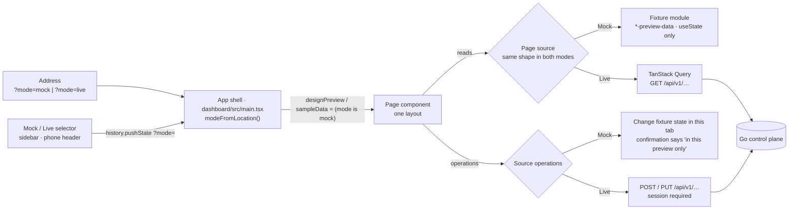

# One dashboard, two data modes

The dashboard has one implementation of each page. A page is laid out once, from the approved design, and is fed by
one of two data sources: **Mock** (the approved fixtures) or **Live** (the control plane). There is no second,
plainer "live" layout, and the layout does not depend on the hostname or on whether a session exists.

## Feature diagram

## Behavior

- **Selecting a mode.** Mock exists for local development only. On `127.0.0.1` or `localhost` the dashboard starts in
  Mock, honours `?mode=mock` and `?mode=live`, and shows the selector (labelled "Data mode") in the sidebar footer, or
  in the header on phones where the sidebar becomes the bottom bar. Choosing a mode writes `?mode=` to the address and
  keeps the current page; hash navigation keeps the parameter. On any other host there is no selector and the
  dashboard is always Live, whatever the address says, so a deployed dashboard cannot show sample data.
- **Mock.** Shows the approved fixtures and works with no control plane running. It never sends a write request:
  create, edit, duplicate, import, and "Run Agent" change state in the browser tab only, and their confirmations end
  with "in this preview only". Fixture pages carry an "ILLUSTRATIVE DATA" label and fixture charts are announced as
  mock or illustrative to assistive technology.
- **Live.** Requires a verified session exactly as before; an unauthenticated visitor gets the sign-in screen and a
  failed session check hides page data. Data comes only from the API. When a request fails the page says so; it does
  not fall back to fixtures. Where the control plane holds nothing for a part of the design, that part shows
  "Unavailable", an empty state, or a disabled control with the reason.
- **Same layout.** Both modes render the same components, class names, and responsive rules. Only values,
  capabilities, and permitted operations differ, and those come from the page's source object.

## The pattern for a page

1. The page takes the approved (formerly preview-only) markup as its only markup.
2. A `…Source` type lists what the page needs: collections, loading and error flags, a `view` of display values, and
   operations. Operations a mode cannot perform are absent from its source, and the page disables the control.
3. A Mock hook builds the source from the fixture module with `useState`. A Live hook builds it from TanStack Query
   and real mutations. The page calls both hooks (the Live queries are disabled in Mock) and uses one.
4. Values the control plane does not have are stated as unavailable in the Live view, never invented.
5. Components, CSS classes, and branches that only the old live layout used are deleted.

Agents is the reference implementation: `dashboard/src/agents.tsx` (layout), `agentsView.tsx` (`AgentsSource`,
`AgentsView`, `useLiveAgents`), `agents-preview-data.tsx` (fixtures, `useMockAgents`), `agentsData.ts` (schemas and
loaders).

## Page-by-page record

| Page | State | Source | What Live shows that the fixtures invent |
|---|---|---|---|
| Shell | One shell | `main.tsx` | Signed-in login and avatar instead of the sample person |
| Agents | One layout | `AgentsSource` | Runs, success rate, duration, and provider-reported cost from real runs; owner, created date, variables, templates, and earlier versions are Unavailable; safety lists the worker's real safeguards; import is disabled |
| Overview | One layout | `OverviewSource` | Open objectives and their progress, running agents, online workers, the open PR queue, CI pass rate, recent activity, the last three agent runs, the latest local branch diff with its first changed lines, the saved workflow's stages, and merged-PR, cycle-time, and CI-duration charts are real; budget, plan approvals, trusted-main and evidence health, the sprint timeline, workflow execution, KPI trend deltas, sparklines, and the PR bars are Unavailable, empty, or left out |
| Objectives | One layout | `ObjectivesSource` | Objectives, their owner, product, status, progress, and due date, the status counts, completed count and completion share, and the plan summary (target, created, and last-updated dates) are real, and objectives are created and edited through the API; approval, linked workflows, blockers, acceptance criteria, related PRs, activity, milestones, the capacity chart, and the KPI trend graphics are Unavailable or left out; favorites are disabled |
| Workflows | One layout | `WorkflowsSource` | Saved workflows, their graph, name, description, status, and version are real, and workflows are created, edited, laid out, validated, and saved through the API; the Run Preview, the run timeline, runs, schedules, permissions, approvals, earlier versions, publishing, and component settings beyond name and description are Unavailable or empty with the reason; Run, Publish, Simulate Run, and every control on those tabs are disabled; no component carries a passed-step marker |
| Projects | One layout; no fixtures | props from the shell | Live lists worker checkouts and, for the selected one, its agent run branches. Mock has no sample inventory and says so ("Live data only") instead of showing an empty one |
| Product Workspace | One layout | `WorkspaceSource` | Products, linked repositories with worker and branch, repository health, objectives, the roadmap (bars run from an objective's creation to its due date), workflow definitions, and agent profiles are real, and products are created and edited through the API; files, stakeholders, release streams, decisions, delivery metrics, and every trend graphic are Unavailable with the reason; favorites and the delivery range are disabled |
| Reviews | One layout | `ReviewsSource` | Open pull requests and issues of a connected GitHub checkout, their state, author, branch, and date, the pull-request diff with its file and line counts, the base branch, agent-run branches with their diff, comments, and evidence, and the counts on the queue tabs are real; GitHub comments, reviews, issue close / reopen, run comments, request changes, and cancel go through the API; review time, merge rate, policy gate pass, commits, risk, evidence completeness, required checks, merge strategy, policy, AI suggestions, artifacts, checklist, approvals, and trusted-main readiness are Unavailable; trend graphics, card signals, and the inline discussion are left out; New PR, Approve, Merge, Export evidence, bookmarks, the date range, and Auto-merge are disabled with the reason |
| Integrations and Settings | One layout | `SystemSource` | Control plane health, worker heartbeats and coding CLIs, GitHub checkouts, and session auth are real; GitLab, Slack, Linear / Jira, Docker / Registry, and Google are Not connected; profile, policies, roles, budgets, secrets, controller limits, notification rules, and audit are Unavailable or empty with a note; every write control is disabled |
| Reports | One layout | `ReportsSource` | Delivery velocity, cycle time, acceptance rate, and work outcomes from GitHub pull-request history, CI duration with its distribution and p50 / p95 from GitHub Actions history, agent spend from the cost providers report on agent runs, objective, run, worker, and source insights, the product and workspace summary tables, and four CSV exports are real and follow the report scope; review latency and autonomous completion are Unavailable with the reason and their percentile buttons are disabled; KPI trend deltas, the autonomy series, the summary total rows, and PDF / XLSX exports are left out; the Workflow filter is disabled because runs carry no workflow ID; a chart with no complete history shows an empty plot with the reason |

No page is pending. Every page renders the approved layout in both modes, the approved shell styling always
applies, and the header has one markup fed by an identity: the sample person in Mock, the signed-in account in Live.

## Mock and Live side by side

Captured at 1672×941 from the final build. Live is a local control plane with one worker, three agent profiles, and
eleven recorded runs; it has no objectives or products, so those pages show their empty states.

| Page | Mock | Live |
|---|---|---|
| Overview | [Mock](../screenshots/one-dashboard/overview-mock.jpg) | [Live](../screenshots/one-dashboard/overview-live.jpg) |
| Objectives | [Mock](../screenshots/one-dashboard/objectives-mock.jpg) | [Live](../screenshots/one-dashboard/objectives-live.jpg) |
| Workflows | [Mock](../screenshots/one-dashboard/workflows-mock.jpg) | [Live](../screenshots/one-dashboard/workflows-live.jpg) |
| Agents | [Mock](../screenshots/one-dashboard/agents-mock.jpg) | [Live](../screenshots/one-dashboard/agents-live.jpg) |
| Projects | [Mock](../screenshots/one-dashboard/projects-mock.jpg) | [Live](../screenshots/one-dashboard/projects-live.jpg) |
| Product Workspace | [Mock](../screenshots/one-dashboard/workspace-mock.jpg) | [Live](../screenshots/one-dashboard/workspace-live.jpg) |
| Reviews | [Mock](../screenshots/one-dashboard/reviews-mock.jpg) | [Live](../screenshots/one-dashboard/reviews-live.jpg) |
| Integrations | [Mock](../screenshots/one-dashboard/integrations-mock.jpg) | [Live](../screenshots/one-dashboard/integrations-live.jpg) |
| Reports | [Mock](../screenshots/one-dashboard/reports-mock.jpg) | [Live](../screenshots/one-dashboard/reports-live.jpg) |
| Settings | [Mock](../screenshots/one-dashboard/settings-mock.jpg) | [Live](../screenshots/one-dashboard/settings-live.jpg) |

## What was removed overall

- Every second layout: the plain live variants of Overview, Objectives, Workflows, Agents, Product Workspace,
  Reviews, Integrations and Settings, and Reports. The sections below list each page's components, markup, and CSS.
- Preview-only components that existed beside a live page: `SystemIntegrationsPreview`, `WorkspaceDesignPreview`,
  `WorkflowDesignPreview`, `WorkflowSectionsPreview`, `WorkflowMobileRunPreview`, `ReviewPreviewSummary`,
  `AgentsMobilePreview`. Their markup is now the page, fed by a source.
- Live-only components: `AgentExecutionOverview`, `AgentPerformanceTrend`, `LiveWorkspacePage` and its helpers,
  `UnavailableMetricsPanel`, and `workspace.css`.
- Mode selection from the hostname and the session, the `?live` flag, and the temporary `unifiedPages` list.
- References to the mode flag in page components fell from about 400 to about 50, and those that remain choose a
  data source or pass the flag down; none of them chooses a layout.
- Stylesheet rules no component used, including eleven classes left from earlier layouts.

Class and file names that still contain "preview" (for example `agents-design-preview`, `reviews-preview.css`,
`*-preview-data`) name the approved design's styles and the fixture modules. They apply in both modes.

## Removed with the Agents migration

- `AgentExecutionOverview.tsx` and `AgentPerformanceTrend.tsx` (live-only cards, replaced by the design's Tool
  Permissions, Safety & Governance, and Performance Trends cards fed with real data).
- The live-only branches of `agents.tsx` (the second header, list row, profile summary, and bottom run panel).
- Sixteen CSS classes only those used (`agents-bottom-panels`, `agents-runs-panel`, `agents-trend-*`,
  `agents-permission-row`, `agents-safeguard-list`, and related).
- Mode selection from `localReviewHost` and `auth.data.authenticated`, and the `?live` switch.

## Removed with the Integrations and Settings migration

- `SystemIntegrationsPreview.tsx`; its markup is now the only layout in `system.tsx`, its fixtures and local state
  are `useMockSystem` in `system-preview-data.tsx`.
- The live-only branches of `system.tsx`: the runtime service cards, the eight status panels, the six Settings cards,
  the static configuration rail, and the footer notice. Their facts moved into the design's provider cards, the
  Controller Configuration rows, and the per-card notes.
- Twelve CSS classes only those used (`system-service-icon`, `system-operations-grid`, `system-operation-card`,
  `system-setting-values`, `system-audit-card`, `system-status`, `system-notice`, `system-settings-grid`,
  `system-setting-card`, `system-setting-heading`, `system-setting-icon`, `system-add-button`) and the `span`
  variants of the rail and filter rules.

## Removed with the Product Workspace migration

- `WorkspaceDesignPreview.tsx`; its markup is now the only layout in `workspace.tsx`, its fixtures and local state are
  `useMockWorkspace` in `workspace-preview-data.tsx`.
- The live-only layout in `workspace.tsx`: the page title row, the directory with its count badge and footer note, the
  product heading with "Edit Product", the four plain metric cards, and the `ProductRoadmap`, `WorkspaceMetric`,
  `WorkspacePanel`, `UnavailablePanel`, `WorkspaceObjectives`, `WorkspaceRepositories`, and `DefinitionNames`
  components. "Edit product" and "Open repository inventory" moved into the design's Product actions menu.
- `workspace.css` and every `workspace-*` class only that layout used; `workspace-form-actions` (the shared product
  editor) moved to `workspace-preview.css`.
- The fixture-only "Add a product to this preview" dialog; both modes use `ProductEditor`.

## Removed with the Objectives migration

- The mode branches in `objectives.tsx` (57 `sampleData` references, now three that pick the source). The page is
  `objectives.tsx` (list, filters, views, create dialog) and `ObjectiveDetail.tsx` (detail panel, editor, milestones);
  `objectivesView.ts` holds the schemas, `ObjectivesSource`, and `useLiveObjectives`; `objective-preview.ts` holds the
  fixtures and `useMockObjectives`.
- The Live-only detail header ("Edit objective" / "Cancel edit" button, ID caption), plain meta grid (due date,
  created), underline tabs, seven-card overview with the "Objective progress" card, and "not included in the available
  objective data" copy. "Edit objective" moved into the design's "More objective actions" menu; the due date sits
  beside the completion bar and the created date in Plan Summary.
- The Live-only "Objective progress" bar list in the capacity card, the plain KPI labels ("Completed objectives",
  "Completion rate"), the lower-case filter labels, the plain title and owner cells, and AG Grid's own pagination
  panel; both modes use the numbered footer pager.
- Thirteen CSS rules only those used (`edit-objective-button`, `objective-detail-head small`, `objective-overview-wide`,
  `objective-progress-card`, `capacity-empty`, `capacity-bars`, the `ag-paging-panel` rule).
- The "The mock preview is read-only." refusal: Mock now creates and edits fixture objectives in the tab and says
  "in this preview only".
- The editor's mirrored `progress`, `status`, and `product` state. The detail panel reads the saved record and the
  form is seeded when editing starts, so the summary cannot show a value the record does not hold.

## Removed with the Reviews migration

- The mode branches in `reviews.tsx` (64 `designPreview` references, now seven that pick the source and mark the Mock
  root). The page is `reviews.tsx` (state, metrics, section bar, panes), `ReviewQueue.tsx`, `ReviewDetail.tsx`,
  `ReviewSummary.tsx`, and `LocalBranchReview.tsx`; `reviewsView.ts` holds the schemas, `ReviewsSource`, and
  `useLiveReviews`; `review-preview.tsx` holds the fixtures and `useMockReviews`.
- `reviews-preview-summary.tsx` (`ReviewPreviewSummary`); its tiles and checks are `ReviewSummary`. `ReviewPreviewContext`
  and `ReviewPreviewDiff` became the data-driven `ReviewContext` and `PullRequestPatch`.
- The Live-only title-row badge ("GitHub · name", "GitHub repository not connected", "Connecting to GitHub", "GitHub
  unavailable"); the repository menu names the checkout and the queue reports connecting, missing, and failed states.
- The Live-only section bar (text tabs with five permanently disabled entries, the repository `Select`, the disabled
  "All repos" button); Issues and Local branches are queue tabs beside Pull Requests and the repository is the design's
  menu.
- The Live-only queue heading (lower-case titles with an "N items" / "N runs" badge), four-tab detail row, plain
  "Pull request diff" bar, repeated description above the diff, the "Open pull request on GitHub" row (now in the
  overflow menu), three-card context row, four-tile statistics grid, and the summary order with Export evidence first
  and Merge last.
- Live labels "Open pull requests", "Draft pull requests", and "Open issues" on the metric cards; the draft count is
  the Draft chip and the issue count is on the Issues tab.
- Five CSS rules only those used (`reviews-unavailable`, `reviews-provider-available`, their dot rules, and
  `reviews-filter-select`), and the rule that hid the description inside the detail pane.
- The fixed 94% width of the evidence bar; it follows the value.

## Removed with the Reports migration

- The mode branches in `reports.tsx` (66 `designPreview` references, now five that pick the source and mark the Mock
  root). The page is `reports.tsx` (scope bar, KPI cards, charts, insights); `reportsView.tsx` holds `ReportsSource`
  and `useLiveReports` with every query, scope filter, and CSV export; `reports-preview.tsx` holds the fixtures and
  `mockReports`.
- `UnavailableMetricsPanel` with its "Connect a source to view this chart" plot and `delivery-note` line. Review
  Latency Trend and Agent Spend keep the design's heading, legend, and percentile buttons and show the reason in the
  plot area.
- The Live-only line charts (112px delivery chart without axis titles or dots, the teal acceptance line), the
  "Completed GitHub Actions runs" legend, the SVG donut label (`report-chart-label`), the "Pull request status · range"
  subtitle (now the caption beside the Work Outcomes title), the "Findings from the selected snapshot" subtitle, the
  Workspace Summary footnote (`inventory-footnote`), and the "Objective owner" / "Apply filters" labels (now "Team" and
  "Apply Filters").
- The fixture-name icon table in `ReportSummaries.tsx`; a summary row carries its own icon.
- "Agent Spend: Unavailable" for every run. Live adds up the cost providers reported on the scoped runs.

## Removed with the Workflows migration

- The mode branches in `workflows.tsx` (61 lines naming `designPreview`, now 15: four in `WorkflowsPage` for the prop,
  the two source picks, and the phone overview graph; the rest are the shared `WorkflowOverview` panel and an import).
  The page is `workflows.tsx` (state, heading, canvas, inspector), `WorkflowPalette.tsx`, `WorkflowRun.tsx`,
  `WorkflowNodeSettings.tsx`, and `WorkflowSections.tsx`; `workflowsView.ts` holds `WorkflowsSource` and
  `useLiveWorkflows`; `workflow-preview-data.ts` holds the fixtures and `useMockWorkflows`.
- `WorkflowDesignPreview.tsx`, `WorkflowMobileRunPreview.tsx`, and `WorkflowSectionsPreview.tsx` as fixture-only
  components; their markup is now data-driven and their fixtures are in `workflow-preview-data.ts`.
- The Live-only canvas bar (the workflow `Select`, "New Workflow", "Auto layout"), React Flow's `Controls` and
  `Background`, the full-width status row with "Runner not connected", and the "ORCHESTRATION" eyebrow. Switching,
  creating, and auto layout are in the workflow menu on the version badge.
- The Live-only inspector tail: the "Delete component" button (now in the Component options menu), the "Workflow
  settings" disclosure (name, description, and status are edited on the Settings tab), and the "Version N · saved to
  local control plane" hint (the version badge and the Versions tab).
- The Live-only Run Preview body ("Runner unavailable" badge, the empty panel, the Graph definition summary) and the
  Live-only phone summary, task list, and approval state; the design's paused panel and phone cards carry those facts.
- The disabled Runs, Versions, Schedules, Permissions, and Settings tabs in Live; each opens the design's frame.
- CSS only those used: `workflow-select`, `workflow-canvas-actions`, `workflow-settings`, `workflow-field`,
  `workflow-divider`, `workflow-preview-empty`, `workflow-preview-summary`, `workflow-mobile-summary`,
  `workflow-mobile-details`, `workflow-mobile-detail-panel`, `workflow-mobile-task-list`, `workflow-mobile-task-row`,
  `workflow-mobile-approval-state`, `.workflow-status small`, the React Flow controls rules, and the disabled
  section-tab rule.
- The Mock refusal to create a workflow: Mock adds one in the tab and says "in this preview only".
- The 190×110 card size passed to ELK; saved graphs are laid out with the compact card sizes the design draws.

## Removed with the Overview migration

- The mode branches in `OverviewPage.tsx` (37 `sampleData` references, now one that picks the source). Fixtures moved
  to `mockOverview` in `overview-preview-data.tsx`; Live values come from `useLiveOverview` in `overviewView.tsx`.
- The Live-only run list in Code Review (`overview-review-list` and its five rules); the latest reviewable run now
  fills the design's review frame, with a count of reviewable diffs and the link to Reviews.
- The Live-only workflow header ("View workflow" link, raw status badge), the `workflow-overview-status` line, and the
  ELK layout pass for the Overview graph (`overviewNodeLayout`, "Could not arrange workflow graph"). Saved workflows
  use the approved stage positions, glyphs, and arrows; component and connection counts and "runner not connected"
  moved into the Workflow options menu, and the badge reads "Execution unavailable".
- Invented Live graphics: the placeholder sparklines and PR bars the old Live cards drew from constant arrays.
- The fixture sprint dates and "Protected · Verified · Up to date" caption that the old Live layout showed unchanged.
- The second worker caption line in Recent Activity (`.activity-list small`); the panel shows five single-line rows
  and All Activity lists every row.

## Verification

- The whole Playwright suite (95 tests) passes on the final head, with `go vet` and `go test ./cmd/...`.
- Every page was captured in Mock and Live at 1672×941 and 390×844 with no horizontal overflow and no page errors.
- Final comparison of the approved build against Mock for all ten routes at both sizes: Workflows, Reviews,
  Integrations, and Reports are identical on desktop; Overview, Workflows, Agents, Product Workspace, Integrations,
  Reports, and Settings are identical on phones. Overview, Objectives, Product Workspace, and Settings on desktop and
  Reviews on phones differ by 1 to 49 pixels of at most 2 colour levels, which is not visible. Agents on desktop
  differs by 73 pixels of up to 13 levels at one icon edge; two captures of the approved build itself differ by 24
  pixels on that page. Objectives on phones differs in the detail header, deliberately (see below). Projects differs
  deliberately: Mock states that it has no sample data.
- Against a real control plane: Agents create, edit, duplicate, disable, and the Status field each sent the expected
  `POST` or `PUT` and received 200 or 201; the queue dialog listed the project's real GitHub issues and the worker's
  real readiness; Mock sent no write request for the same actions.

- `dashboard/e2e/z_run_evidence.spec.ts`: "the Mock and Live switch selects the data source, keeps the page, and
  stays in the address".
- `dashboard/e2e/z_agents.spec.ts`: Live layout, real create, edit, disable, and queued runs; Mock filters, sorting,
  local-only actions, and "without API reads".
- `dashboard/e2e/agents-desktop-preview.spec.ts`, `agents-mobile-preview.spec.ts`: the approved desktop and phone
  design in Mock.
- Approved (`main`), Mock, and Live panels were measured at 1672×941 and 1672×749 and are identical.
- `dashboard/e2e/system.spec.ts`: the Settings & Integrations layout in Live with real status, honest "Not connected"
  and "Unavailable" states, disabled controls, and no write requests; `integrations-preview.spec.ts`: the same layout
  in Mock.
- `dashboard/e2e/overview-live.spec.ts`: the Overview frame in Live with real objectives, runs, activity, PR queue, CI
  health, and analytics; honest unavailable panels; failed requests reported without fixtures; no write requests; the
  phone summary without overflow. `overview.spec.ts`: the same layout in Mock at 1672×941, 1672×749, 1522×856, and
  390×844. `home.spec.ts` "overview lists only agent runs with captured local diffs": the Live review frame and its
  diff excerpt. Approved and Mock were pixel-compared at 1672×941, 1672×749, 1024×768, and 390×844 and differ only in
  the mode selector.
- `dashboard/e2e/objectives-views.spec.ts`: the Objectives frame in Mock with local-only create and edit and no API
  traffic; in Live with real records, honest unavailable parts, validation, failed loads and saves reported without
  fixtures, retry, the create and edit payloads, and the phone layout without overflow. `home.spec.ts`: Live create and
  edit, and the Live frame at 1672×941. Approved and Mock were pixel-compared at 1672×941, 1672×749, 1440×900, and
  1024×768 and are identical; at 390×844 they differ only in the detail header, where the status badge and the three
  action buttons are no longer clipped.
- `dashboard/e2e/github-reviews.spec.ts`: the Reviews frame in Live with real pull requests, issues, diff statistics,
  honest Unavailable values, disabled controls, the exact GitHub write requests, the repository menu, a copied link, a
  failed load without fixtures, and the phone layout. `reviews-preview.spec.ts`: the same frame in Mock with local-only
  actions and no API traffic. `home.spec.ts`, `z_run_evidence.spec.ts`, and `z_agents.spec.ts`: the not-connected
  state, agent-run branches, and run evidence in that frame. Approved and Mock were pixel-compared at 1672×941,
  1672×749, 1512×874, 1440×900, 1280×800, 1024×768, and 390×844 and are identical.
- `dashboard/e2e/reports.spec.ts`, `report-summary-metrics.spec.ts`: the Reports frame in Live with real delivery, CI,
  outcome, and spend figures, area charts with the design's axis titles, honest Unavailable cards and empty plots,
  disabled percentile and Workflow controls, scope apply and reset, failed and truncated histories without fixtures,
  the four CSV exports, and the phone layout. `reports-preview.spec.ts`: the same frame in Mock with local scope and
  no API traffic. `home.spec.ts`: Reports against the real control plane. Approved and Mock were pixel-compared at
  1672×941, 1672×749, 1512×874, 1440×900, 1280×800, 1024×768, and 390×844 and are identical.
- `dashboard/e2e/workflows-live.spec.ts`: the Workflows frame in Live with the saved graph laid out automatically, the
  workflow menu, real add, rename, delete, drag placement, save, create, and the Settings rename with their request
  bodies, honest Unavailable parts and disabled controls on every tab, failed loads, an empty list, and rejected saves
  and creates without fixtures, and the phone run detail without overflow. `workflows.spec.ts` and
  `workflow-mobile-preview.spec.ts`: the same frame in Mock with local-only actions and no workflow requests. Approved
  and Mock were pixel-compared on the Builder at 1672×941, 1672×749, 1512×874, 1440×900, 1280×800, 1024×768, and
  390×844, and on the five other tabs at 1672×941, 1024×768, and 390×844, and are identical.
- `dashboard/e2e/workspace.spec.ts`: the Product Workspace frame in Live with real products, repositories, objectives,
  and roadmap; honest unavailable panels and disabled controls; product edit through `PUT /api/v1/products/{id}`;
  product switching on a phone; empty and failed product lists. `workspace-preview.spec.ts`: the same layout in Mock
  with no protected API traffic. Approved and Mock were pixel-compared on all six tabs at 1672×941, 1024×768, and
  390×844 and are identical.
