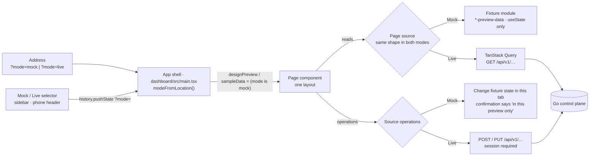

# One dashboard, two data modes

The dashboard has one implementation of each page. A page is laid out once, from the approved design, and is fed by
one of two data sources: **Mock** (the approved fixtures) or **Live** (the control plane). There is no second,
plainer "live" layout, and the layout does not depend on the hostname or on whether a session exists.

## Feature diagram

## Behavior

- **Selecting a mode.** Mock exists for local development only. On `127.0.0.1` or `localhost` the dashboard starts in
  Mock, honours `?mode=mock` and `?mode=live`, and shows the selector (labelled "Data mode") in the sidebar footer, or
  in the header on phones where the sidebar becomes the bottom bar. Choosing a mode writes `?mode=` to the address and
  keeps the current page; hash navigation keeps the parameter. On any other host there is no selector and the
  dashboard is always Live, whatever the address says, so a deployed dashboard cannot show sample data.
- **Mock.** Shows the approved fixtures and works with no control plane running. It never sends a write request:
  create, edit, duplicate, import, and "Run Agent" change state in the browser tab only, and their confirmations end
  with "in this preview only". Fixture pages carry an "ILLUSTRATIVE DATA" label and fixture charts are announced as
  mock or illustrative to assistive technology.
- **Live.** Requires a verified session exactly as before; an unauthenticated visitor gets the sign-in screen and a
  failed session check hides page data. Data comes only from the API. When a request fails the page says so; it does
  not fall back to fixtures. Where the control plane holds nothing for a part of the design, that part shows
  "Unavailable", an empty state, or a disabled control with the reason.
- **Same layout.** Both modes render the same components, class names, and responsive rules. Only values,
  capabilities, and permitted operations differ, and those come from the page's source object.

## The pattern for a page

1. The page takes the approved (formerly preview-only) markup as its only markup.
2. A `…Source` type lists what the page needs: collections, loading and error flags, a `view` of display values, and
   operations. Operations a mode cannot perform are absent from its source, and the page disables the control.
3. A Mock hook builds the source from the fixture module with `useState`. A Live hook builds it from TanStack Query
   and real mutations. The page calls both hooks (the Live queries are disabled in Mock) and uses one.
4. Values the control plane does not have are stated as unavailable in the Live view, never invented.
5. Components, CSS classes, and branches that only the old live layout used are deleted.

Agents is the reference implementation: `dashboard/src/agents.tsx` (layout), `agentsView.tsx` (`AgentsSource`,
`AgentsView`, `useLiveAgents`), `agents-preview-data.tsx` (fixtures, `useMockAgents`), `agentsData.ts` (schemas and
loaders).

## Page-by-page record

| Page | State | Source | What Live shows that the fixtures invent |
|---|---|---|---|
| Shell | One shell | `main.tsx` | Signed-in login and avatar instead of the sample person |
| Agents | One layout | `AgentsSource` | Runs, success rate, duration, and provider-reported cost from real runs; owner, created date, variables, templates, and earlier versions are Unavailable; safety lists the worker's real safeguards; import is disabled |
| Overview | One layout | `OverviewSource` | Open objectives and their progress, running agents, online workers, the open PR queue, CI pass rate, recent activity, the last three agent runs, the latest local branch diff with its first changed lines, the saved workflow's stages, and merged-PR, cycle-time, and CI-duration charts are real; budget, plan approvals, trusted-main and evidence health, the sprint timeline, workflow execution, KPI trend deltas, sparklines, and the PR bars are Unavailable, empty, or left out |
| Objectives | Pending | | |
| Workflows | Pending | | |
| Projects | Single layout already; no fixtures | | |
| Product Workspace | One layout | `WorkspaceSource` | Products, linked repositories with worker and branch, repository health, objectives, the roadmap (bars run from an objective's creation to its due date), workflow definitions, and agent profiles are real, and products are created and edited through the API; files, stakeholders, release streams, decisions, delivery metrics, and every trend graphic are Unavailable with the reason; favorites and the delivery range are disabled |
| Reviews | Pending | | |
| Integrations and Settings | One layout | `SystemSource` | Control plane health, worker heartbeats and coding CLIs, GitHub checkouts, the worker model endpoint, and session auth are real; GitLab, Slack, Linear / Jira, Docker / Registry, and Google are Not connected; profile, policies, roles, budgets, secrets, controller limits, notification rules, and audit are Unavailable or empty with a note; every write control is disabled |
| Reports | Pending | | |

"Pending" pages still switch between two layouts with the mode; the shell marks migrated pages in `unifiedPages`
until the list is empty.

## Removed with the Agents migration

- `AgentExecutionOverview.tsx` and `AgentPerformanceTrend.tsx` (live-only cards, replaced by the design's Tool
  Permissions, Safety & Governance, and Performance Trends cards fed with real data).
- The live-only branches of `agents.tsx` (the second header, list row, profile summary, and bottom run panel).
- Sixteen CSS classes only those used (`agents-bottom-panels`, `agents-runs-panel`, `agents-trend-*`,
  `agents-permission-row`, `agents-safeguard-list`, and related).
- Mode selection from `localReviewHost` and `auth.data.authenticated`, and the `?live` switch.

## Removed with the Integrations and Settings migration

- `SystemIntegrationsPreview.tsx`; its markup is now the only layout in `system.tsx`, its fixtures and local state
  are `useMockSystem` in `system-preview-data.tsx`.
- The live-only branches of `system.tsx`: the runtime service cards, the eight status panels, the six Settings cards,
  the static configuration rail, and the footer notice. Their facts moved into the design's provider cards, the
  Controller Configuration rows, and the per-card notes.
- Twelve CSS classes only those used (`system-service-icon`, `system-operations-grid`, `system-operation-card`,
  `system-setting-values`, `system-audit-card`, `system-status`, `system-notice`, `system-settings-grid`,
  `system-setting-card`, `system-setting-heading`, `system-setting-icon`, `system-add-button`) and the `span`
  variants of the rail and filter rules.

## Removed with the Product Workspace migration

- `WorkspaceDesignPreview.tsx`; its markup is now the only layout in `workspace.tsx`, its fixtures and local state are
  `useMockWorkspace` in `workspace-preview-data.tsx`.
- The live-only layout in `workspace.tsx`: the page title row, the directory with its count badge and footer note, the
  product heading with "Edit Product", the four plain metric cards, and the `ProductRoadmap`, `WorkspaceMetric`,
  `WorkspacePanel`, `UnavailablePanel`, `WorkspaceObjectives`, `WorkspaceRepositories`, and `DefinitionNames`
  components. "Edit product" and "Open repository inventory" moved into the design's Product actions menu.
- `workspace.css` and every `workspace-*` class only that layout used; `workspace-form-actions` (the shared product
  editor) moved to `workspace-preview.css`.
- The fixture-only "Add a product to this preview" dialog; both modes use `ProductEditor`.

## Removed with the Overview migration

- The mode branches in `OverviewPage.tsx` (37 `sampleData` references, now one that picks the source). Fixtures moved
  to `mockOverview` in `overview-preview-data.tsx`; Live values come from `useLiveOverview` in `overviewView.tsx`.
- The Live-only run list in Code Review (`overview-review-list` and its five rules); the latest reviewable run now
  fills the design's review frame, with a count of reviewable diffs and the link to Reviews.
- The Live-only workflow header ("View workflow" link, raw status badge), the `workflow-overview-status` line, and the
  ELK layout pass for the Overview graph (`overviewNodeLayout`, "Could not arrange workflow graph"). Saved workflows
  use the approved stage positions, glyphs, and arrows; component and connection counts and "runner not connected"
  moved into the Workflow options menu, and the badge reads "Execution unavailable".
- Invented Live graphics: the placeholder sparklines and PR bars the old Live cards drew from constant arrays.
- The fixture sprint dates and "Protected · Verified · Up to date" caption that the old Live layout showed unchanged.
- The second worker caption line in Recent Activity (`.activity-list small`); the panel shows five single-line rows
  and All Activity lists every row.

## Verification

- `dashboard/e2e/z_run_evidence.spec.ts`: "the Mock and Live switch selects the data source, keeps the page, and
  stays in the address".
- `dashboard/e2e/z_agents.spec.ts`: Live layout, real create, edit, disable, and queued runs; Mock filters, sorting,
  local-only actions, and "without API reads".
- `dashboard/e2e/agents-desktop-preview.spec.ts`, `agents-mobile-preview.spec.ts`: the approved desktop and phone
  design in Mock.
- Approved (`main`), Mock, and Live panels were measured at 1672×941 and 1672×749 and are identical.
- `dashboard/e2e/system.spec.ts`: the Settings & Integrations layout in Live with real status, honest "Not connected"
  and "Unavailable" states, disabled controls, and no write requests; `integrations-preview.spec.ts`: the same layout
  in Mock.
- `dashboard/e2e/overview-live.spec.ts`: the Overview frame in Live with real objectives, runs, activity, PR queue, CI
  health, and analytics; honest unavailable panels; failed requests reported without fixtures; no write requests; the
  phone summary without overflow. `overview.spec.ts`: the same layout in Mock at 1672×941, 1672×749, 1522×856, and
  390×844. `home.spec.ts` "overview lists only agent runs with captured local diffs": the Live review frame and its
  diff excerpt. Approved and Mock were pixel-compared at 1672×941, 1672×749, 1024×768, and 390×844 and differ only in
  the mode selector.
- `dashboard/e2e/workspace.spec.ts`: the Product Workspace frame in Live with real products, repositories, objectives,
  and roadmap; honest unavailable panels and disabled controls; product edit through `PUT /api/v1/products/{id}`;
  product switching on a phone; empty and failed product lists. `workspace-preview.spec.ts`: the same layout in Mock
  with no protected API traffic. Approved and Mock were pixel-compared on all six tabs at 1672×941, 1024×768, and
  390×844 and are identical.
