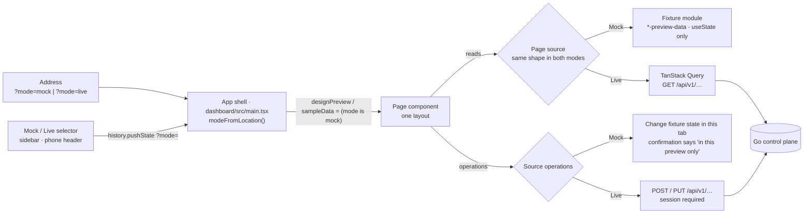

# One dashboard, two data modes

The dashboard has one implementation of each page. A page is laid out once, from the approved design, and is fed by
one of two data sources: **Mock** (the approved fixtures) or **Live** (the control plane). There is no second,
plainer "live" layout, and the layout does not depend on the hostname or on whether a session exists.

## Feature diagram

## Behavior

- **Selecting a mode.** `?mode=mock` or `?mode=live` in the address wins on any host. Without it, `127.0.0.1` and
  `localhost` start in Mock and every other host starts in Live. The selector (labelled "Data mode") is in the sidebar
  footer, and in the header on phones where the sidebar becomes the bottom bar. Choosing a mode writes `?mode=` to the
  address and keeps the current page; hash navigation keeps the parameter.
- **Mock.** Shows the approved fixtures and works with no control plane running. It never sends a write request:
  create, edit, duplicate, import, and "Run Agent" change state in the browser tab only, and their confirmations end
  with "in this preview only". Fixture pages carry an "ILLUSTRATIVE DATA" label and fixture charts are announced as
  mock or illustrative to assistive technology.
- **Live.** Requires a verified session exactly as before; an unauthenticated visitor gets the sign-in screen and a
  failed session check hides page data. Data comes only from the API. When a request fails the page says so; it does
  not fall back to fixtures. Where the control plane holds nothing for a part of the design, that part shows
  "Unavailable", an empty state, or a disabled control with the reason.
- **Same layout.** Both modes render the same components, class names, and responsive rules. Only values,
  capabilities, and permitted operations differ, and those come from the page's source object.

## The pattern for a page

1. The page takes the approved (formerly preview-only) markup as its only markup.
2. A `…Source` type lists what the page needs: collections, loading and error flags, a `view` of display values, and
   operations. Operations a mode cannot perform are absent from its source, and the page disables the control.
3. A Mock hook builds the source from the fixture module with `useState`. A Live hook builds it from TanStack Query
   and real mutations. The page calls both hooks (the Live queries are disabled in Mock) and uses one.
4. Values the control plane does not have are stated as unavailable in the Live view, never invented.
5. Components, CSS classes, and branches that only the old live layout used are deleted.

Agents is the reference implementation: `dashboard/src/agents.tsx` (layout), `agentsView.tsx` (`AgentsSource`,
`AgentsView`, `useLiveAgents`), `agents-preview-data.tsx` (fixtures, `useMockAgents`), `agentsData.ts` (schemas and
loaders).

## Page-by-page record

| Page | State | Source | What Live shows that the fixtures invent |
|---|---|---|---|
| Shell | One shell | `main.tsx` | Signed-in login and avatar instead of the sample person |
| Agents | One layout | `AgentsSource` | Runs, success rate, duration, and provider-reported cost from real runs; owner, created date, variables, templates, and earlier versions are Unavailable; safety lists the worker's real safeguards; import is disabled |
| Overview | Pending | | |
| Objectives | Pending | | |
| Workflows | Pending | | |
| Projects | Single layout already; no fixtures | | |
| Product Workspace | Pending | | |
| Reviews | Pending | | |
| Integrations and Settings | Pending | | |
| Reports | Pending | | |

"Pending" pages still switch between two layouts with the mode; the shell marks migrated pages in `unifiedPages`
until the list is empty.

## Removed with the Agents migration

- `AgentExecutionOverview.tsx` and `AgentPerformanceTrend.tsx` (live-only cards, replaced by the design's Tool
  Permissions, Safety & Governance, and Performance Trends cards fed with real data).
- The live-only branches of `agents.tsx` (the second header, list row, profile summary, and bottom run panel).
- Sixteen CSS classes only those used (`agents-bottom-panels`, `agents-runs-panel`, `agents-trend-*`,
  `agents-permission-row`, `agents-safeguard-list`, and related).
- Mode selection from `localReviewHost` and `auth.data.authenticated`, and the `?live` switch.

## Verification

- `dashboard/e2e/z_run_evidence.spec.ts`: "the Mock and Live switch selects the data source, keeps the page, and
  stays in the address".
- `dashboard/e2e/z_agents.spec.ts`: Live layout, real create, edit, disable, and queued runs; Mock filters, sorting,
  local-only actions, and "without API reads".
- `dashboard/e2e/agents-desktop-preview.spec.ts`, `agents-mobile-preview.spec.ts`: the approved desktop and phone
  design in Mock.
- Approved (`main`), Mock, and Live panels were measured at 1672×941 and 1672×749 and are identical.
