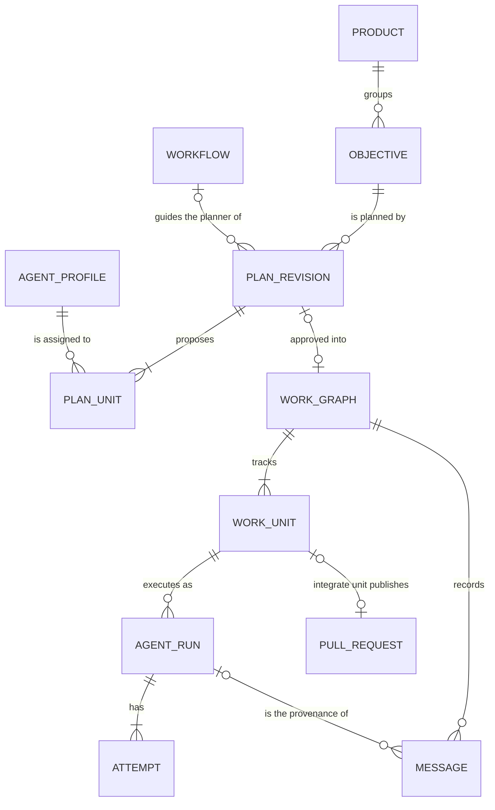
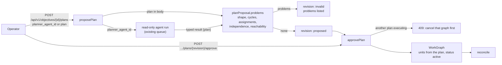
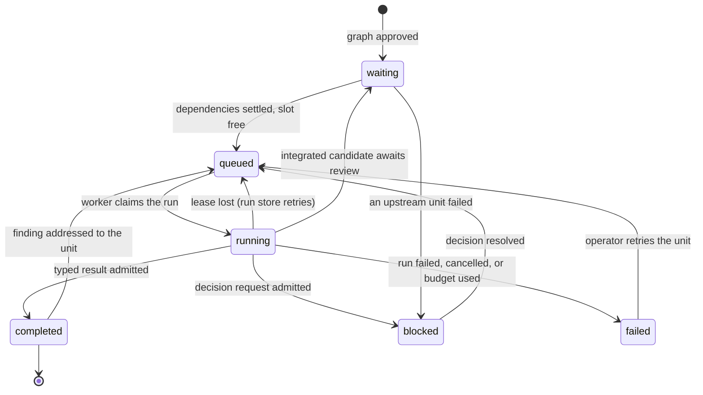
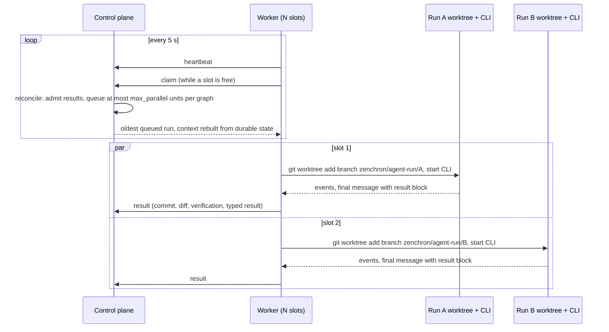

# Objective orchestration: architecture and decisions

This records how one objective becomes coordinated work by several Codex CLI and Claude Code agents and ends as one
integrated pull request, which existing components were kept, changed, or removed to get there, and how the imported
orchestration issues map onto the rebuilt code. Observable behavior and the checks that prove it are in
[Objective orchestration](../features/objective-orchestration.md). Everything here runs locally: one control plane,
one or more local workers, local checkouts, and the installed CLIs.

## Domain relationships

The concepts are distinct records with one direction of reference each; none is a renamed copy of another.



| Concept | Record | Owner |
|---|---|---|
| Product, Objective, Workflow, Agent Profile | unchanged | `products.go`, `objectives.go`, `workflows.go`, `agents.go` |
| Engineering Plan | `objectivePlan`, one per revision, with `planUnit`s | `orchestration_plan.go` |
| WorkGraph, WorkUnit | `workGraph`, `workUnit` in `work-graphs.json` | `work_graph.go` |
| Agent Run | the existing `agentRun`, plus `graph_id`, `unit_key`, `merge`, `result` | `agent_runs.go` |
| Handoff, CollaborationRequest, Finding, DecisionRequest, StateUpdate | `graphMessage`, immutable, appended to its graph | `work_graph_admission.go` |
| Integration Candidate | the commit of an integration run, on the integrate unit as `candidate` with its `inputs` | `work_graph_reconcile.go`, worker `integration.go` |

A workflow is guidance only: its steps are given to the planner, and the plan records which workflow was chosen. The
workflow canvas still does not execute.

## 1. Objective, plan, WorkGraph



A model only ever proposes. `problems` is the single gate for a planner's plan and an operator's plan alike, and it
runs again at approval because profiles can change in between. A plan identical to the one already executing is
recognized by its hash and returned as approved, so nothing is approved twice.

## 2. WorkUnit lifecycle and dependencies



States are a projection, recomputed on every reconcile from the durable record (handoff position, verdict, failure,
run ids) and the current run; no transition is stored as an event that could be lost. A unit's work is consumable by
its dependents only when it is *settled*: a producer has an admitted handoff with no unanswered finding or decision,
a review accepted the handoff it started from, the integrate unit has a candidate newer than every producer handoff.
A consumer runs again whenever an input hands off after the consumer last started, which is the one rule behind
re-review after remediation and re-integration after a changed candidate.

## 3. Parallel agent execution



There is no second scheduler and no second lease. The graph only *creates and requeues* runs in the existing queue;
the worker's claim is what triggers a reconcile, so nothing is scheduled unless a worker is there to take it.
Concurrency has two bounds: the worker executes at most `ZENCHRON_WORKER_CONCURRENCY` runs (default 2, at most 8), and
a graph keeps at most `max_parallel` units (1 to 4) queued or running, so the oldest-first claim interleaves graphs.
Each run has its own worktree and branch; the worker serializes only the Git commands that change a checkout's list
of worktrees.

## 4. Typed handoffs, review, and remediation

```mermaid
sequenceDiagram
  participant P as Producer run (unit api)
  participant API as Control plane
  participant R as Review run (unit review-api)
  P->>API: result: commit C1, {"handoff": ...}
  API->>API: admit: handoff message bound to C1, candidate = C1
  API->>R: new run from the producer's branch; context: handoff, diff, acceptance
  R->>API: result: base commit C1, {"review": {"verdict": "block", "findings": [...]}}
  API->>API: base commit == candidate? admit findings, addressed to the owning producer
  API->>P: same run requeued (attempt 2); context rebuilt with the findings
  P->>API: result: commit C2, {"handoff": ...}
  API->>R: fresh review run (new run id) from C2
  alt verdict arrives for C1 after the candidate became C2
    API->>API: discard: a stale verdict never approves newer code
  else verdict accept on C2
    API->>API: review unit completed; dependents may start
  end
```

An agent ends its final message with one fenced `zenchron-result` block. The worker forwards that block untouched;
the control plane decodes it strictly (unknown members and oversized fields reject the whole result) and never reads
the surrounding prose. Commits come from what the worker observed: a handoff is bound to the run's commit, a verdict
to the base commit of the review run. Independence is enforced when the plan is validated: a reviewer profile may not
write code and may not be the profile that produced the work it reviews, and a review run that changed files fails.
Remediation is another attempt of the producer's own run, so the existing three-attempt limit bounds it; a review or
integrate unit starts a fresh run per round, at most six.

## 5. Integration and pull-request publication

```mermaid
sequenceDiagram
  participant API as Control plane
  participant W as Worker
  participant I as Integration worktree
  participant GH as GitHub
  API->>W: integration run: merge [{branch A, commit}, {branch B, commit}] (no provider)
  W->>I: worktree from the base branch
  W->>I: each input branch still at its admitted commit?
  alt an input moved
    W->>API: failed, stale: [branch] → unit fails visibly
  else
    W->>I: git merge --no-ff commit, in plan order
    alt conflict
      W->>I: git merge --abort
      W->>API: failed, merge_conflict, branch + files → finding for the owning producer
    else merged
      W->>I: verification commands on the combined candidate
      W->>API: commit M, verification, diff
      API->>API: candidate = M; reviews of the integrate unit run on M
      API->>W: after the reviews accept: second pass of the same run, publish
      W->>GH: push the integration branch
      API->>GH: create or reuse one pull request, described from the graph
    end
  end
```

Integration is deterministic: the worker merges the exact admitted commits and no model takes part. A conflict is
reported and routed, never resolved by dropping a side. The publication pass must reproduce the reviewed commit, or the
unit fails. Nothing is merged into the base branch.

## 6. Decision request and resume

```mermaid
sequenceDiagram
  participant P as Producer run
  participant API as Control plane
  participant UI as Dashboard
  participant H as Person
  P->>API: result: {"decision_request": {"question", "options"}}
  API->>API: decision_request message; unit blocked
  UI->>API: GET /api/v1/work-graphs
  UI-->>H: question, options, form
  H->>UI: answer
  UI->>API: POST /api/v1/work-graphs/{id}/decisions/{message} {resolution}
  API->>API: caller may see the objective and dispatch to the worker? record decision_resolution with `by`
  API->>P: same run requeued; context carries the question and the decision
```

Worker credentials are confined to the worker routes, so the machine that runs an agent cannot answer the agent's
question. A decision is asked for only when an agent reports one; planning, review, remediation, and integration
proceed without approval once the plan is accepted.

## Decisions

| Component | Decision | Rationale | Consequence |
|---|---|---|---|
| Run queue, leases, attempts, fencing (`agent_runs.go`) | KEEP, extend | It is the only scheduler the product needs. | A unit executes as an ordinary run. `enqueue` is extracted from the create handler and is the one way a run is created; `lease` is extracted from the claim handler. |
| Request-changes requeue (`agent_reviews.go`) | REFACTOR | Remediation, a resumed decision, and publication are the same operation as a reviewer's change request. | One `agentRun.requeue`; `requeueForUnit` reuses it under the same attempt limit. |
| Cancellation handler | REFACTOR | A cancelled graph cancels its runs. | `cancelRun` is shared by the handler and the graph. |
| Worker loop executing one run at a time (`main.go`, `commands.go`) | REPLACE | Parallel units need parallel execution. | `dispatch` fills up to N slots; each run is a goroutine joined at shutdown. |
| Heartbeat goroutine started per command (`keepWorkerHeartbeat`) | REMOVE | The main loop no longer blocks on a run, so it heartbeats by itself. | `commands.go` is deleted. |
| Provider execution loop (`cli_provider.go`, adapters, sandbox rules) | KEEP | Agents still run only through the two CLIs. | Untouched. The typed result is read from the final message the adapters already capture. |
| Result channel as a file in the worktree | REJECTED | A read-only reviewer cannot write a file, and the file would be candidate source. | The fenced block in the final message works under every tool permission and sandbox. |
| Model-driven conflict resolution | REJECTED for now | The brief asks for conflicts to be routed to their owner. | Integration is a Git-only run kind in the worker (`integration.go`). |
| Worktree manager, process ownership, verification, push | KEEP | Each unit needs exactly what a run already gets. | Reused unchanged, including for integration runs. |
| Pull-request creation | KEEP, extend | One PR per integrated candidate is the existing create-or-reuse path. | The body of a graph's PR is written from the graph. |
| GitHub subsystem, authorization model | KEEP | Not duplicated. | Graph routes use `requestAccess`: objective visibility, repository grant, and `mayDispatchTo` for changes. |
| Objectives, products, workflows, profiles | KEEP | They are definitions; plans and graphs reference them. | `objectiveStore.get` added. Objective status and progress are still edited by people. |
| JSON snapshot persistence | KEEP | One more bounded snapshot fits the existing model. | `work-graphs.json` holds plans and graphs. |
| A separate event log for graphs | REJECTED | Messages are the durable record and states are derived. | No second event store. |

## Reconciliation with the imported issues

The issues were written for an earlier architecture. Their intent and invariants are kept; their package names,
governance machinery, and vocabulary beyond what is listed here are not ported.

| Issue | Kept | Adapted or left out |
|---|---|---|
| #54 planner | Model proposes, deterministic code validates; smallest team; explicit approval; reuse of the runtime | Roles and capabilities are agent profiles and their tools. No ContextPack, policy packs, or benchmark. |
| #268 issue fleet | Mandatory typed handoff before work counts; one run per unit; concurrency ceiling respected | A fleet is a plan of independent produce units; there is no separate batch object, and a plan always integrates into one PR. |
| #270 WorkGraph | Durable identity and revision, cycle detection, deterministic frontier, handoff-driven progression, restart reconstruction, idempotent run association, no nested scheduler | Gate units other than review and integrate are not modeled. |
| #271 typed communication | The five message types, immutability, provenance, runtime-observed commit binding, bounded payloads | CollaborationRequest and StateUpdate are delivered as context only and trigger no work. Corrections append new messages; there is no supersedes link. |
| #272 review and remediation | Independence, exact-subject review, findings routed to the owning unit, fresh session, stale verdicts discarded, bounded | Independence classes are reduced to "another profile that cannot write". |
| #273 integration | Own run and workspace, deterministic input order, exact candidates, conflicts surfaced, new subject with its own review | Semantic conflicts are detected only as failed verification of the combined candidate and are reported, not routed. |
| #278 objective to team | The whole path from objective to executed graph, dynamic team size, decisions only where an agent asks | Repository intelligence is the planner reading the repository. |
| #289 decision resolution | Durable request, authorized resolution with provenance, automatic resume | Resolutions are free text; there is no typed option or expiry. |
| #277 workspace | Graph, units, messages, decisions, review state, and PR in Product Workspace, Objectives, Agents, Reviews | Cost and budget projections are not added. |
| #274 product environment | Not addressed here | Products are unchanged. |
| #279 dogfood | See the live record in the feature doc | Measurements are reported as recorded; nothing is estimated. |

## Not implemented

- A wake-up when a run finishes: the worker asks for work every 5 seconds, so each transition waits up to that long.
- Units on more than one checkout or worker; a graph runs on the one project its plan names.
- Automatic remediation of a combined candidate that fails verification; the unit fails and an operator retries.
- Reopening a completed unit on a CollaborationRequest.
- Budgets beyond attempts, runs per unit, `max_parallel`, and the worker's time limits; no token or cost ceiling.
- A model that resolves merge conflicts.
- Editing a plan in the dashboard; a changed plan is a new proposal, by a planner or through the API.
