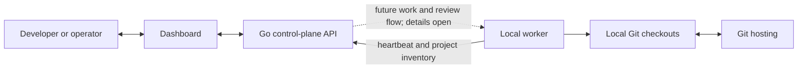

# Control plane roadmap

See [Architecture checkpoint](architecture-checkpoint.md) for discussion-confirmed direction, prototype contracts, and
agent/control-plane decisions that remain open. The current implementation is not the approved target architecture.

## Confirmed product direction

Zenchron coordinates multiple Git projects through a dashboard for developers and non-developers. Proposed code changes
should be reviewable as local branches and pull requests. People can review, comment, or request changes, then the
control plane should continue from that feedback. Issues and review state should be visible in the dashboard, which is
built alongside the backend and available for live review. The first model integration uses OpenAI-compatible Chat
Completions; that selects a request protocol, not an agent design.

The Go API, local worker, project inventory, and live dashboard preview are the accepted bootstrap milestone. Hosting,
worker connectivity beyond the local preview, agent and work identities, durable storage, authorization, and audit remain
open architecture decisions. A local review handoff prototype is implemented; its production identity and authority
model are still open.

## Delivery sequence proposal

Only phase 0 is accepted. The later phases are planning candidates; their order and data models depend on the open
decisions in the [architecture checkpoint](architecture-checkpoint.md).

### 0. Local bootstrap — accepted

Go API, local worker heartbeat, repository inventory, and live dashboard preview. Accept when focused API and worker
tests pass and the browser shows a real worker and checkout. Verified: `/healthz` reports healthy, `/api/v1/workers`
and `/api/v1/projects` show the online local worker and checkout, focused control-plane and worker tests pass, and the
Projects and isolated-worktree E2E flows pass through the dashboard. `./dev.sh` now starts all three local processes
and waits for API, worker, and dashboard readiness.

### 1. Durable and secure core

Persistent workspace state, user identity, roles, secrets handling, and audit events. Accept when restart and
authorization tests pass and no unauthenticated remote listener is exposed.

### 2. Project connections — GitHub read sync and PR review submission partially implemented

Git provider installation, repository mapping, issues, and pull-request synchronization. The control plane reads open
issues and pull requests from GitHub.com and can submit PR comments or request changes when its GitHub App installation
or personal-token fallback has Pull requests: write permission. It can comment on, close, and reopen issues with Issues:
write or Pull requests: write. Dashboard-submitted
feedback on Zenchron run branches is matched to the originating run; eligible
change requests queue a follow-up pass. GitHub Enterprise host mapping, other providers, historical sync, and importing
feedback submitted directly on GitHub remain outstanding. Accept with provider-backed fixtures and a live read/write
review round-trip; never use fabricated PR data.

### 3. Worker control channel — partially implemented

Outbound worker registration, leased worktree and agent-run commands, acknowledgements, cancellation, and retry fencing
are implemented in the local prototype. Generic command types, actor-bound policy decisions, and production worker
reconciliation remain open. Focused tests cover duplicate and stale claims, lease recovery, and cancellation.

### 4. Agent harness — partially implemented

Agent profiles, durable run lifecycle, isolated worktrees, OpenAI-compatible Chat Completions, bounded read tools, and
optional `code.write` are implemented. Successful non-empty GitHub runs can publish their branch and create or reuse a
pull request. `cd dashboard && npm run test:e2e:agent-runtime` builds and runs the real control plane and worker with a
loopback model stub, verifies the isolated commit and captured diff, and confirms the source checkout stays unchanged.
Test execution, evidence capture, provider spend reporting, and production credential management remain outstanding;
a real provider run is not verified.

### 5. Review loop — partially implemented

The dashboard shows GitHub issues and pull requests, local run diffs, and review feedback. It can submit top-level PR
comments and requests for changes; feedback on a Zenchron run branch is attached to its run, and an eligible request
queues a bounded follow-up pass on the same branch. Reviews made directly on GitHub, inline comments, approval, and
merge remain outstanding. Accept when provider-submitted feedback is imported and authorized decisions reach the
correct run and pull request.

### 6. Operational dashboard

Product/workspace views, workflows, agents, reviews, reports, integrations, and responsive layouts. Accept when each
mockup view maps to a named route and is checked against real data contracts.

Phases can overlap when their data contracts are stable. The current loopback preview supports local agent execution;
hosted control and merge authorization still require durable audit, user identity, and policy enforcement.

## Current implementation

- The loopback Go API and local worker exchange heartbeats.
- `./dev.sh` starts the API, worker, and live-reloading dashboard together; the API and dashboard remain bound to
  loopback until authentication is implemented.
- Reviews reads the latest 100 open GitHub pull requests and issues for one selected `github.com` checkout at a time,
  and loads a bounded diff for a selected pull request. It can submit issue comments, change issue state, top-level PR
  comments, and requests for changes through the control plane. GitHub App or personal-token credentials stay in
  the control plane; public read sync needs no token and review submission needs Pull requests write permission. Inbound
  review handoff, GitHub Enterprise host mapping, and historical sync remain outstanding.
- GitHub App authentication uses a server-side PEM key, signs RS256 JWTs, and caches installation tokens; the existing
  `ZENCHRON_GITHUB_TOKEN` remains a personal-token fallback. App token minting is covered by a local fake-server test;
  a real installation read/write round-trip is still unverified.
- The worker discovers direct-child Git checkouts and reports opaque IDs, names, current branches, and a sanitized
  `origin` host/repository locator. It strips URL credentials and query strings and does not send local paths.
- The dashboard has a live overview plus objective, workflow, project inventory, Agents, and Reviews routes. Its shared
  shell, page and panel headings, metric cards, and selected-entity titles keep a common type scale across routes.
  Objective, workflow, and agent profile definitions persist as versioned JSON snapshots; the overview and Agents route
  poll live agent-run history. Worker presence remains in process memory.
- The workflow canvas can edit and validate a graph, but it does not execute that graph.
- Agent profiles store prompt configuration and tool allowlists. With `ZENCHRON_LLM_BASE_URL` configured on a worker,
  the OpenAI-compatible Chat Completions loop executes bounded read tools and optional `code.write` in per-run Git
  worktrees; successful, reviewable changes are committed locally on the isolated branch. A successful non-empty run
  can push only that branch and create or reuse a pull request when control-plane GitHub authentication and a GitHub.com origin are
  configured. Test execution, provider spend, and evidence capture remain unavailable.
- Agent run prompts can be durably queued for an active profile and online project, claimed by its assigned worker,
  and completed with a fenced result. A worker without a configured model endpoint leaves runs queued; see
  [Agent run queue](../features/agent-run-queue.md). A focused cross-process E2E now proves the real API and worker can call a
  loopback OpenAI-compatible stub, perform an allowed tool write in a per-run worktree, and return the captured diff.
- Queued and active agent runs can be cancelled from Reviews. The control plane persists cancellation state, the
  assigned worker polls while a model call runs, and cancellation keeps the partial isolated diff. A run whose lease
  expires after cancellation is completed as cancelled instead of retried. Generic command types and actor-bound policy
  decisions remain unimplemented.
- The local worker can prepare a durable, leased isolated Git worktree request for an online project. Completion is
  fenced by claim attempt so stale workers cannot acknowledge a newer lease. Focused tests cover duplicate claims,
  expired-lease recovery after control-plane restart, stale acknowledgements, cancellation, and idempotent worktree
  preparation. Successful agent runs with reviewable diffs commit on isolated branches; conditional branch push and
  pull-request creation are implemented in the agent-run path. General worker command types and per-command actor and
  policy binding remain unimplemented.
- Reviews provides GitHub issue and PR queues plus captured local run diffs. Reviewers can leave local comments and
  request another bounded pass on the same run and branch. Dashboard-submitted top-level GitHub comments and change
  requests on Zenchron run branches are attached to their runs; an eligible change request queues another pass. Reviews
  made directly on GitHub are not imported. Checks, approval, and merge actions remain unavailable.
- Settings and Integrations routes show live API, worker, and checkout status while clearly marking external providers,
  identity, authorization, and audit history unavailable.
- Reports summarizes current objective, workflow, agent-profile, worker, and checkout records. GitHub PR history now
  supplies work-outcome categories and delivery measures when the selected window contains relevant events; completed
  GitHub Actions history supplies CI duration. Agent-run success uses recorded terminal runs. Model spend, review
  latency, and autonomous completion still need provider evidence.
- Product Workspace persists products and links them to live worker-reported repositories. Objectives can link to a
  product by ID; workflow and agent definitions remain reusable workspace-wide, while files, decisions, stakeholders,
  and release streams remain unavailable.
- Users and roles, database-backed storage, direct GitHub review import, GitHub merge and approval actions, other Git
  provider write actions, and production model credential management are not yet implemented.

## UI and data rules

- Use the installed Mantine, Tabler, AG Grid, XYFlow, ELK, Monaco, and TanStack Query packages where each fits the
  screen;
  do not add another UI dependency without approval.
- Build mockup pages against named API fields. Use explicit empty, loading, error, and unavailable states when the
  system has no evidence. Do not ship the mockups' illustrative metric values as product data.
- Keep workflow diagrams and feature docs beside every shipped feature. Keep this roadmap updated when a phase's
  evidence changes.
- Keep the dashboard useful on desktop and mobile while preserving the same authority and review decisions.

## Open production decisions

- Choose hosting, worker connectivity, identity, authorization, secrets, storage, and audit boundaries before exposing
  the API beyond loopback or enabling provider writes for a hosted control plane.
- Agree the identities and relationships needed for projects, workers, agent work, branches, reviews, and follow-up
  changes before expanding beyond the accepted bootstrap milestone.
- Decide the review and merge authority model before expanding provider write actions or automated continuation beyond
  the local prototype.
