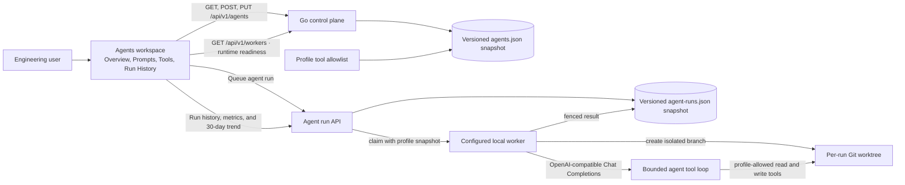

# Agent profiles

Prototype status: the profile fields, tool allowlist, and versioning describe current implementation only. The agent definition and execution model remain undecided; see [the architecture checkpoint](../architecture/architecture-checkpoint.md).

The Agents workspace stores reusable profile configuration: display name, description, provider and model identifiers,
system and goal prompts, enabled state, version, and a small allowlist of repository tools. The profile detail is
split into Overview, Prompts, Tools & Permissions, and Run History tabs. Version, run count, and success rate come from
stored profile and run data; model cost stays unavailable until provider usage is recorded. The profile list shows each
profile's latest run time and completed-run success rate from recorded run history. The profile overview also charts
successful, failed, and other run outcomes in rolling 24-hour buckets for the last 30 days; it shows an empty state
when that profile has no runs. Profiles persist in the
control-plane state directory and survive restart. The profile list searches saved names, descriptions, providers, and
model identifiers, and shows up to three allowed tool IDs with a count for any additional tools. The run dialog shows each online project's worker and its reported model-runtime readiness; missing
status stays unknown, and runs queued on a worker without a configured runtime remain queued. Provider identifiers
are labels only; credentials are not stored.

The Overview tab is read-only by default and shows saved provider/model metadata, version, run count, completed-run
success rate, prompt previews, executable tool permissions, and enforced execution safeguards. It reports per-run
worktree isolation, profile-gated file writes, and unavailable test execution from the current worker contract. Average latency and model cost stay unavailable because
the worker does not record them yet. `Edit profile` enables the profile fields, prompt textareas, and tool selection;
Cancel restores the saved values, and Save persists the profile through the versioned update API. Disable/Enable acts
directly on the selected saved profile. Prompt previews are truncated for display, with the full prompt available on
hover. Metrics use recorded data only.

The unauthenticated local design preview is fixture-only and makes no agent or run API requests. Its metrics and
profile history, including performance deltas, sparklines, durations, and costs, are illustrative and carry a visible
`ILLUSTRATIVE DATA` label; fields absent from the live profile contract, including owner and creation time, stay
exclusive to that preview. Search, status filtering, and name sorting operate on the local fixture. Create, duplicate,
disable, simulated run, library selection, import/export, and version/history controls update or inspect preview data
only; they never call the agent APIs.

The worker enforces `code.search`, `code.write`, `docs.search`, `git.diff`, and `git.read` when an OpenAI-compatible
runtime endpoint is configured on that worker. `code.write` is opt-in and applies only to the run's isolated Git
worktree. `tests.run` remains saved profile metadata but is not exposed to the model. Provider identifiers are labels;
the worker endpoint selects the protocol and credentials. Model spend remains unavailable.

## Feature diagram

## API

- `GET /api/v1/agents` lists profiles.
- `POST /api/v1/agents` creates an active profile.
- `PUT /api/v1/agents/{id}` replaces editable profile fields, increments its version, and updates its timestamp.
- Supported tool identifiers: `code.search`, `code.write`, `docs.search`, `git.diff`, `git.read`, and `tests.run`.

The API validates field lengths and rejects unknown JSON fields, duplicate tools, and unsupported tool identifiers.

## Verification

- `go test ./cmd/zenchron` covers profile validation, create/update behavior, and persistence through control-plane restart.
- `cd dashboard && npm run test:e2e -- e2e/z_agents.spec.ts` checks runtime readiness, profile search and edits, and a
  completed worker run against a loopback model stub; local preview checks cover filters, sorting, and actions
  without API calls.
- The populated desktop layout fixture uses six profiles (five active) plus a completed run; focused tablet and phone
  checks verify that the profile, detail, and run panels do not overlap.
- On desktop viewports from 700px high, the profile list spans both rows while run history and performance stack under
  the selected profile; the content height contracts to the available viewport and retains the 670px mock height cap.
