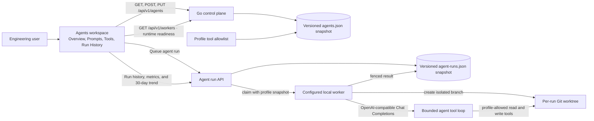

# Agent profiles

Prototype status: the profile fields, tool allowlist, and versioning describe current implementation only. The agent definition and execution model remain undecided; see [the architecture checkpoint](../architecture/architecture-checkpoint.md).

The Agents workspace stores reusable profile configuration: display name, description, provider and model identifiers,
system and goal prompts, enabled state, version, and a small allowlist of repository tools. The profile detail is
split into Overview, Prompts, Tools & Permissions, and Run History tabs. Version, run count, and success rate come from
stored profile and run data; model cost stays unavailable until provider usage is recorded. The profile list shows each
profile's latest run time and completed-run success rate from recorded run history. The profile overview also charts
successful, failed, and other run outcomes in rolling 24-hour buckets for the last 30 days; it shows an empty state
when that profile has no runs. Profiles persist in the
control-plane state directory and survive restart. The profile list searches saved names, descriptions, providers, and
model identifiers, and shows up to three allowed tool IDs with a count for any additional tools. The run dialog shows each online project's worker and its reported model-runtime readiness; missing
status stays unknown, and runs queued on a worker without a configured runtime remain queued. Provider identifiers
are labels only; credentials are not stored.

The page has one layout in both data modes (see [One dashboard, two data modes](../architecture/dashboard-modes.md)).
The Overview tab shows the profile fields, 30-day performance, numbered prompt previews, Variables & Templates, Tool
Permissions, Safety & Governance, the three most recent runs, and a success, cost, and latency trend. In Live the
figures come from recorded runs: run count, completed-run success rate, average attempt duration, and the cost the
provider reported; a figure with no data reads Unavailable. Owner, creation date, profile variables, templates, and
earlier versions are not stored by the control plane and say so. Safety & Governance lists the safeguards the worker
enforces on every run (isolated worktree, profile-gated file writes and test execution, withheld provider credentials).
`Edit profile` in the "More agent actions" menu, the Edit buttons on the prompt cards, and Tool Permissions > Edit
enable the profile fields, the prompt editors, and tool selection; Cancel restores the saved values and Save persists
through the versioned update API. Duplicate Profile creates a saved copy, Disable/Enable and the Status field update
the saved profile, and Run Agent opens the queue dialog. Export downloads the profiles as JSON; import is not available
in Live.

In Mock the same page shows the approved fixtures under a visible `ILLUSTRATIVE DATA` label and makes no agent or run
API requests. Its figures, deltas, sparklines, durations, and costs are illustrative. Create, edit, duplicate, import,
the profile field selects, and Run Agent change fixture state in the browser tab only; confirmations end with "in this
preview only" and Run Agent records a run labelled SIMULATED.

Setting `provider` to `codex-cli` or `claude-code` runs the profile through the installed CLI on the worker; the
queue dialog then reports that CLI's readiness and can start the run from a GitHub issue. See
[Issue to pull request](issue-to-pull-request.md).

## Feature diagram

## API

- `GET /api/v1/agents` lists profiles.
- `POST /api/v1/agents` creates an active profile.
- `PUT /api/v1/agents/{id}` replaces editable profile fields, increments its version, and updates its timestamp.
- Supported tool identifiers: `code.search`, `code.write`, `docs.search`, `git.diff`, `git.read`, and `tests.run`.

The API validates field lengths and rejects unknown JSON fields, duplicate tools, and unsupported tool identifiers.

## Verification

- `go test ./cmd/zenchron` covers profile validation, create/update behavior, and persistence through control-plane restart.
- `cd dashboard && npm run test:e2e -- e2e/z_agents.spec.ts` checks runtime readiness, profile search and edits, and a
  completed worker run against a loopback model stub; local preview checks cover filters, sorting, and actions
  without API calls.
- The populated desktop layout fixture uses six profiles (five active) plus a completed run; focused tablet and phone
  checks verify that the profile, detail, and run panels do not overlap.
- `cd dashboard && npm run test:e2e -- e2e/agents-mobile-preview.spec.ts` verifies the 390×844 summary, local tabs and
  actions, return to profile management, and absence of agent API reads.
- `cd dashboard && npm run test:e2e -- e2e/agents-desktop-preview.spec.ts` verifies prompt-card editing saves only to
  the local fixture and makes no agent API requests; it also checks Overview panel links, local tool/governance edits,
  Performance Trends range selection, and the detail toolbar's mock-sized buttons and icons.
- On desktop viewports from 700px high, the profile list spans both rows while run history and performance stack under
  the selected profile; the content height contracts to the available viewport and retains the 670px mock height cap.
- Compact preview card headings keep all three overview rows and the lower run/trend panels inside that 670px detail grid at 1672×941.
