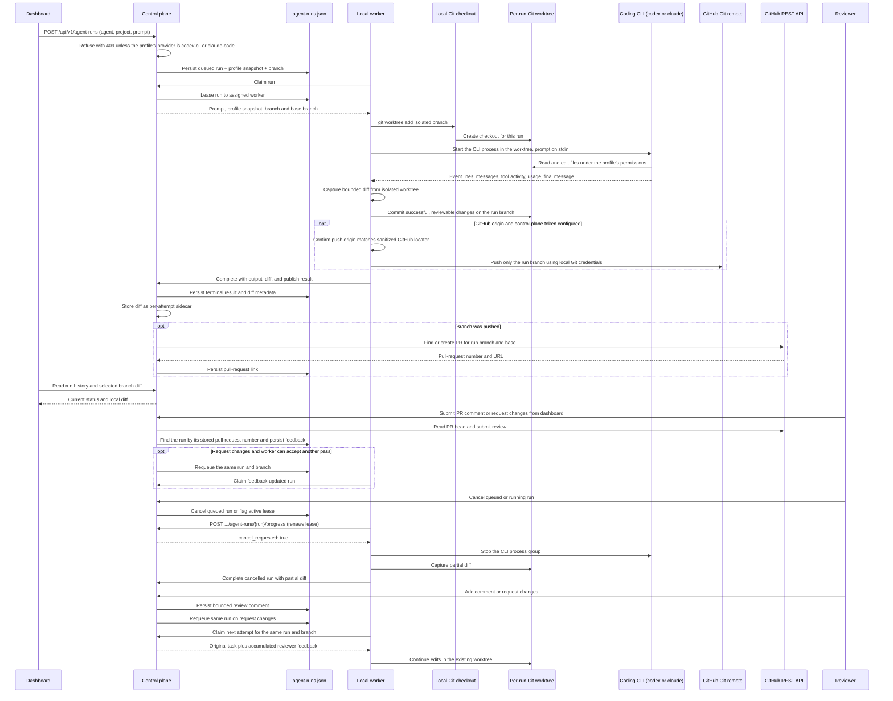

# Agent run queue

This page describes the run queue: the lifecycle, leases, cancellation, and review loop of an agent run. Runs execute
through one path only, the installed Codex or Claude Code CLI started by the worker's process runner. That path,
GitHub issues as the source of work, verification, and run events are described in
[Issue to pull request](issue-to-pull-request.md).
Component decisions are recorded in [Backend architecture and decisions](../architecture/backend-architecture.md).

The control plane accepts a prompt for an active agent profile and an online project, stores a durable run
record with a run-specific branch name and base branch, then leases it to that project's worker. The worker claim
includes a snapshot of the selected profile so later profile edits do not alter an already queued run. Results are
fenced by worker ID and claim attempt to reject stale or duplicate completions.

The Agents page can queue an active profile for an online project and the dashboard polls real run history. A run can
be queued only for a profile whose `provider` is `codex-cli` or `claude-code`: `POST /api/v1/agent-runs` answers
`409` ("this agent profile's provider has no execution adapter; use codex-cli or claude-code") for any other value,
and the queue dialog disables "Queue run" with the note "Only Codex CLI (codex-cli) and Claude Code (claude-code)
profiles can run." Profiles themselves may still be saved with any provider string. The worker claims a run only when
it reports that profile's CLI installed, signed in, and, for Codex, passing its sandbox self-test. It creates a
worktree under `<UserCacheDir>/zenchron/worktrees/<project-id>/<run-id>` and starts the CLI there with the profile
prompts and the task prompt. There is no direct model-API execution and no `ZENCHRON_LLM_*` setting; a worker that
still has those variables set ignores them. GitHub App credentials or the optional personal-token fallback stay on
the control plane; they read private provider items and submit PR comments or request-changes when the installation
has Pull requests write permission.

Run `cd dashboard && npm run test:e2e:agent-runtime` for the process-level smoke check. It builds and launches the real
control plane and worker with auth enabled, verifies anonymous dashboard and invalid worker requests are rejected,
then uses an allowlisted test session while the worker discovers a temporary Git checkout and runs through the fake
Codex CLI described below. It verifies the run events, the committed branch, captured diff, and unchanged source
checkout, that a failing provider fails the run with `provider_exit`, and that a profile without `code.write`
leaves the branch unchanged. The check uses temporary state and removes it when it exits.

### Fake CLI in E2E

The Playwright suite and the process-level check call no model. `dashboard/e2e/fake-cli/codex` is a POSIX `sh` script
that the harness puts first on the worker's `PATH`; the worker has no test-only switch and finds it exactly as it
finds an installed Codex. The script answers `--version` and `login status`, behaves like a confining sandbox for
the worker's `codex sandbox` self-test, and for `codex exec` reads the prompt on stdin and prints Codex JSONL events
(a command execution, a file change, the final message, usage), so the worker's detection, process runner, event
parser, limits, and cancellation run unchanged. It writes a file only when the filesystem profile it is given grants
the worktree write access. The prompt text selects the scenario: a default change, the review follow-up
("Requested changes:"), a tool that never returns so the run can be cancelled, and a failing turn ("Fail this run.").

Queued runs can be cancelled immediately. For a running run, the control plane persists a cancellation request and the
assigned worker learns of it from its next progress report, sent every two seconds. The worker cancels the request,
captures any partial worktree diff, and completes the run as `cancelled`. If the worker disappears before acknowledging,
lease recovery marks the requested cancellation complete instead of requeuing the run. A completion racing the cancel
request is recorded as cancelled by the control plane. Cancellation is available in Reviews; cancelled runs with a
captured diff remain reviewable and can receive bounded follow-up feedback.

`POST /api/v1/agent-runs/{id}/cancel` cancels a queued run or requests cancellation of its active lease. The assigned
worker reports to `POST /api/v1/workers/{workerID}/agent-runs/{runID}/progress`, which renews the three-minute lease
and returns `cancel_requested`. A worker that does not hold the current lease gets a conflict and stops. The control
plane and worker must be the same release: the earlier `GET .../cancellation` endpoint no longer exists, a heartbeat
that still carries `agent_runtime_enabled` is rejected, and run records carry fields an older binary rejects, so
restore a compatible state backup before rolling back. A run queued by an earlier release for a profile with another
provider stays queued, because no worker can claim it; cancel it.

The profile's tools decide what the CLI may do: without `code.write` it reads only, with it it may edit files in the
run worktree, and `tests.run` adds sandboxed commands where the provider's sandbox is available; see
[Issue to pull request](issue-to-pull-request.md). The source checkout remains untouched. After a successful run the
worker commits staged changes on the isolated branch using the fixed local identity `Zenchron Agent
<agent@zenchron.invalid>`. A run that fails or is cancelled before the commit leaves its changes uncommitted; the commit happens before
verification, so a run that fails verification, or is cancelled during it, keeps its commit on the isolated branch. A diff larger than the 128 KiB display cap is still committed and is
marked truncated in the stored copy. Follow-up passes create additional
commits on the same branch; diff capture compares the full branch against its merge base so the review still includes
earlier passes. The commit SHA is stored on the run and shown in Agents and Reviews. When the run finishes, the worker
captures the bounded branch diff, including newly created files, and sends it with the result. The control plane stores
at most 128 KiB per attempt in a private sidecar and exposes it through
`GET /api/v1/agent-runs/{id}/diff`. The Reviews page displays diffs from terminal runs and stores up to ten reviewer
comments per run, each limited to 1,000 bytes.
Request changes requeues the same run ID and branch, preserving its worktree and passing all comments to the next
attempt. This action is available only while the assigned worker is online with the profile's provider ready and the
profile has `code.write`. A run queued while its worker's CLI is not ready stays queued and the prompt is sent to no
provider. Agent run requests and their prompts are stored locally with the rest of the control-plane state.

The branch name is visible in run history. When the
control plane has GitHub App authentication or the `ZENCHRON_GITHUB_TOKEN` fallback and the project has a supported GitHub.com origin, successful non-empty runs
push only their `zenchron/agent-run/<id>` branch using the worker's local Git credentials, then create or reuse an open
pull request under the configured token owner. The pull-request link appears in Reviews. A push failure leaves the local
branch and diff reviewable and records a bounded status message. Automatic publication is skipped without the token or
a GitHub.com origin. Comments and request-changes submitted from the dashboard on a Zenchron PR are attached to its run;
request-changes queues that same branch when the worker can accept another code pass. Change requests made directly on
GitHub are imported on demand with `POST /api/v1/agent-runs/{id}/sync-reviews`. Approval and merge stay disabled in
Reviews.

Each run is bounded by the worker's `ZENCHRON_RUN_TIMEOUT` wall-clock limit (two hours by default), the inactivity
and tool-activity limits, and 20,000 bytes of final output.

## Focused verification

- `go test ./cmd/zenchron-worker -run 'TestCLI|TestCollectAgentRunDiffBoundsOutput' -count=1` drives a fake CLI through the real process runner (local branch commit, verification, failure, limits, cancellation) and verifies the diff size limit.
- `go test ./cmd/zenchron -run 'TestAgentRunQueuePersistsAndFencesClaims|TestAgentRunRefusesProfilesWithoutAnExecutionAdapter' -count=1` covers claim fencing, provider gating, bounded diff storage and retrieval, and the 409 for a provider without an execution adapter.
- `go test ./cmd/zenchron -run 'TestRunLeaseRecoversAfterRestartAndFailsWhenAttemptsAreUsedUp|TestStaleAttemptCannotFinishOrReportAfterRunIsReclaimed' -count=1` covers lease recovery after a control-plane restart, stale-attempt rejection, failure after the last attempt, and refusing to cancel a finished run.
- `go test ./cmd/zenchron -run 'TestAgentRunFinishCreatesPullRequestAfterWorkerPush|TestGitHubCreatesPullRequestFromPublishedBranch' -count=1` covers GitHub PR creation after a worker push result.
- `go test ./cmd/zenchron-worker -run 'TestPushAgentBranchRestrictsOriginAndPushesOnlyTheRunBranch' -count=1` verifies the origin guard and branch-only push against a local bare repository.
- `go test ./cmd/zenchron -run 'TestAgentRunCancellationFencesWorkerAndKeepsPartialDiff' -count=1` covers queued and active cancellation, worker binding, late completion fencing, and partial diff retention.
- `cd dashboard && npm run test:e2e -- e2e/z_agents.spec.ts --grep 'same branch'` starts the real Go API and worker with the fake Codex CLI; it queues from the Agents page, verifies the CLI-written branch diff in Reviews, submits request-changes, and checks the same-run/same-branch follow-up diff.
- `cd dashboard && npm run test:e2e -- e2e/z_agents.spec.ts --grep 'active worker run'` verifies cancellation, waiting on the run's tool event from `GET /api/v1/agent-runs/{id}/events`, and partial-diff retention. Use `--grep 'agent profiles can be saved'` and `--grep 'queue dialog'` for profile CRUD, CLI readiness, and the blocked non-CLI profile.
- `cd dashboard && npm run test:e2e -- e2e/home.spec.ts --grep 'Reviews page'` covers local branch feedback and same-run requeue.

Run history is capped at 200 records. An abandoned lease can be retried up to three times; after that the run fails.
Diff sidecars are bounded by the same 200 runs and three attempts (at most 75 MiB before filesystem overhead).
Worker presence is in-memory, so the worker must heartbeat again after a control-plane restart before claiming work.
