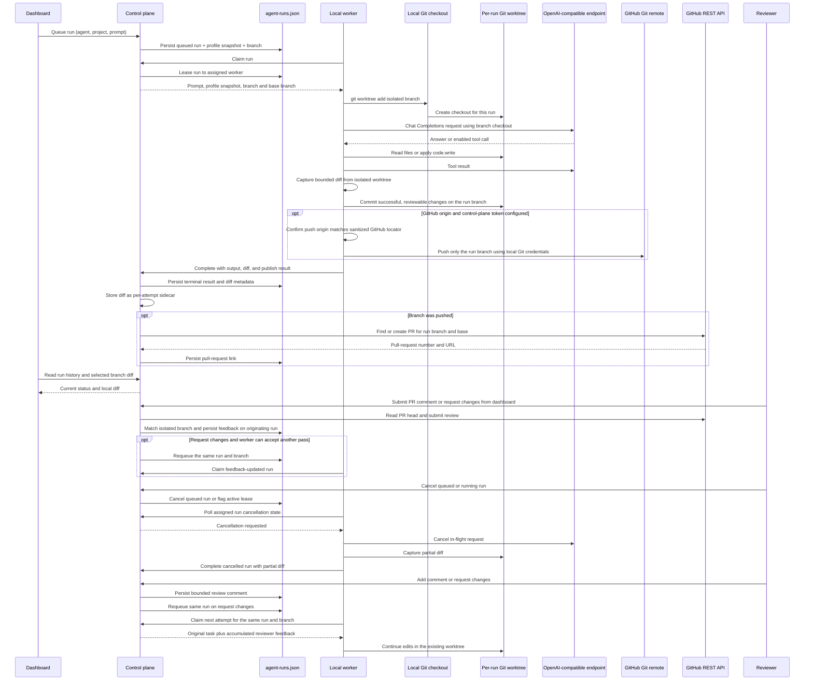

# Agent run queue

Prototype status: run ownership, profile snapshots, worker leases, retries, cancellation, and same-run feedback are current implementation choices, not an approved agent lifecycle. See [the architecture checkpoint](../architecture/architecture-checkpoint.md) before extending these contracts.

The loopback control plane accepts a prompt for an active agent profile and an online project, stores a durable run
record with a run-specific branch name and base branch, then leases it to that project's worker. The worker claim
includes a snapshot of the selected profile so later profile edits do not alter an already queued run. Results are
fenced by worker ID and claim attempt to reject stale or duplicate completions.

The Agents page can queue an active profile for an online project and the dashboard polls real run history. The worker
claims runs only when `ZENCHRON_LLM_BASE_URL` is configured. It creates a worktree under
`<UserCacheDir>/zenchron/worktrees/<project-id>/<run-id>` and sends the selected model, profile prompts, task prompt,
and enabled-tool results to that OpenAI-compatible Chat Completions endpoint. Set
`ZENCHRON_LLM_API_KEY` on the worker when the endpoint needs a bearer key. HTTPS is required except for loopback HTTP
endpoints. GitHub App credentials or the optional personal-token fallback stay on the control plane; they read private
provider items and submit PR comments or request-changes when the installation has Pull requests write permission.

Run `cd dashboard && npm run test:e2e:agent-runtime` for the process-level smoke check. It builds and launches the real
control plane and worker with auth enabled, verifies anonymous dashboard and invalid worker requests are rejected,
then uses an allowlisted test session while the worker discovers a temporary Git checkout and runs against the loopback
Chat Completions stub. It verifies the committed branch, captured diff, and unchanged source checkout. The check uses
temporary state and removes it when it exits.

Queued runs can be cancelled immediately. For a running run, the control plane persists a cancellation request and the
assigned worker polls that run's cancellation state while its model call is active. The worker cancels the request,
captures any partial worktree diff, and completes the run as `cancelled`. If the worker disappears before acknowledging,
lease recovery marks the requested cancellation complete instead of requeuing the run. A completion racing the cancel
request is recorded as cancelled by the control plane. Cancellation is available in Reviews; cancelled runs with a
captured diff remain reviewable and can receive bounded follow-up feedback.

`POST /api/v1/agent-runs/{id}/cancel` cancels a queued run or requests cancellation of its active lease. The assigned
worker checks `GET /api/v1/workers/{workerID}/agent-runs/{runID}/cancellation` over the existing control-plane HTTP
channel. Cancellation adds a persisted `cancelled` status; an older binary rejects that status when loading run history,
so restore a compatible state backup before rolling back to a pre-cancellation build.

The runtime implements `code.search`, `docs.search`, `git.diff`, `git.read`, and the opt-in `code.write` tool. Writes
are limited to one regular file up to 256 KiB, inside the run worktree, with an existing parent directory. Tool paths
reject traversal, `.git` metadata, and symlinks. The source checkout remains untouched. It does not offer the saved
`tests.run` permission to the model or capture evidence yet. After a successful model run with a non-truncated diff, the
worker commits staged changes on the isolated branch using the fixed local identity `Zenchron Agent
<agent@zenchron.invalid>`. Failed, cancelled, and over-limit runs are left uncommitted. Follow-up passes create additional
commits on the same branch; diff capture compares the full branch against its merge base so the review still includes
earlier passes. The commit SHA is stored on the run and shown in Agents and Reviews. When the run finishes, the worker
captures the bounded branch diff, including newly created files, and sends it with the result. The control plane stores
at most 128 KiB per attempt in a private sidecar and exposes it through
`GET /api/v1/agent-runs/{id}/diff`. The Reviews page displays diffs from terminal runs and stores up to ten reviewer
comments per run, each limited to 1,000 bytes.
Request changes requeues the same run ID and branch, preserving its worktree and passing all comments to the next model
attempt. This action is available only while the assigned worker is online with a configured model runtime and the
profile has `code.write`. Queueing without a configured runtime leaves the run queued and does not send the prompt to a
provider. Agent run requests and their prompts are stored locally with the rest of the control-plane state.

Workers that have not reported the current runtime status cannot claim profiles with `code.write`; this keeps older
worker processes from applying edits to the original checkout. The branch name is visible in run history. When the
control plane has GitHub App authentication or the `ZENCHRON_GITHUB_TOKEN` fallback and the project has a supported GitHub.com origin, successful non-empty runs
push only their `zenchron/agent-run/<id>` branch using the worker's local Git credentials, then create or reuse an open
pull request under the configured token owner. The pull-request link appears in Reviews. A push failure leaves the local
branch and diff reviewable and records a bounded status message. Automatic publication is skipped without the token or
a GitHub.com origin. Comments and request-changes submitted from the dashboard on a Zenchron PR are attached to its run;
request-changes queues that same branch when the worker can accept another code pass. Reviews made directly on GitHub
are not imported. Approval and merge stay disabled in Reviews.

Each run is limited to six model/tool rounds, five tool calls per response, a two-minute deadline, and 20,000 bytes of
tool and final output. Tool arguments are validated; reads and writes reject traversal and paths outside the run
worktree.

## Focused verification

- `go test ./cmd/zenchron-worker -run 'TestWorkerClaimsAgentRunCallsChatToolsAndCompletesIt|TestCollectAgentRunDiffBoundsOutput' -count=1` verifies local branch commit, full diff across a follow-up pass, and the diff size limit.
- `go test ./cmd/zenchron -run 'TestAgentRunQueuePersistsAndFencesClaims' -count=1` covers claim fencing, bounded diff storage, and retrieval.
- `go test ./cmd/zenchron -run 'TestAgentRunFinishCreatesPullRequestAfterWorkerPush|TestGitHubCreatesPullRequestFromPublishedBranch' -count=1` covers GitHub PR creation after a worker push result.
- `go test ./cmd/zenchron-worker -run 'TestPushAgentBranchRestrictsOriginAndPushesOnlyTheRunBranch' -count=1` verifies the origin guard and branch-only push against a local bare repository.
- `go test ./cmd/zenchron -run 'TestAgentRunCancellationFencesWorkerAndKeepsPartialDiff' -count=1` covers queued and active cancellation, worker binding, late completion fencing, and partial diff retention.
- `cd dashboard && npm run test:e2e -- e2e/z_agents.spec.ts --grep 'same branch'` starts the real Go API and worker with a loopback OpenAI-compatible test endpoint; it queues from the Agents page, verifies the model-written branch diff in Reviews, submits request-changes, and checks the same-run/same-branch follow-up diff.
- `cd dashboard && npm run test:e2e -- e2e/z_agents.spec.ts --grep 'active worker run'` verifies cancellation and partial-diff retention. Use `--grep 'agent profiles can be saved'` and `--grep 'queue dialog'` for profile CRUD and runtime readiness.
- `cd dashboard && npm run test:e2e -- e2e/home.spec.ts --grep 'Reviews page'` covers local branch feedback and same-run requeue.

Run history is capped at 200 records. An abandoned lease can be retried up to three times; after that the run fails.
Diff sidecars are bounded by the same 200 runs and three attempts (at most 75 MiB before filesystem overhead).
Worker presence is in-memory, so the worker must heartbeat again after a control-plane restart before claiming work.
