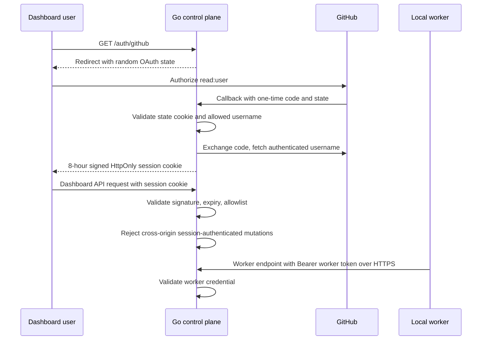

# GitHub sign-in and remote worker authentication

GitHub sign-in protects dashboard API access when the Go control plane binds outside loopback. Local preview remains
unauthenticated on loopback. GitHub identity is distinct from the GitHub App or token used for repository operations.

## Configuration

Register a GitHub OAuth App with callback URL `<ZENCHRON_PUBLIC_URL>/auth/github/callback`, then configure the control
plane:

- `ZENCHRON_PUBLIC_URL`: public HTTPS origin, for example `https://engineering.example.com`.
- `ZENCHRON_GITHUB_CLIENT_ID` and `ZENCHRON_GITHUB_CLIENT_SECRET`: OAuth App credentials.
- `ZENCHRON_GITHUB_ALLOWED_USERS`: comma-separated GitHub usernames permitted to sign in.
- `ZENCHRON_SESSION_SECRET`: at least 32 random bytes; `openssl rand -hex 32` creates a suitable value.
- `ZENCHRON_WORKER_TOKEN`: shared secret also configured on each remote worker.
- `ZENCHRON_LISTEN_ADDR`: non-loopback address, such as `0.0.0.0:8080`.

Generate `ZENCHRON_WORKER_TOKEN` from at least 32 random bytes as well, and distribute it through the deployment's
secret manager rather than source control.

Terminate TLS at the deployment proxy and expose only that HTTPS origin. A remote worker uses
`ZENCHRON_CONTROL_PLANE_URL=https://engineering.example.com` and the same `ZENCHRON_WORKER_TOKEN`. Remote workers
refuse HTTP control-plane URLs and missing tokens. Loopback worker setup does not require a token.

## Security boundary and limits

- Dashboard API requests require a signed session cookie. State-changing dashboard requests also validate a supplied
  `Origin` against `ZENCHRON_PUBLIC_URL`; requests without an `Origin` remain available to non-browser clients. Worker
  bearer requests use their separate credential check. OAuth state is random, short-lived, HttpOnly, and SameSite Lax.
  The session cookie is HttpOnly, SameSite Lax, Secure on HTTPS, and expires after eight hours.
- The user access token is used only to fetch the GitHub username and avatar; it is discarded and never used for
  repository access. Repository operations continue to use the control-plane GitHub App or token configuration.
- The allowlist is checked at login and on each session request, so removing a username takes effect immediately.
  Rotating `ZENCHRON_SESSION_SECRET` invalidates all sessions.
- Worker endpoints use a separate bearer token. This first remote-worker bootstrap shares one token across workers;
  any worker holding it can authenticate as any worker ID. Per-worker enrollment, revocation, and role-based access
  remain required before multi-tenant or untrusted-worker deployment.
- This is user authentication plus an allowlist. GitHub organization/team roles, invite flows, audit history, and
  persistent/revocable server-side sessions remain open architecture work.

## Verification

Focused checks: `go test ./cmd/zenchron ./cmd/zenchron-worker`, `cd dashboard && npm run typecheck`, and the auth and
Settings dashboard E2E specs. `cd dashboard && npm run test:e2e:agent-runtime` launches real control-plane and worker
processes with auth enabled, confirms anonymous API and wrong worker-token requests fail, then verifies the authenticated
worker completes a model run on an isolated branch. It signs a temporary allowlisted session fixture; the GitHub OAuth
exchange itself is covered with a local provider stub in the Go tests.
