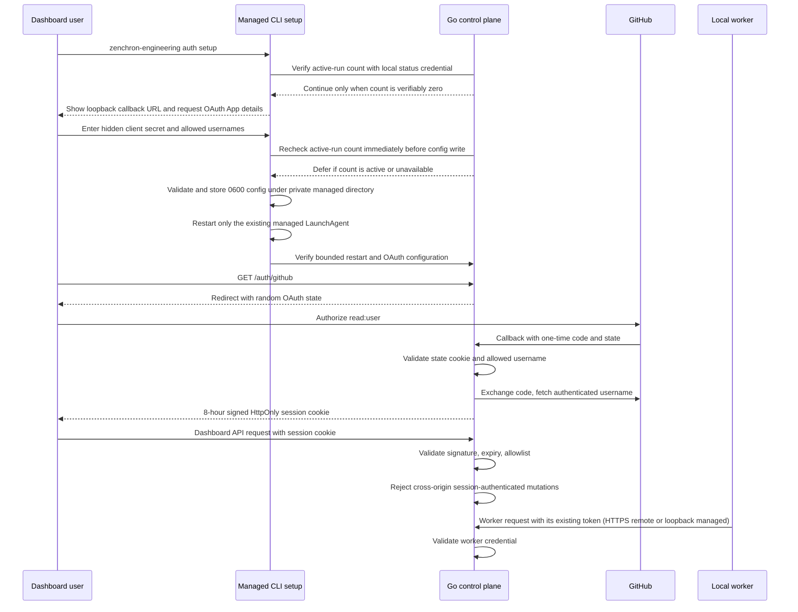

# GitHub sign-in and remote worker authentication

GitHub sign-in is optional for a managed localhost installation and required when the Go control plane binds outside
loopback. An unconfigured managed install remains in Local workspace mode and does not claim a GitHub identity.
GitHub identity is distinct from the GitHub App or token used for repository operations and the updater's protected-main
credential. Per-worker credentials and per-repository access for users are configured with `ZENCHRON_ACCESS_FILE`; see
[Worker enrollment and project access](worker-enrollment-and-project-access.md). A non-loopback control plane requires
that file.

## Feature diagram

## Configuration

Configure a GitHub OAuth App or GitHub App user-authorization flow with callback URL
`<ZENCHRON_PUBLIC_URL>/auth/github/callback`, then configure the control plane. For a GitHub App, sign-in uses its
Client ID and Client Secret; the numeric App ID and private key are for separate server-side GitHub API access.
The optional “Request user authorization (OAuth) during installation” setting controls installation-time authorization;
the dashboard starts its own OAuth web flow. For the local preview, use
`http://127.0.0.1:4173/auth/github/callback` and set `ZENCHRON_PUBLIC_URL=http://127.0.0.1:4173`.

For a managed localhost installation, create the OAuth App yourself with callback URL
`http://127.0.0.1:8080/auth/github/callback`, then run `zenchron-engineering auth setup` in Terminal. The setup prompts
for the Client ID, a hidden Client Secret, and the allowed GitHub username(s); it generates a session signing secret
and loopback worker credential. It verifies that no agent runs are active before prompting and checks again after the
prompts, immediately before writing configuration; an active run or unavailable count defers setup without saving
credentials. These checks do not lock run admission; they narrow the interval but do not guarantee an idle supervisor
at the subsequent restart. It validates the complete configuration before writing
`github-oauth.json` with mode `0600` under the private managed installation directory, then restarts only the existing
managed LaunchAgent and verifies the auth endpoint. It does not change the LaunchAgent plist, access policy, application
data, CLI, or updater credentials. Repeating setup leaves existing configuration unchanged. If activation fails, it
removes the newly written file and restarts the prior local-workspace configuration; rollback errors are reported.
When OAuth is not configured, `/auth/github` responds with the setup command. Local-only use does not require sign-in.

- `ZENCHRON_PUBLIC_URL`: public HTTPS origin for remote use, for example `https://engineering.example.com`; loopback
  development may use `http://127.0.0.1:4173`.
- `ZENCHRON_GITHUB_CLIENT_ID` and `ZENCHRON_GITHUB_CLIENT_SECRET`: OAuth app or GitHub App user-authorization credentials.
- `ZENCHRON_GITHUB_ALLOWED_USERS`: comma-separated GitHub usernames permitted to sign in.
- `ZENCHRON_SESSION_SECRET`: at least 32 random bytes; `openssl rand -hex 32` creates a suitable value.
- `ZENCHRON_ACCESS_FILE`: worker enrollments and repository grants; required for a non-loopback listener.
- `ZENCHRON_WORKER_TOKEN`: shared worker secret accepted only when no access file is configured, for loopback
  development with authentication enabled.
- `ZENCHRON_LISTEN_ADDR`: non-loopback address, such as `0.0.0.0:8080`.

Generate `ZENCHRON_WORKER_TOKEN` from at least 32 random bytes as well, and distribute it through the deployment's
secret manager rather than source control.

Terminate TLS at the deployment proxy and expose only that HTTPS origin. A remote worker uses
`ZENCHRON_CONTROL_PLANE_URL=https://engineering.example.com` and its own enrolled token in `ZENCHRON_WORKER_TOKEN`. Remote workers
refuse HTTP control-plane URLs and missing tokens. Loopback worker setup does not require a token.

## Security boundary and limits

- Dashboard API requests require a signed session cookie. State-changing dashboard requests also validate a supplied
  `Origin` against `ZENCHRON_PUBLIC_URL`; requests without an `Origin` remain available to non-browser clients. Worker
  bearer requests use their separate credential check. OAuth state is random, short-lived, HttpOnly, and SameSite Lax.
  The session cookie is HttpOnly, SameSite Lax, Secure on HTTPS, and expires after eight hours.
- The user access token is used only to fetch the GitHub username and avatar; it is discarded and never used for
  repository access. Repository operations continue to use the control-plane GitHub App or token configuration.
- The allowlist is checked at login and on each session request, so removing a username takes effect immediately.
  Rotating `ZENCHRON_SESSION_SECRET` invalidates all sessions.
- Managed OAuth setup stores the client secret, session signing secret, and generated worker credential only in a
  mode-0600 file owned by the service user. The managed installation directory must have the same owner and must not
  be writable by group or other users; existing 0755 directories are accepted. The secret is entered without terminal
  echo and is not printed by the setup command. Existing LaunchAgent environment values take precedence and are not
  overwritten.
- OAuth setup does not read, change, or claim to configure the GitHub credentials used by the updater to verify
  protected `main` or fetch releases.
- OAuth token-exchange failures return a distinct gateway error; only a successfully verified but unlisted GitHub username
  receives the account-not-authorized response.
- GitHub OAuth codes are exchanged at `github.com`; user identity is fetched separately from `api.github.com/user`.
- Worker endpoints use a separate bearer token. With an access file each worker has its own token bound to its id and
  revocable by editing the file. Without one, a single shared token authenticates any worker id; that mode is refused
  on a non-loopback listener.
- This is user authentication plus an allowlist. GitHub organization/team roles, invite flows, audit history, and
  persistent/revocable server-side sessions remain open architecture work.

## Verification

Automated checks cover managed OAuth config, the full allowlisted callback against a local provider stub, and the
Dashboard local-workspace setup/pairing states. `cd dashboard && npm run test:e2e:agent-runtime` launches real
control-plane and worker processes with auth enabled, confirms anonymous API and wrong worker-token requests fail, then
verifies the authenticated worker completes a model run on an isolated branch. A live GitHub sign-in still requires an
owner-created OAuth App and must be accepted manually on the loopback installation; CI never receives its credentials.
