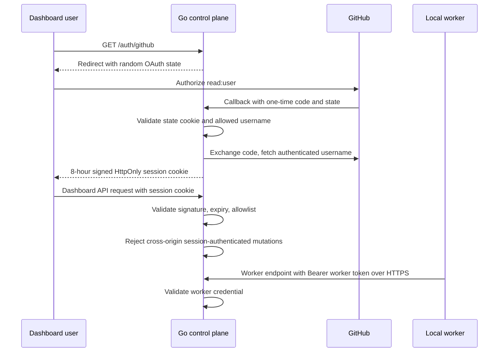

# GitHub sign-in and remote worker authentication

GitHub sign-in protects dashboard API access when the Go control plane binds outside loopback. Local preview remains
unauthenticated on loopback. GitHub identity is distinct from the GitHub App or token used for repository operations.
Per-worker credentials and per-repository access for users are configured with `ZENCHRON_ACCESS_FILE`; see
[Worker enrollment and project access](worker-enrollment-and-project-access.md). A non-loopback control plane requires
that file.

## Configuration

Configure a GitHub OAuth App or GitHub App user-authorization flow with callback URL
`<ZENCHRON_PUBLIC_URL>/auth/github/callback`, then configure the control plane. For a GitHub App, sign-in uses its
Client ID and Client Secret; the numeric App ID and private key are for separate server-side GitHub API access.
The optional “Request user authorization (OAuth) during installation” setting controls installation-time authorization;
the dashboard starts its own OAuth web flow. For the local preview, use
`http://127.0.0.1:4173/auth/github/callback` and set `ZENCHRON_PUBLIC_URL=http://127.0.0.1:4173`.

- `ZENCHRON_PUBLIC_URL`: public HTTPS origin for remote use, for example `https://engineering.example.com`; loopback
  development may use `http://127.0.0.1:4173`.
- `ZENCHRON_GITHUB_CLIENT_ID` and `ZENCHRON_GITHUB_CLIENT_SECRET`: OAuth app or GitHub App user-authorization credentials.
- `ZENCHRON_GITHUB_ALLOWED_USERS`: comma-separated GitHub usernames permitted to sign in.
- `ZENCHRON_SESSION_SECRET`: at least 32 random bytes; `openssl rand -hex 32` creates a suitable value.
- `ZENCHRON_ACCESS_FILE`: worker enrollments and repository grants; required for a non-loopback listener.
- `ZENCHRON_WORKER_TOKEN`: shared worker secret accepted only when no access file is configured, for loopback
  development with authentication enabled.
- `ZENCHRON_LISTEN_ADDR`: non-loopback address, such as `0.0.0.0:8080`.

Generate `ZENCHRON_WORKER_TOKEN` from at least 32 random bytes as well, and distribute it through the deployment's
secret manager rather than source control.

Terminate TLS at the deployment proxy and expose only that HTTPS origin. A remote worker uses
`ZENCHRON_CONTROL_PLANE_URL=https://engineering.example.com` and its own enrolled token in `ZENCHRON_WORKER_TOKEN`. Remote workers
refuse HTTP control-plane URLs and missing tokens. Loopback worker setup does not require a token.

## Security boundary and limits

- Dashboard API requests require a signed session cookie. State-changing dashboard requests also validate a supplied
  `Origin` against `ZENCHRON_PUBLIC_URL`; requests without an `Origin` remain available to non-browser clients. Worker
  bearer requests use their separate credential check. OAuth state is random, short-lived, HttpOnly, and SameSite Lax.
  The session cookie is HttpOnly, SameSite Lax, Secure on HTTPS, and expires after eight hours.
- The user access token is used only to fetch the GitHub username and avatar; it is discarded and never used for
  repository access. Repository operations continue to use the control-plane GitHub App or token configuration.
- The allowlist is checked at login and on each session request, so removing a username takes effect immediately.
  Rotating `ZENCHRON_SESSION_SECRET` invalidates all sessions.
- OAuth token-exchange failures return a distinct gateway error; only a successfully verified but unlisted GitHub username
  receives the account-not-authorized response.
- GitHub OAuth codes are exchanged at `github.com`; user identity is fetched separately from `api.github.com/user`.
- Worker endpoints use a separate bearer token. With an access file each worker has its own token bound to its id and
  revocable by editing the file. Without one, a single shared token authenticates any worker id; that mode is refused
  on a non-loopback listener.
- This is user authentication plus an allowlist. GitHub organization/team roles, invite flows, audit history, and
  persistent/revocable server-side sessions remain open architecture work.

## Verification

Focused checks: `go test ./cmd/zenchron ./cmd/zenchron-worker`, `cd dashboard && npm run typecheck`, and the auth and
Settings dashboard E2E specs. `cd dashboard && npm run test:e2e:agent-runtime` launches real control-plane and worker
processes with auth enabled, confirms anonymous API and wrong worker-token requests fail, then verifies the authenticated
worker completes a model run on an isolated branch. It signs a temporary allowlisted session fixture; the GitHub OAuth
exchange is covered with a local provider stub and was verified live against the GitHub test app on the loopback preview.
