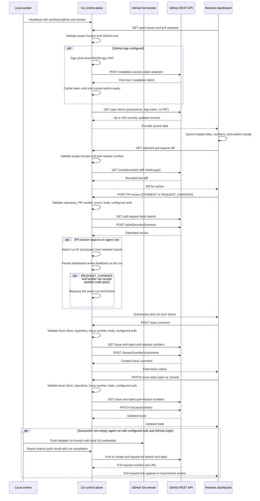

# GitHub issue sync and pull-request reviews

The control plane reads open GitHub issues and pull requests for a selected `github.com/owner/repository` discovered by
the local worker. The Reviews dashboard can comment on an issue, close or reopen it, and submit a top-level comment or
request changes on a selected pull request.
GitHub remains authoritative for provider comments and review state. Submissions are authored as the installed GitHub
App, or as the account that owns `ZENCHRON_GITHUB_TOKEN` when the personal-token fallback is configured.

When a successful agent run changes files in a supported GitHub checkout, the worker pushes only its isolated run
branch with the workstation's configured Git credentials. The control plane uses its GitHub App installation token or
personal-token fallback to find or create the matching pull request against the run's base branch and returns its link
to Reviews. No merge is performed.

Endpoints:

- `GET /api/v1/projects/{id}/pull-requests`
- `GET /api/v1/projects/{id}/pull-requests/{number}/diff`
- `GET /api/v1/projects/{id}/issues`
- `POST /api/v1/projects/{id}/issues/{number}/comments`
- `PATCH /api/v1/projects/{id}/issues/{number}`
- `POST /api/v1/projects/{id}/pull-requests/{number}/reviews`

Only GitHub.com remotes with exactly an owner and repository are supported. Lists contain up to 100 open items ordered
by recent update. Public reads work without credentials. Private reads need repository read access. Creating pull requests
and submitting PR reviews need **Pull requests: write**. Posting issue comments and changing issue state needs **Issues:
write** or **Pull requests: write** ([GitHub issue comments](https://docs.github.com/en/rest/issues/comments#create-an-issue-comment), [GitHub issues](https://docs.github.com/en/rest/issues/issues#update-an-issue)). The control plane can authenticate with a GitHub App installation configured by `ZENCHRON_GITHUB_APP_ID`, `ZENCHRON_GITHUB_INSTALLATION_ID`, and `ZENCHRON_GITHUB_APP_PRIVATE_KEY_PATH`. It signs an RS256 JWT, mints an installation token, and caches the token until one minute before GitHub's one-hour expiry. The PEM key stays on the control-plane machine. A configured `ZENCHRON_GITHUB_TOKEN` takes precedence as a personal-token fallback. Actions: read is optional and enables authenticated GitHub Actions history in Reports. The worker uses workstation Git credentials to push and never receives GitHub API credentials. The dashboard
never receives them either. The review body is limited to 1,000 bytes, and only `COMMENT` and `REQUEST_CHANGES` events are
accepted. The Reviews queue search filters the loaded list by item number, title, or author without another provider
request.

Submitting an issue comment, changing issue state, or submitting a PR review is an external write. Each endpoint requires a loopback client and
`application/json`; this is a local-preview guard, not user authentication. GitHub records comments and reviews under
the configured App or token actor; the current preview has no user identity or actor audit and must not be network-exposed. A worker push or PR creation failure keeps
the local diff available and is shown on the branch review. When a review is submitted from the dashboard for a
Zenchron-created PR, the control plane matches its isolated branch to the originating run and persists the comment.
`REQUEST_CHANGES` requeues that same run and branch when the worker is online, has a model runtime and write permission,
and has attempts remaining. If the worker cannot accept another pass, the feedback is still stored and the dashboard
reports that no run was queued. GitHub reviews made directly on github.com are not yet imported; webhook or provider
polling is not implemented. Approve and merge are not enabled. Issue comments are submitted as top-level comments
authored as the configured App or personal-token owner.

Issue comment and state endpoints fetch the selected issue first and reject numbers that resolve to pull requests. GitHub's
[Issues API also includes pull requests](https://docs.github.com/en/rest/issues/issues), so UI filtering alone is not a
sufficient boundary.

## Verification

`go test ./cmd/zenchron -run 'TestGitHub' -count=1` verifies GitHub request headers, repository mapping, issue/PR
separation, bounded PR diff reads, issue-comment and issue-state payloads, PR-number rejection, review payloads, and
local-client/auth/event validation. It also verifies GitHub App JWT signature and claims, installation-token caching,
configuration validation, and private-key file permissions using a local fake GitHub server. `cd dashboard && npm run test:e2e -- e2e/github-reviews.spec.ts` checks live queue rendering, issue comments,
close/reopen, and both provider review actions. The focused `home.spec.ts`
Reviews test covers unavailable state and local-branch review. These checks use fixtures; a real provider write and
private repository are not verified.

The diff read uses GitHub's [`application/vnd.github.diff` media type](https://docs.github.com/en/rest/pulls/pulls) on
the get-a-pull-request endpoint. The REST API also follows GitHub's
[pull-request reviews](https://docs.github.com/en/rest/pulls/reviews) and
[issues](https://docs.github.com/en/rest/issues/issues) endpoints.
