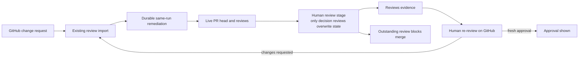

# Human re-review after remediation

An agent response to GitHub `CHANGES_REQUESTED` records feedback as run state, while GitHub remains the authority for
approval and merge policy. The pull-request projection compares the live PR head with durable imported-review/run
state and reports whether the feedback is untouched, being remediated, awaiting human re-review, or freshly approved.
Fresh approval is anchored to the current head and is shown only when every reviewer's latest effective decision no
longer requests changes; a later approval from a different reviewer cannot clear another reviewer's request, and
comment-only reviews do not clear a request. Only `APPROVED`, `CHANGES_REQUESTED`, and `DISMISSED` reviews update a
reviewer's effective decision. Outstanding GitHub change requests remain visible as a merge block;
Zenchron never dismisses a review.

## Feature diagram

