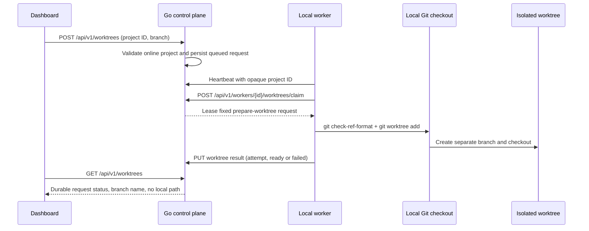

# Isolated Git worktrees

Prototype status: the request queue and lease behavior describe the current local implementation. Whether isolated worktrees remain the project execution boundary is undecided; see [the architecture checkpoint](../architecture/architecture-checkpoint.md).

The Projects page can ask the local worker to prepare an isolated worktree for a discovered checkout. The control plane
stores a durable request, binds it to the worker that reported the project, and leases it to that worker over its
outbound polling connection. The worker validates the Git branch names and runs the fixed `git worktree add` operation.
The original checkout and branch stay in place. Absolute repository and worktree paths remain on the worker.

Requests move through `queued`, `preparing`, and `ready` or `failed`. Queued requests can be cancelled. Leases expire
after ten minutes and can be retried up to three times. Each claim increments an attempt number; completion must echo
that number, so a stale worker cannot finish a newer lease. Retries use the same request-specific worktree path, so a
completed checkout can be acknowledged again without creating another branch. Worktree directories default to
`<UserCacheDir>/zenchron/worktrees`; `ZENCHRON_WORKTREES_ROOT` can select another local directory.

After a control-plane restart, the worker must heartbeat again before claiming work. The saved lease is rechecked on
the next claim: an expired request is requeued with its attempt count retained, while an acknowledgement from the
previous attempt is rejected. A second claim while the only request is leased returns `204` and does not deliver it
again.

The control plane and worker must use the same release: older workers do not echo the attempt number and their results
are rejected.

This dashboard operation prepares a worktree only; agent runs use separate per-run worktrees. It does not invoke an
agent, modify source files, commit changes, or open a pull request. The control plane API defaults to loopback; remote
listening requires the GitHub OAuth and worker authentication settings described in
[GitHub sign-in and remote worker authentication](github-login-and-remote-worker-auth.md).

## Feature diagram

## Verification

- `go test ./cmd/zenchron -run 'TestWorktree'` covers queue validation, duplicate claims, restart recovery after an
  expired lease, stale-attempt rejection, and cancellation. `go test ./cmd/zenchron-worker -run 'TestPrepareWorktree'`
  covers real Git worktree creation, retry idempotence, invalid-branch rejection, and base-branch preservation.
- `cd dashboard && npm run test:e2e -- e2e/home.spec.ts --grep "isolated Git branch"` uses a temporary Git checkout
  and confirms the worker completes the request through the dashboard.
