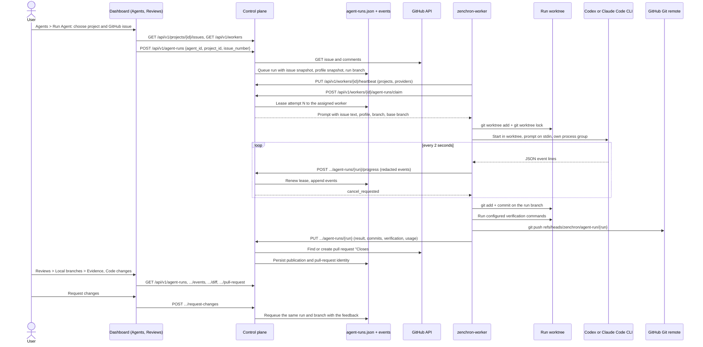
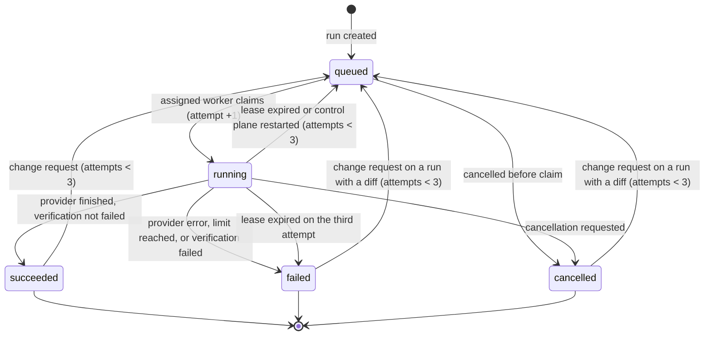

# Issue to pull request

A user picks a GitHub issue and an agent profile; Zenchron runs the installed Codex CLI or Claude Code CLI in an
isolated Git worktree on the project's worker, verifies the result with the operator's commands, commits it, pushes
only the run branch, and opens a pull request that closes the issue. Progress, evidence, and the final state are read
from the control plane; nobody copies prompts or results between tools.

## Feature diagram



## Run lifecycle



Three values are kept apart on every run:

- `status` is the lifecycle state above.
- `verification` is `passed`, `failed`, `not_configured`, or empty when verification did not run.
- `publication` is `published`, `push_failed`, `pull_request_failed`, `no_changes`, or empty when nothing was published.

`termination_reason` says why the last attempt ended: `completed`, `provider_exit`, `wall_clock_timeout`,
`inactivity_timeout`, `tool_timeout`, `cancelled`, `lease_lost`, `verification_failed`, or `worker_error`. A provider
that exits successfully is therefore not reported as delivered work unless verification and publication say so.

## Behavior

- A run is bound to one project, which is one worker's checkout. It waits in the queue until that worker reports the
  profile's provider as installed and signed in.
- A run can be started only from an issue written by a repository owner, member, or collaborator; an issue from
  anyone else is refused, because its text becomes the agent's task. The title, body, labels, and comments from owners,
  members, and collaborators are snapshotted when the run is created. Comments from anyone else are not sent to the
  agent.
- Each run has its own branch `zenchron/agent-run/<run id>` and its own worktree. The worker refuses any other branch
  name, so two runs never share files and a run cannot push to another branch.
- The provider process gets the prompt on stdin. Codex runs under a permission profile built by the worker: the
  worktree is writable (read-only when the profile lacks `code.write`), the temporary directory is writable, the home
  directory is unreadable apart from the worktree, the repository's Git metadata, and operator-listed read paths, and
  network access is off. Claude Code runs without user settings or MCP servers and with file tools only, unless
  the profile has both `code.write` and `tests.run`: then it also gets Bash, forced into Claude Code's sandbox, which
  refuses commands that cannot be sandboxed, allows writes only in the worktree and the temporary directory, and
  denies reading the home directory outside the worktree and the listed read paths.
- Every provider starts under `zenchron-worker guard`. If the worker process dies for any reason, the guard stops the
  provider's whole process group within seconds, so no agent keeps editing a worktree without a worker.
  Claude Code hooks are disabled for every run, because a project hook is a worktree script that would run outside the
  sandbox. Worker, GitHub, SSH-agent, AWS, Google application-credential, and provider API-key environment variables
  are removed from the provider and from verification commands, so a subscription sign-in is never replaced
  by API billing.
- The profile's model is passed to the CLI; the model name `default` leaves the choice to the CLI's own configuration.
- Events and the final message are redacted for known credential formats, the worker token, and local absolute paths,
  and bounded: 1,000 bytes per event, 300 stored events per run, 20,000 bytes of final output.
- A successful execution with changes is committed, then verified. A failed verification keeps the commit on the local
  branch, marks the run `failed`, and publishes nothing. Without configured commands verification is `not_configured`
  and publication proceeds; the pull request states that.
- The pull request is created with the control plane's GitHub credential, titled after the issue, and ends with
  `Closes #<issue>`. Creation reuses an open pull request for the same branch. If GitHub fails after the push,
  `POST /api/v1/agent-runs/{id}/publish` retries without creating a duplicate.
- A change request from the dashboard, or one imported from GitHub with `sync-reviews`, queues another attempt on the
  same branch and worktree; the new commit lands on the same pull request. A run has at most three attempts. When
  several change requests are imported at once, all are kept and the newest queues the attempt.
- The worker retries delivering a result up to four times after a connection or server error, so a finished run is
  not repeated because one request failed. It stops an attempt when the control plane answers a progress report with
  conflict, unauthorized, forbidden, or not found, and never pushes from an attempt that lost its lease.
- Cancelling a running run stops the provider's whole process group and keeps the partial diff. Cancelled and
  interrupted worktrees are never deleted automatically.
- If the control plane restarts or a worker disappears, the attempt's lease lapses, the run is queued again, and the
  old attempt can no longer report or finish. The next attempt continues in the same worktree.

## Dashboard

A local address opens in Mock mode. Choose Live in the sidebar, or add `?mode=live` before the `#` (for example
`http://127.0.0.1:4173/?mode=live#reviews`), to see the control plane's real data on every page; any other host starts
in Live.

- **Agents > Run Agent.** The queue dialog lists the selected project's open GitHub issues; choosing one makes the prompt
  optional and states that the pull request will close the issue. The project line and the note under it say whether
  the project's worker reports the agent profile's CLI as installed and signed in. Until it does, "Queue run" is
  disabled for a CLI profile and the note says to sign in on the worker and restart it.
  If the issue list cannot be loaded the dialog says so and a prompt-only run is still possible.
- **Reviews > Local branches > Evidence.** For the selected run: issue link, provider and version, worker, branch,
  base and result commits, execution result, verification, publication, pull-request link, reported usage, the pull
  request's check runs, every attempt, and the event log, which refreshes every two seconds while the run is active.
  Loading, failure, and empty states are shown per section.
- **Reviews > Local branches > Code changes / Conversations** are unchanged: the stored diff, comments, request
  changes, and cancel. The Local branches queue exists in Live only; the Mock fixtures hold no agent runs.

- **Agents > Run Agent > Create a new issue.** Creates a GitHub issue from a title and description and selects it for
  the run.
- **Integrations and Settings.** The Local workers card lists which coding CLIs are ready on online workers.
- **Evidence actions.** "Import change requests from GitHub" on a run with a pull request, and "Retry pull request"
  when the branch was pushed but GitHub did not create the pull request. Both report the outcome in place.

## API

| Method and path | Purpose |
|---|---|
| `GET /api/v1/projects/{id}/issues` | Open issues of a project's repository |
| `POST /api/v1/projects/{id}/issues` | Create an issue `{title, body}` |
| `GET /api/v1/workers` | Workers with `providers: [{id, version, ready}]` |
| `POST /api/v1/agent-runs` | Start a run `{agent_id, project_id, issue_number?, prompt?}` |
| `GET /api/v1/agent-runs` | Runs with status, verification, publication, commits, attempt log |
| `GET /api/v1/agent-runs/{id}/events?after=<sequence>` | Bounded execution events |
| `GET /api/v1/agent-runs/{id}/diff` | Stored branch diff |
| `GET /api/v1/agent-runs/{id}/pull-request` | Live pull-request state, check runs, and reviews |
| `POST /api/v1/agent-runs/{id}/cancel` | Cancel a queued or running run |
| `POST /api/v1/agent-runs/{id}/request-changes` | Queue a follow-up attempt with feedback |
| `POST /api/v1/agent-runs/{id}/sync-reviews` | Import change requests submitted on GitHub |
| `POST /api/v1/agent-runs/{id}/publish` | Retry pull-request creation after a GitHub failure |

Agent profiles select a CLI with `provider` set to `codex-cli` or `claude-code`. Any other provider value uses the
OpenAI-compatible chat runtime described in [Agent run queue](agent-run-queue.md).

## Setup

1. **Control plane GitHub access.** Set GitHub App credentials or `ZENCHRON_GITHUB_TOKEN` as described in
   [GitHub issue sync and pull-request reviews](github-review-sync.md). It needs Issues and Pull requests write access.
   Without it runs still execute and commit locally but are not published.
2. **CLIs on the worker machine.** Install and sign in to the ones you want: `codex login` and `claude auth login`.
   Check with `codex login status` and `claude auth status`. The worker detects them at startup; restart it after
   installing or signing in.
3. **Git push access.** The worker pushes with the workstation's own Git credentials for the checkout's `origin`.
4. **Worker configuration.** Point `ZENCHRON_WORKER_CONFIG` at a JSON file. It is the worker's repository allowlist and
   the only source of verification commands:

   ```json
   {
     "repositories": {
       "github.com/acme/api": {
         "verify": [["go", "vet", "./..."], ["go", "test", "./...", "-count=1"]]
       }
     }
   }
   ```

   An optional `"environment": {"GOCACHE": "/tmp/zenchron-gocache"}` beside `verify` is added to the provider and
   verification processes. Use it for tool caches a sandboxed agent must be able to write; it cannot set worker,
   GitHub, or provider API-key variables. An optional `"read_paths": ["/Users/dev/go/pkg/mod"]` lists absolute paths
   both provider sandboxes may read in addition to the worktree, for dependency caches in the home directory.

   Commands are argument lists run in the worktree without a shell. Without this file the worker serves every checkout
   under `ZENCHRON_PROJECTS_ROOT` and reports verification as `not_configured`.
5. **Start the worker** with `ZENCHRON_PROJECTS_ROOT` set to a checkout or a directory of checkouts.

Worker settings:

| Variable | Default | Meaning |
|---|---|---|
| `ZENCHRON_WORKER_CONFIG` | unset | Repository allowlist and verification commands |
| `ZENCHRON_RUN_TIMEOUT` | `2h` | Wall-clock limit for one provider execution |
| `ZENCHRON_RUN_INACTIVITY_TIMEOUT` | `15m` | Longest silence while no tool is running |
| `ZENCHRON_RUN_TOOL_TIMEOUT` | `45m` | Longest silence while a provider-started tool is running |
| `ZENCHRON_VERIFY_TIMEOUT` | `30m` | Limit for all verification commands together |
| `ZENCHRON_WORKTREES_ROOT` | user cache directory | Where run worktrees are created |

`zenchron-worker cleanup-worktrees` removes run worktrees that are not locked by a running attempt and contain no
modified or untracked files. Run branches and their commits stay.

## Recovery and troubleshooting

| Symptom | Cause and action |
|---|---|
| Run stays `queued` | The assigned worker is offline or does not report the provider as ready. Check `GET /api/v1/workers`; sign in to the CLI and restart the worker. |
| `failed` with `inactivity_timeout` or `tool_timeout` | The provider was silent past the limit. Raise the limit or request changes; the partial work is in the worktree. |
| `failed` with `verification_failed` | Read the `verification` events for the failing command's output. Request changes to let the agent fix it. |
| `publication` is `push_failed` | The workstation could not push to `origin`. Fix Git credentials, then request changes or push the run branch manually. |
| `publication` is `pull_request_failed` | The branch is on GitHub. Call `POST /api/v1/agent-runs/{id}/publish`. |
| Attempt log shows `lease_expired` | The worker or control plane stopped mid-run. The run was queued again automatically. |
| Sandboxed Claude Code cannot run the build tool | The tool's cache is in the home directory. Set its cache variable under `environment` in the worker configuration to a path in the temporary directory. |
| Old state file rejected at startup | Run records gained fields; a binary from before this change cannot read new state. Restore a backup before rolling back. |

## Verification

Automated, deterministic:

- `go test ./cmd/zenchron-worker -run 'TestCLI|TestGitStage|TestStaleLease|TestRunRejects|TestRunFails|TestCleanupWorktrees|TestProvider|TestWorkerConfig|TestRunLimits' -count=1`
  drives a fake CLI through the real process runner in real Git repositories: verified commit, verification failure,
  provider failure, inactivity versus a long-running tool, wall-clock limit, cancellation with partial diff, lost
  lease, unauthorized branch, option-like model names, redaction, and cleanup safety.
- `go test ./cmd/zenchron -run 'TestIssueRun|TestPullRequest|TestProgress|TestStaleAttempt|TestRunWaits|TestResult|TestVerificationFailure' -count=1`
  covers the issue snapshot and untrusted-comment filtering, identity linking, idempotent publication, lease renewal
  and fencing, provider gating, result validation, and review import against a fake GitHub API.
- `cd dashboard && npm run test:e2e:agent-runtime` runs the real control plane and worker binaries end to end with
  the chat runtime.

- `cd dashboard && npm run test:e2e -- e2e/z_run_evidence.spec.ts` covers the queue dialog (issue selection and
  creation, the request body, a blocked unready provider, issues unavailable), the Mock/Live switch,
  Settings readiness, the Evidence actions, and the Evidence panel (summary, checks, attempts,
  events, failure and empty states, no horizontal overflow) at 1672×941 and 390×844 against mocked API responses.
  `npm run test:e2e -- e2e/z_agents.spec.ts --grep 'real worker run'` checks the panel against a run executed by the
  real control plane and worker.

Live, on 2026-11-11 against `bogdaniel/zenchron-engineering-os` with a loopback control plane and one worker:

| Step | Evidence |
|---|---|
| Issue created through Zenchron | [#339](https://github.com/bogdaniel/zenchron-engineering-os/issues/339), [#341](https://github.com/bogdaniel/zenchron-engineering-os/issues/341) |
| Codex CLI 0.167.0 run | Run `91622f32ea88dff006e417bed76a6d62`, base `8d4731c`, commit `bda3e9d`, verification `passed`, [PR #340](https://github.com/bogdaniel/zenchron-engineering-os/pull/340) |
| Review continuation | `request-changes` on the same run produced attempt 2, commit `0daa6cd` on the same pull request |
| Claude Code 2.1.322 run | Run `e2b04e4418ca2eba6f1332470561df03`, commit `14ee1d8`, verification `passed`, [PR #342](https://github.com/bogdaniel/zenchron-engineering-os/pull/342) |
| Control-plane restart mid-run | Run `541d18526f598d04d1a298b43b75bcb3`: attempt 1 `lease_expired`, attempt 2 claimed in the same worktree |
| Cancellation | The same run and run `ebf56847dab4d59fff2ff784bd8ce483` ended `cancelled`; no provider process remained |
| Codex run started and inspected in the dashboard, final build | Issue [#351](https://github.com/bogdaniel/zenchron-engineering-os/issues/351) chosen in the queue dialog; run `ff05244b6995c241c4c1c8c83e43e899`, commit `a2d221b`, verification `passed`, [PR #352](https://github.com/bogdaniel/zenchron-engineering-os/pull/352); evidence read from Reviews |
| Issue created in the dashboard, sandboxed Claude Code run, build `5c0a62c` | Issue [#355](https://github.com/bogdaniel/zenchron-engineering-os/issues/355) created in the queue dialog; run `787f04a04bc9a7282a378a73af8142da`, commit `fc70b15`, [PR #356](https://github.com/bogdaniel/zenchron-engineering-os/pull/356). In attempt 1 the agent could not run Go (no writable build cache); after `environment` was added (`ab1d58d`) a change request from Reviews produced attempt 2, in which the agent ran `gofmt`, `go vet`, and `go test` itself and the worker's verification passed |
| Codex under the read-confining profile, build `ec7333c` | Change request from Reviews on run `ff05244b…` produced attempt 2, commit `77f8b87` on PR #352, verification `passed`; asked to print a file in the home directory, the agent reported the sandbox denied it |
| Worker killed with SIGKILL mid-run, build `ec7333c` | Run `d635c3be1a980aafb781164a83c626f0`: both `codex exec` processes were gone 2.2 s after the kill; after the worker restarted the lease expired, attempt 2 was claimed, and the run was cancelled |
| Restart and cancellation repeated on the final build | Run `4e2d7f7cc2bf8549cd7ac171c59cc7e2`: control plane killed mid-run, attempt 1 `lease_expired`, attempt 2 resumed; cancelled with the Reviews "Cancel run" button in 0.8 s, partial diff kept, no provider process left |
| Claude Code run started and inspected in the dashboard, final build | Issue [#353](https://github.com/bogdaniel/zenchron-engineering-os/issues/353); run `48513125f6833b6d21a270471ef47891`, commit `b5921c7`, verification `passed`, [PR #354](https://github.com/bogdaniel/zenchron-engineering-os/pull/354) |

The first six rows used the build before the independent review fixes; the dashboard rows used builds that include
them. Those dashboard rows were driven by a Playwright script acting on the real pages; the hand-run walk-through is
recorded under "Repeating the live check". A newly created issue can
take a few seconds to appear in GitHub's issue list and therefore in the dialog.

The first live Codex run (`b1e099df2b806f6f136f9a7e94d963a6`) failed in the worker after the provider had finished: a
Git deadline had started before the provider ran. That defect is fixed and covered by
`TestGitStageDeadlineStartsAfterProviderFinishes`.

### Repeating the live check

1. Start the control plane with GitHub credentials and a worker with `ZENCHRON_PROJECTS_ROOT` on a clone of the target
   repository and a `ZENCHRON_WORKER_CONFIG` that lists it.
2. `GET /api/v1/workers` must show the provider with `"ready": true`; `GET /api/v1/projects` gives the project id.
3. Open the dashboard in Live mode (`?mode=live` on a local address). Agents > Create Agent: provider `codex-cli` or `claude-code`, model `default`, tools including
   "Write files in isolated branch" (and "Run tests" for a sandboxed Claude Code shell).
4. Agents > Run Agent: choose the project, choose or create the GitHub issue, Queue run.
5. Reviews > Local branches: select the run's branch, open Evidence, and watch the events until the run is terminal;
   then read Verification, Publication, the pull-request link, and its checks. The same data is available from
   `GET /api/v1/agent-runs`, `.../events`, and `.../pull-request`.

On 2026-11-11 the repository owner performed this walk-through by hand on `http://127.0.0.1:4174/?live`: issue
[#353](https://github.com/bogdaniel/zenchron-engineering-os/issues/353) chosen in the queue dialog for a Claude Code
profile, run `3288dd4206a46ab48c4e5330d174fb44`, commit `d1340d6`, verification `passed`,
[PR #363](https://github.com/bogdaniel/zenchron-engineering-os/pull/363) with green checks, all read from the Evidence
panel. The other dashboard rows in the table above were driven by a script acting on the same pages.

## Outstanding

- On a phone-sized screen the Reviews workspace is lengthened while Evidence is open, so the panel is about 240px
  tall at 390px wide (roughly four summary rows) instead of 120px. The checks, attempts, and event log still scroll
  inside the panel, because the page's stacked, resizable panes are kept as they are.
- A sandboxed agent cannot open network connections, including local test servers: a Codex run could not run Go
  tests that bind a loopback port. The worker's verification runs outside the sandbox and covers them.
- A build that needs a dependency cache in the home directory runs inside the agent only if the operator lists that
  cache under `read_paths`.
- Provider sandbox behavior was probed by hand against Codex 0.167.0 and Claude Code 2.1.322 on macOS. CI has neither
  CLI, so only the arguments the worker passes are tested automatically.
- Review and CI state are read on request, not pushed by webhooks.
- Usage is whatever the CLI reports. Codex reports tokens without cost; Claude Code reports a cost figure even under
  a subscription. No budget is enforced beyond the time limits and the three-attempt cap.
