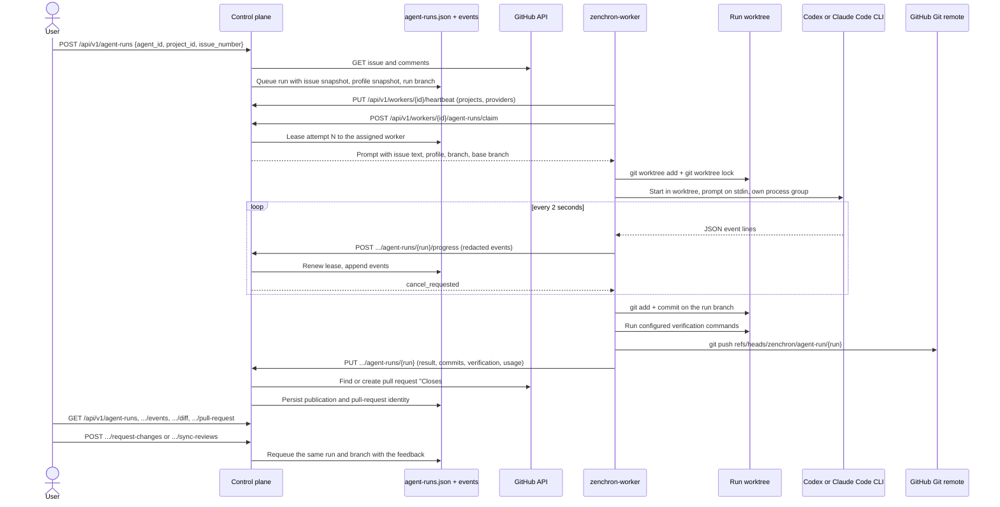
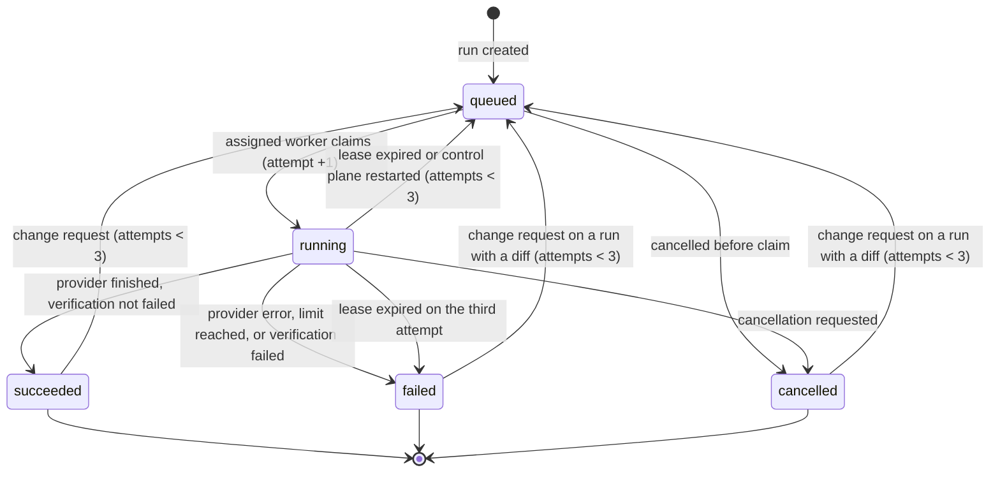

# Issue to pull request

A user picks a GitHub issue and an agent profile; Zenchron runs the installed Codex CLI or Claude Code CLI in an
isolated Git worktree on the project's worker, verifies the result with the operator's commands, commits it, pushes
only the run branch, and opens a pull request that closes the issue. Progress, evidence, and the final state are read
from the control plane; nobody copies prompts or results between tools.

## Feature diagram



## Run lifecycle



Three values are kept apart on every run:

- `status` is the lifecycle state above.
- `verification` is `passed`, `failed`, `not_configured`, or empty when verification did not run.
- `publication` is `published`, `push_failed`, `pull_request_failed`, `no_changes`, or empty when nothing was published.

`termination_reason` says why the last attempt ended: `completed`, `provider_exit`, `wall_clock_timeout`,
`inactivity_timeout`, `tool_timeout`, `cancelled`, `lease_lost`, `verification_failed`, or `worker_error`. A provider
that exits successfully is therefore not reported as delivered work unless verification and publication say so.

## Behavior

- A run is bound to one project, which is one worker's checkout. It waits in the queue until that worker reports the
  profile's provider as installed and signed in.
- A run can be started only from an issue written by a repository owner, member, or collaborator; an issue from
  anyone else is refused, because its text becomes the agent's task. The title, body, labels, and comments from owners,
  members, and collaborators are snapshotted when the run is created. Comments from anyone else are not sent to the
  agent.
- Each run has its own branch `zenchron/agent-run/<run id>` and its own worktree. The worker refuses any other branch
  name, so two runs never share files and a run cannot push to another branch.
- The provider process gets the prompt on stdin. Codex runs with `--sandbox workspace-write` (or `read-only` when the
  profile lacks `code.write`). Claude Code runs with file tools only and without Bash, user settings, or MCP servers.
  Worker, GitHub, and provider API-key environment variables are removed, so a subscription sign-in is never replaced
  by API billing.
- The profile's model is passed to the CLI; the model name `default` leaves the choice to the CLI's own configuration.
- Events and the final message are redacted for known credential formats, the worker token, and local absolute paths,
  and bounded: 1,000 bytes per event, 300 stored events per run, 20,000 bytes of final output.
- A successful execution with changes is committed, then verified. A failed verification keeps the commit on the local
  branch, marks the run `failed`, and publishes nothing. Without configured commands verification is `not_configured`
  and publication proceeds; the pull request states that.
- The pull request is created with the control plane's GitHub credential, titled after the issue, and ends with
  `Closes #<issue>`. Creation reuses an open pull request for the same branch. If GitHub fails after the push,
  `POST /api/v1/agent-runs/{id}/publish` retries without creating a duplicate.
- A change request from the dashboard, or one imported from GitHub with `sync-reviews`, queues another attempt on the
  same branch and worktree; the new commit lands on the same pull request. A run has at most three attempts. When
  several change requests are imported at once, all are kept and the newest queues the attempt.
- The worker retries delivering a result up to four times after a connection or server error, so a finished run is
  not repeated because one request failed. It stops an attempt when the control plane answers a progress report with
  conflict, unauthorized, forbidden, or not found, and never pushes from an attempt that lost its lease.
- Cancelling a running run stops the provider's whole process group and keeps the partial diff. Cancelled and
  interrupted worktrees are never deleted automatically.
- If the control plane restarts or a worker disappears, the attempt's lease lapses, the run is queued again, and the
  old attempt can no longer report or finish. The next attempt continues in the same worktree.

## API

| Method and path | Purpose |
|---|---|
| `GET /api/v1/projects/{id}/issues` | Open issues of a project's repository |
| `POST /api/v1/projects/{id}/issues` | Create an issue `{title, body}` |
| `GET /api/v1/workers` | Workers with `providers: [{id, version, ready}]` |
| `POST /api/v1/agent-runs` | Start a run `{agent_id, project_id, issue_number?, prompt?}` |
| `GET /api/v1/agent-runs` | Runs with status, verification, publication, commits, attempt log |
| `GET /api/v1/agent-runs/{id}/events?after=<sequence>` | Bounded execution events |
| `GET /api/v1/agent-runs/{id}/diff` | Stored branch diff |
| `GET /api/v1/agent-runs/{id}/pull-request` | Live pull-request state, check runs, and reviews |
| `POST /api/v1/agent-runs/{id}/cancel` | Cancel a queued or running run |
| `POST /api/v1/agent-runs/{id}/request-changes` | Queue a follow-up attempt with feedback |
| `POST /api/v1/agent-runs/{id}/sync-reviews` | Import change requests submitted on GitHub |
| `POST /api/v1/agent-runs/{id}/publish` | Retry pull-request creation after a GitHub failure |

Agent profiles select a CLI with `provider` set to `codex-cli` or `claude-code`. Any other provider value uses the
OpenAI-compatible chat runtime described in [Agent run queue](agent-run-queue.md).

## Setup

1. **Control plane GitHub access.** Set GitHub App credentials or `ZENCHRON_GITHUB_TOKEN` as described in
   [GitHub issue sync and pull-request reviews](github-review-sync.md). It needs Issues and Pull requests write access.
   Without it runs still execute and commit locally but are not published.
2. **CLIs on the worker machine.** Install and sign in to the ones you want: `codex login` and `claude auth login`.
   Check with `codex login status` and `claude auth status`. The worker detects them at startup; restart it after
   installing or signing in.
3. **Git push access.** The worker pushes with the workstation's own Git credentials for the checkout's `origin`.
4. **Worker configuration.** Point `ZENCHRON_WORKER_CONFIG` at a JSON file. It is the worker's repository allowlist and
   the only source of verification commands:

   ```json
   {
     "repositories": {
       "github.com/acme/api": {
         "verify": [["go", "vet", "./..."], ["go", "test", "./...", "-count=1"]]
       }
     }
   }
   ```

   Commands are argument lists run in the worktree without a shell. Without this file the worker serves every checkout
   under `ZENCHRON_PROJECTS_ROOT` and reports verification as `not_configured`.
5. **Start the worker** with `ZENCHRON_PROJECTS_ROOT` set to a checkout or a directory of checkouts.

Worker settings:

| Variable | Default | Meaning |
|---|---|---|
| `ZENCHRON_WORKER_CONFIG` | unset | Repository allowlist and verification commands |
| `ZENCHRON_RUN_TIMEOUT` | `2h` | Wall-clock limit for one provider execution |
| `ZENCHRON_RUN_INACTIVITY_TIMEOUT` | `15m` | Longest silence while no tool is running |
| `ZENCHRON_RUN_TOOL_TIMEOUT` | `45m` | Longest silence while a provider-started tool is running |
| `ZENCHRON_VERIFY_TIMEOUT` | `30m` | Limit for all verification commands together |
| `ZENCHRON_WORKTREES_ROOT` | user cache directory | Where run worktrees are created |

`zenchron-worker cleanup-worktrees` removes run worktrees that are not locked by a running attempt and contain no
modified or untracked files. Run branches and their commits stay.

## Recovery and troubleshooting

| Symptom | Cause and action |
|---|---|
| Run stays `queued` | The assigned worker is offline or does not report the provider as ready. Check `GET /api/v1/workers`; sign in to the CLI and restart the worker. |
| `failed` with `inactivity_timeout` or `tool_timeout` | The provider was silent past the limit. Raise the limit or request changes; the partial work is in the worktree. |
| `failed` with `verification_failed` | Read the `verification` events for the failing command's output. Request changes to let the agent fix it. |
| `publication` is `push_failed` | The workstation could not push to `origin`. Fix Git credentials, then request changes or push the run branch manually. |
| `publication` is `pull_request_failed` | The branch is on GitHub. Call `POST /api/v1/agent-runs/{id}/publish`. |
| Attempt log shows `lease_expired` | The worker or control plane stopped mid-run. The run was queued again automatically. |
| Old state file rejected at startup | Run records gained fields; a binary from before this change cannot read new state. Restore a backup before rolling back. |

## Verification

Automated, deterministic:

- `go test ./cmd/zenchron-worker -run 'TestCLI|TestGitStage|TestStaleLease|TestRunRejects|TestRunFails|TestCleanupWorktrees|TestProvider|TestWorkerConfig|TestRunLimits' -count=1`
  drives a fake CLI through the real process runner in real Git repositories: verified commit, verification failure,
  provider failure, inactivity versus a long-running tool, wall-clock limit, cancellation with partial diff, lost
  lease, unauthorized branch, option-like model names, redaction, and cleanup safety.
- `go test ./cmd/zenchron -run 'TestIssueRun|TestPullRequest|TestProgress|TestStaleAttempt|TestRunWaits|TestResult|TestVerificationFailure' -count=1`
  covers the issue snapshot and untrusted-comment filtering, identity linking, idempotent publication, lease renewal
  and fencing, provider gating, result validation, and review import against a fake GitHub API.
- `cd dashboard && npm run test:e2e:agent-runtime` runs the real control plane and worker binaries end to end with
  the chat runtime.

Live, on 2026-11-11 against `bogdaniel/zenchron-engineering-os` with a loopback control plane and one worker:

| Step | Evidence |
|---|---|
| Issue created through Zenchron | [#339](https://github.com/bogdaniel/zenchron-engineering-os/issues/339), [#341](https://github.com/bogdaniel/zenchron-engineering-os/issues/341) |
| Codex CLI 0.167.0 run | Run `91622f32ea88dff006e417bed76a6d62`, base `8d4731c`, commit `bda3e9d`, verification `passed`, [PR #340](https://github.com/bogdaniel/zenchron-engineering-os/pull/340) |
| Review continuation | `request-changes` on the same run produced attempt 2, commit `0daa6cd` on the same pull request |
| Claude Code 2.1.322 run | Run `e2b04e4418ca2eba6f1332470561df03`, commit `14ee1d8`, verification `passed`, [PR #342](https://github.com/bogdaniel/zenchron-engineering-os/pull/342) |
| Control-plane restart mid-run | Run `541d18526f598d04d1a298b43b75bcb3`: attempt 1 `lease_expired`, attempt 2 claimed in the same worktree |
| Cancellation | The same run and run `ebf56847dab4d59fff2ff784bd8ce483` ended `cancelled`; no provider process remained |

The live runs used the build before the independent review fixes (issue-author check, result retry, grant checks at
claim and requeue); those fixes are covered by the automated tests above, not by a repeated live run.

The first live Codex run (`b1e099df2b806f6f136f9a7e94d963a6`) failed in the worker after the provider had finished: a
Git deadline had started before the provider ran. That defect is fixed and covered by
`TestGitStageDeadlineStartsAfterProviderFinishes`.

### Repeating the live check

1. Start the control plane with GitHub credentials and a worker with `ZENCHRON_PROJECTS_ROOT` on a clone of the target
   repository and a `ZENCHRON_WORKER_CONFIG` that lists it.
2. `GET /api/v1/workers` must show the provider with `"ready": true`; `GET /api/v1/projects` gives the project id.
3. Create an agent profile with `provider` `codex-cli` or `claude-code`, `model` `default`, and `code.write` in `tools`.
4. `POST /api/v1/agent-runs` with the profile id, project id, and `issue_number`.
5. Poll `GET /api/v1/agent-runs/{id}/events` until the run is terminal, then check `verification`, `publication`, and
   `pull_request_url`, and open `GET /api/v1/agent-runs/{id}/pull-request` for CI state.

## Outstanding

- The dashboard does not yet offer issue selection, the event log, or provider readiness; these are API-only.
- Claude Code cannot run commands during a run. Verification after the run is the only test evidence for it.
- Review and CI state are read on request, not pushed by webhooks.
- If the worker process is killed, a provider it started keeps running in its own process group until it finishes;
  the next attempt may then start in the same worktree alongside it.
- Usage is whatever the CLI reports. Codex reports tokens without cost; Claude Code reports a cost figure even under
  a subscription. No budget is enforced beyond the time limits and the three-attempt cap.
