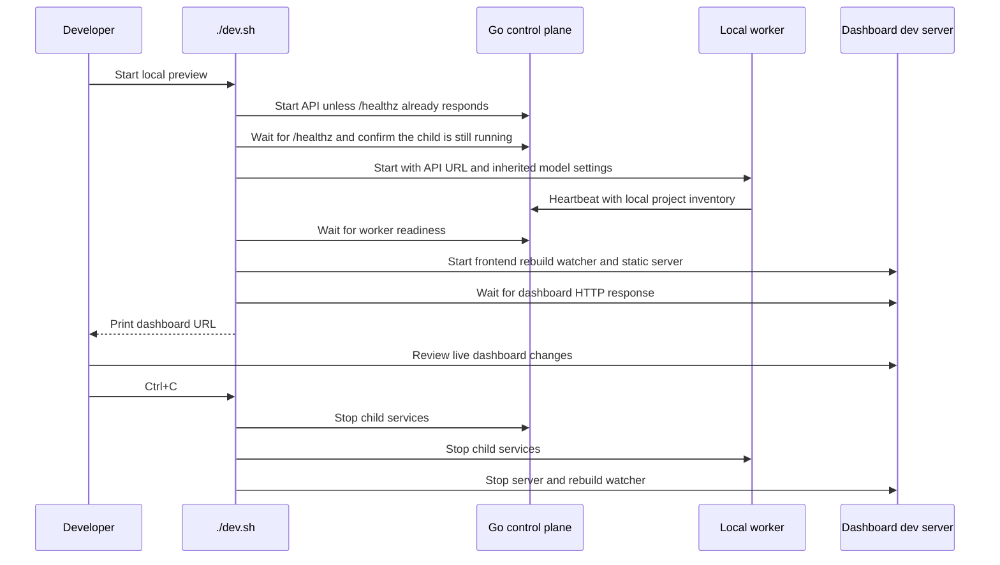

# One-command local preview

`./dev.sh` starts the loopback Go control plane, its local project worker, and the live-reloading dashboard as one
development session. The worker waits for the API, and the script waits until the worker and dashboard are reachable
before printing the dashboard URL. Ctrl+C stops the child services.

The control plane and dashboard bind to loopback by default. The API remains loopback-only until authentication is
implemented. `ZENCHRON_LISTEN_ADDR` and `ZENCHRON_DASHBOARD_PORT` select local ports; `ZENCHRON_PROJECTS_ROOT` selects
the folder scanned by the worker. `ZENCHRON_LLM_BASE_URL` and `ZENCHRON_LLM_API_KEY` are forwarded only to the worker.
The launcher exits with a clear message if the selected service URL is already responding, rather than mistaking an
existing preview for the child process it just started.

Run the preview from the repository root. Install frontend dependencies once with `cd dashboard && npm ci`.

## Focused verification

Run `sh -n dev.sh dashboard/dev.sh`, then start the preview with isolated local ports and check `/healthz`,
`/api/v1/workers/healthz`, and the dashboard URL before stopping it with Ctrl+C. Starting a second preview against an
already responding API URL must exit before printing the ready message.
