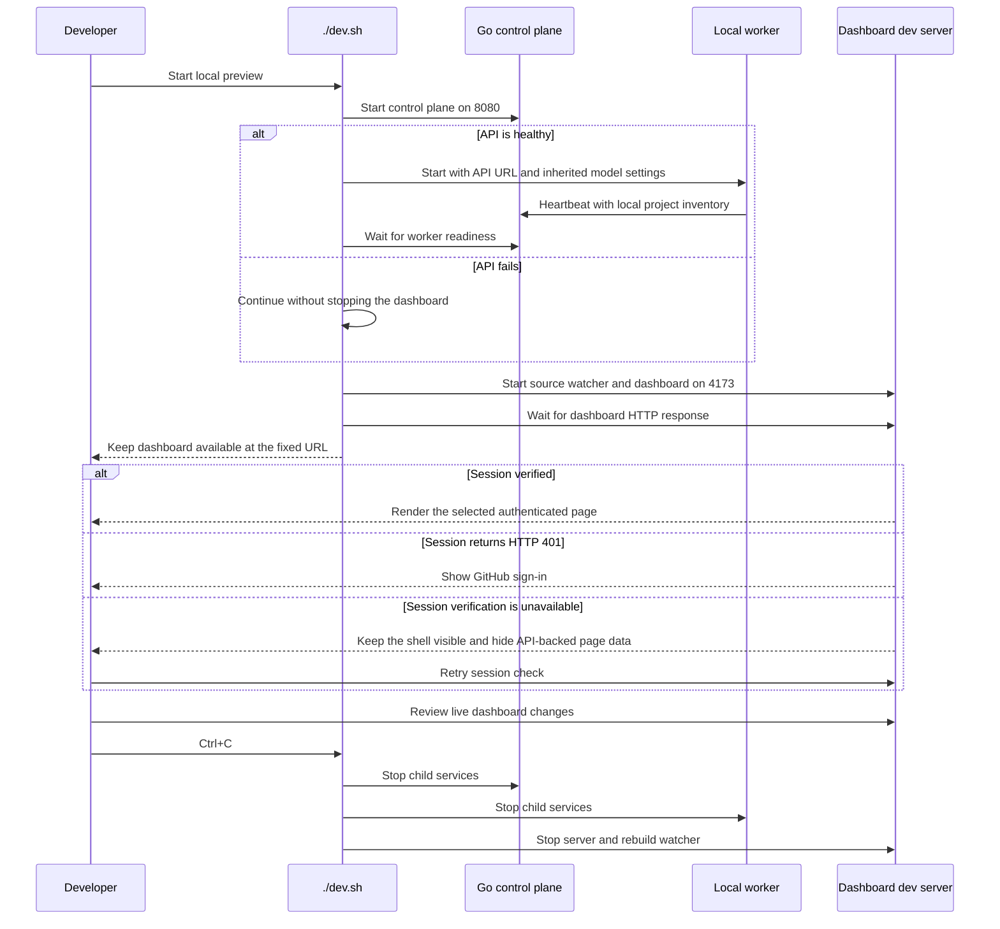

# One-command local preview

`./dev.sh` starts the loopback Go control plane, its local project worker, and the live-reloading dashboard as one
development session. Reserve `127.0.0.1:4173` for the latest dashboard source and `127.0.0.1:8080` for its control
plane and worker so the manual-review URL stays fixed. Focused browser tests use separate temporary ports. Ctrl+C stops
the child services.

The control plane and dashboard bind to loopback by default. Without OAuth settings, the local dashboard signs in as
`Local workspace`; use **Preview sign-in** at the bottom of the sidebar to inspect the login screen. The GitHub button is
disabled in local mode because OAuth is not configured. Exercise real GitHub sign-in by setting the OAuth, session,
allowlist, and public-origin variables from
[GitHub sign-in and remote worker authentication](github-login-and-remote-worker-auth.md) before starting the preview.
The launcher reads optional root `.env.local` before starting services; `.env.*` is ignored by Git. Set its permissions to
`600` and keep client secrets there rather than in tracked files. For loopback login, set `ZENCHRON_PUBLIC_URL` to
`http://127.0.0.1:4173`; the callback is `http://127.0.0.1:4173/auth/github/callback`.
The API can bind to a remote interface only when the GitHub OAuth and worker authentication settings described in
[GitHub sign-in and remote worker authentication](github-login-and-remote-worker-auth.md) are configured.
`ZENCHRON_LISTEN_ADDR` and `ZENCHRON_DASHBOARD_PORT` select local ports; `ZENCHRON_PROJECTS_ROOT` selects
the folder scanned by the worker. `ZENCHRON_LLM_BASE_URL` and `ZENCHRON_LLM_API_KEY` are forwarded only to the worker.
The launcher exits with a clear message if either fixed URL is already responding, rather than mistaking an existing
preview for the child process it just started. If the Go control plane or worker fails after startup, the dashboard
continues serving the latest successful frontend build so layout work remains reviewable. An HTTP 401 shows GitHub sign-in;
if session verification fails for another reason, the dashboard shell stays visible while API-backed page data is hidden and
the user can retry. The fixed ports are reserved for this manual-review preview.

When OAuth is configured, the worker readiness endpoint requires the shared worker bearer token; the launcher uses that
token for its readiness check. OAuth secrets and the worker token are not forwarded to the dashboard process.

Run the preview from the repository root. Install frontend dependencies once with `cd dashboard && npm ci`.

## Focused verification

Run `sh -n dev.sh dashboard/dev.sh` and `node scripts/test_dev_preview.mjs`; `cd dashboard && npm run test:e2e --
e2e/auth.spec.ts` verifies the GitHub sign-in gate and shell fallback when session verification fails. Then start the
preview with isolated local ports and check `/healthz`,
`/api/v1/workers/healthz`, and the dashboard URL before stopping it with Ctrl+C. Starting a second preview against an
already responding API URL must exit before printing the ready message.
