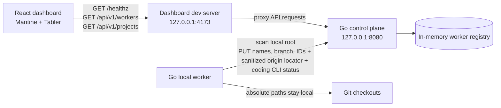

# Local worker presence

The worker-presence and project-discovery slice is the bootstrap milestone. Agent runs and isolated worktree operations described below are additional prototype behavior, not requirements for that milestone.

The first integrated slice proves that the dashboard, Go control plane, and a separate local worker process can
communicate. It reports service and worker presence, discovers Git checkouts at the configured root or one directory
below it, and can execute queued agent runs when the worker has a signed-in Codex or Claude Code CLI. Each run gets
its own branch and [isolated worktree](isolated-worktrees.md); file writes require the profile's `code.write`
permission.

## Feature diagram



```mermaid
sequenceDiagram
    participant W as Local worker
    participant C as Go control plane
    participant D as Dashboard
    W->>W: Scan root and direct child folders for .git
    W->>W: Keep paths and remote credentials local; derive opaque IDs and sanitized origin locator
    W->>C: PUT heartbeat with worker and project names, branch, IDs, sanitized origin locator
    C-->>W: 200 + optional skipped_projects [{id, reason}]
    W->>W: Log skipped local projects when the skipped set changes
    D->>C: GET /healthz
    C-->>D: {status: ok}
    D->>C: GET /api/v1/workers and /api/v1/projects (every 5s)
    C-->>D: Worker and project names, last heartbeat, online/offline status
```

## Run it

From the repository root, start the control plane, worker, and dashboard in separate terminals:

```sh
go run ./cmd/zenchron
```

```sh
go run ./cmd/zenchron-worker
```

```sh
cd dashboard && npm run dev
```

Open <http://127.0.0.1:4173>. The dashboard dev server rebuilds the React app on source changes and proxies API requests to the control plane.

## API

- `GET /healthz` returns `{"status":"ok"}`.
- `PUT /api/v1/workers/{id}/heartbeat` upserts a worker name, server timestamp, and complete project snapshot. Its response includes `skipped_projects: [{id, reason}]` only when projects were not registered. Reasons are `repository_not_granted` and `project_id_registered_by_another_worker`; the response does not include repository names or details about another worker. Worker IDs must be 32 hexadecimal characters; worker names are trimmed and limited to 128 bytes. Project IDs must be 32 hexadecimal characters; project names are trimmed and limited to 255 bytes. The project `git_remote` field is a sanitized host/repository path with URL credentials and query strings removed.
- `GET /api/v1/workers` returns each worker and its current status.
- `GET /api/v1/projects` returns each discovered checkout, its worker, and online/offline status. A worker is online when its last heartbeat is within 15 seconds.
- `GET /api/v1/workers/healthz` returns `200` while any worker is online and `503` otherwise; it is used by the focused browser check.

The worker sends an immediate heartbeat and repeats every five seconds. When `skipped_projects` changes, it logs one line for each skipped project using the local project name and reason; unchanged results do not repeat every heartbeat. Worker and project IDs are stable opaque hashes derived from machine/user identity and local checkout path; local paths and remote credentials are excluded from heartbeat JSON. A sanitized origin host/repository locator is sent so the control plane can map supported GitHub.com checkouts to issue and pull-request queries, plus top-level pull-request review submission. The worker also reports each installed coding CLI with its version, whether it is ready, and why not; CLI sign-ins and credentials stay local. `ZENCHRON_PROJECTS_ROOT` selects a scan root (default `.`). A Git root is included directly; otherwise only immediate child folders are scanned. The registry is in memory, so restarting the control plane clears the list; a running worker registers again on its next heartbeat.

## Security and scope

The control plane defaults to `127.0.0.1:8080`. A non-loopback listener requires GitHub OAuth credentials, an
allowlist, a session secret, a separate worker token, and an HTTPS `ZENCHRON_PUBLIC_URL`; see [GitHub sign-in and
remote worker authentication](github-login-and-remote-worker-auth.md). The worker defaults to
`http://127.0.0.1:8080` for local development and accepts `ZENCHRON_CONTROL_PLANE_URL` and `ZENCHRON_WORKER_NAME`
overrides. Remote workers require HTTPS and the configured bearer token.

The worker executes agent runs through the Codex or Claude Code CLI it reports ready, each in a worktree it creates
for that run. Optional `code.write` changes stay on a per-run branch. Successful non-empty
runs can push that branch and create or reuse a GitHub pull request when the control plane has GitHub App auth or the
personal-token fallback and the
project has a supported GitHub.com origin. Dashboard-submitted comments and change requests on those pull requests link
back to the run; eligible change requests queue a follow-up pass on the same branch. See [Agent run queue](agent-run-queue.md)
and [GitHub issue sync and pull-request reviews](github-review-sync.md) for execution limits and remaining gaps.

## Focused verification

- `go test ./cmd/zenchron -run 'TestWorkerHeartbeatAppearsInWorkerList|TestWorkerHeartbeatRejectsInvalidIdentityAndName|TestValidGitRemote'` covers heartbeat validation and listing.
- `go test ./cmd/zenchron-worker -run 'TestSendHeartbeatUsesWorkerEndpoint|TestDiscoverProjects|TestRepositoryLocator|TestGitRemoteScrubsCredentials|TestPrepareWorktree'` covers worker discovery, credential-free identity, and worktree execution.
- `cd dashboard && npm run test:e2e -- e2e/home.spec.ts --grep 'Projects page shows the live local worker inventory'` checks the live worker/project browser view.
- `cd dashboard && npm run test:e2e -- e2e/home.spec.ts --grep 'worker prepares an isolated Git branch'` verifies dashboard-to-worker command delivery and completion.
