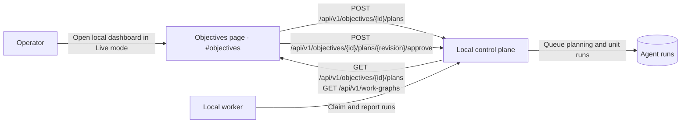

# Local WorkGraph quickstart

Run Zenchron on loopback, create an objective, review a proposed plan, approve it, and follow the resulting WorkGraph.
The steps below describe the local development setup in this checkout.

## Feature diagram

## Start locally

1. From the repository root, install dashboard dependencies once with `(cd dashboard && npm ci)`.
2. Install and sign in to the Codex CLI or Claude Code CLI on this same machine. The local worker discovers these
   providers when it starts.
3. Run `./dev.sh` from the repository root. It starts the control plane at `127.0.0.1:8080`, the local worker, and
   the dashboard at `127.0.0.1:4173`; press Ctrl+C to stop the services.
4. Open <http://127.0.0.1:4173/?mode=live#objectives>. Local dashboard addresses default to Mock mode; Live selects
   data from the local control plane. Mock displays fixtures and does not save changes.

Sources: `README.md`, `dev.sh`, `dashboard/src/main.tsx`, `docs/features/local-preview.md`.

## Create an objective and propose a plan

1. In **Live Objectives**, choose **New Objective**, enter a title and optional details, and select **Create objective**.
   An objective associated with a product offers only its linked repository checkouts in the Plan tab.
2. In **Agents**, create or select an active Codex CLI or Claude Code **producer profile** with `code.write`. Add
   an independent read-only reviewer profile if the workflow requires review. Optionally create a reusable persona and
   bind it to a profile. The control plane validates the assigned profiles and permissions.
3. If you want a repeatable executable sequence, open **Workflows** in Live, create/save a workflow, configure
   supported Agent Task/Test Generator, Code Reviewer, and Integrate nodes and their agent assignments, then use
   **Validate**. Other nodes can remain in saved diagrams but are design-only and cannot be compiled into work.
4. Return to the objective's **Plan** tab and choose an online **Repository checkout**. Under **Planning strategy**,
   choose one of:
   - **Compile a saved workflow**: select an **Executable workflow**. Zenchron deterministically compiles its supported
     nodes and dependencies into the existing objective plan and WorkUnits; the canvas does not run a second engine.
   - **Ask a read-only CLI agent to plan**: select an eligible **Planning agent** without `code.write`. Optionally
     select **Workflow guidance**. The queued planner receives a version-pinned snapshot as guidance, **not** a
     mandatory execution contract. Definitions exceeding the 4 KiB guidance limit are rejected.
5. Choose **Propose plan**. Inspect the proposed plan revision, required units/dependencies, assigned agents/personas,
   instructions, acceptance criteria, and validation problems. Only the latest valid proposed revision can be approved.
   A proposal compiled from a workflow is labeled `compiled`; one informed by planner guidance is `guidance`.
   Existing historical records without that mode display it as unknown.

Sources: `dashboard/src/objectives.tsx`, `dashboard/src/ObjectiveDetail.tsx`,
`dashboard/src/ObjectivePlanPanel.tsx`, `dashboard/src/orchestration.ts`, `dashboard/src/workflows.tsx`,
`cmd/zenchron/orchestration_api.go`, `cmd/zenchron/workflow_compile.go`,
`docs/features/objective-orchestration.md`, `docs/features/workflow-builder.md`.

## Approve and follow the WorkGraph

1. Select **Approve plan and start** on the latest proposed revision. Approval creates a WorkGraph and starts its
   units; if approval is unavailable, read the displayed reason or plan problems. For a changed plan, an existing
   executing graph for that objective must first be cancelled.
2. The graph appears above **Plan revisions** in the same Plan tab. Its overall state is `active`, `blocked`,
   `completed`, `failed`, or `cancelled`. Each unit shows its state, any waiting reason or failure, candidate commit,
   review verdict, run count, and pull-request link when present. The page refreshes graph state every three seconds.
3. If a unit is blocked on a person, read its decision request and submit a resolution. Retry is available for failed
   units; **Cancel work** cancels an unfinished graph. Handoffs, findings, and decisions appear in the graph's message
   list.
   For an approved graph, choose **View delivery report** under **Delivery evidence** in the Plan tab to inspect
   recorded executions, reviews, decisions, usage, missing measurements, and the observed PR link; **Export JSON**
   downloads the same typed report. A PR link alone does not prove external merge status.
4. To inspect the local API's graph data directly, `GET /api/v1/work-graphs` lists graphs; plan revisions are served
   by `GET /api/v1/objectives/{id}/plans`.

Sources: `dashboard/src/ObjectivePlanPanel.tsx`, `dashboard/src/WorkGraphView.tsx`,
`dashboard/src/orchestration.ts`, `cmd/zenchron/orchestration_api.go`, `cmd/zenchron/work_graph_reconcile.go`,
`docs/features/objective-orchestration.md`.

## Verification references

The existing focused checks cover the end-to-end dashboard flow and the control-plane lifecycle:

- `(cd dashboard && npx playwright install chromium)` (once per machine)
- `(cd dashboard && ZENCHRON_E2E_DASHBOARD_PORT=4174 npm run test:e2e -- e2e/orchestration.spec.ts)`
  Choose an unused port; this prevents Playwright from reusing a running dashboard and writing into its local data.
- `go test ./cmd/zenchron -run 'TestObjectiveRunsParallelProducersThroughReviewRemediationIntegrationAndOnePullRequest|TestDecisionRequestBlocksItsUnitUntilAPersonResolvesIt' -count=1`

These commands are listed with orchestration coverage in `docs/features/objective-orchestration.md`; they were not run
as part of this documentation change.
