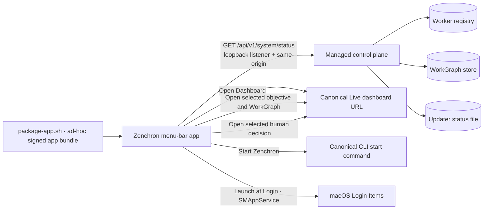

# macOS menu-bar companion

This partial native macOS companion attaches to the managed local installation. It does not launch a second control
plane, worker, dashboard, updater, or store. One per-user lock limits the process to one visible status item.

## Feature diagram



## Behavior

- The menu reports control-plane connectivity and release revision, online worker count, active and blocked graphs,
  queued/running/waiting/failed units, pending decisions, and the recorded updater state. When available, it also
  shows the candidate revision and current progress; blocked or failed updates include the recorded reason.
- When work is active, the menu offers the five most recently updated active WorkGraphs. Each opens its exact
  objective plan in the existing Live dashboard. It also offers up to five most recently recorded unresolved human
  decisions, linked to their exact objective, graph, and decision in the existing plan view. Aggregate counts still
  cover all graphs; cancelled graph decisions remain in history but are excluded from pending-action counts.
- `GET /api/v1/system/status` is read-only, `no-store`, and admitted without a browser session only when the control
  plane is configured to listen on loopback and the request is same-origin loopback. A configured updater status file
  that cannot be read is reported as unavailable without exposing its path or raw error; work and worker status remain
  available.
- Cancelled WorkGraphs remain in history but their unresolved decisions are excluded from actionable status counts and
  menu links. Blocked WorkGraphs still expose unanswered decisions.
- **Open Dashboard** uses the canonical URL returned by the control plane, after validating its host and port.
- When disconnected, the menu shows the disconnected condition and offers **Start Zenchron**, which invokes the
  existing `~/.local/bin/zenchron-engineering start` command. Quit exits only the menu-bar process.
- A process lock prevents another companion instance for the same user from adding a second icon.
- **Launch at Login** is opt-in and uses `SMAppService.mainApp`. The menu reflects macOS registration state, directs approval-required cases to System Settings, and reports registration errors. It never starts or stops the engineering services.
- Status refreshes continue while the menu is tracking and older network responses cannot overwrite a newer refresh.
  Decision rows include requester and decision ID so same-title decisions remain distinguishable.

## Build and run

Requires macOS 13 or newer and the Swift command-line tools:

```sh
swift test --package-path macos/ZenchronMenuBar
swift build -c release --package-path macos/ZenchronMenuBar
macos/ZenchronMenuBar/.build/release/zenchron-menubar
macos/ZenchronMenuBar/Scripts/package-app.sh "$HOME/Applications/builds"
open "$HOME/Applications/builds/Zenchron Menu Bar.app"
swiftc macos/ZenchronMenuBar/Sources/ZenchronStatusCore/SystemStatus.swift \
  macos/ZenchronMenuBar/Scripts/status-self-check.swift -o /tmp/zenchron-status-self-check
/tmp/zenchron-status-self-check
```

The package script refuses to overwrite an existing app bundle and ad-hoc signs the generated `.app`. Move it to a
stable user-controlled location before enabling Launch at Login; registering a temporary build path would leave a
broken login item after the bundle moves. Quit exits only the menu-bar process.

## Limits

This is a partial #387 implementation. The app bundle is locally ad-hoc signed, not Developer ID signed or notarized;
the feature does not yet install/update a stable managed app path or verify login-item approval, updater-generation
reconnect, CPU/memory, or token/cost telemetry. The control-plane API and app are macOS-local; CI on non-macOS hosts
does not exercise the menu UI. No live restart/wake/update acceptance is claimed.
