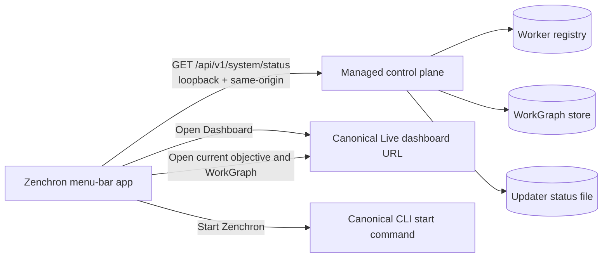

# macOS menu-bar companion

This partial native macOS companion attaches to the managed local installation. It does not launch a second control
plane, worker, dashboard, updater, or store. One per-user lock limits the process to one visible status item.

## Feature diagram



## Behavior

- The menu reports control-plane connectivity and release revision, online worker count, active and blocked graphs,
  queued/running/waiting/failed units, pending decisions, and the recorded updater state.
- When work is active, the menu links to the most recently updated active WorkGraph's exact objective plan in the
  existing Live dashboard. The status API returns that graph and objective's IDs and title with the aggregate counts.
- `GET /api/v1/system/status` is read-only, `no-store`, and admitted without a browser session only for a same-origin
  loopback request. It returns bounded aggregate counts and one active graph link, not graph contents, credentials, or
  provider data.
- **Open Dashboard** uses the canonical URL returned by the control plane, after validating its host and port.
- When disconnected, the menu shows the disconnected condition and offers **Start Zenchron**, which invokes the
  existing `~/.local/bin/zenchron-engineering start` command. Quit exits only the menu-bar process.
- A process lock prevents another companion instance for the same user from adding a second icon.

## Build and run

Requires macOS 13 or newer and the Swift command-line tools:

```sh
swift test --package-path macos/ZenchronMenuBar
swift build -c release --package-path macos/ZenchronMenuBar
macos/ZenchronMenuBar/.build/release/zenchron-menubar
swiftc macos/ZenchronMenuBar/Sources/ZenchronStatusCore/SystemStatus.swift \
  macos/ZenchronMenuBar/Scripts/status-self-check.swift -o /tmp/zenchron-status-self-check
/tmp/zenchron-status-self-check
```

The app can be quit from its menu. It is not yet installed at a stable managed path or registered to launch at login.
Registering the current SwiftPM build path would leave a broken login item after the executable moves, so this waits on
canonical companion packaging.

## Limits

This is a partial #387 implementation. It does not yet provide Launch at Login, updater-generation reconnect
verification, multiple selectable work-item links or decision deep links, CPU/memory or token/cost telemetry, or a
signed `.app` installer. The control-plane API and app
are macOS-local; CI on non-macOS hosts does not exercise the menu UI. No live restart/wake/update acceptance is claimed.
