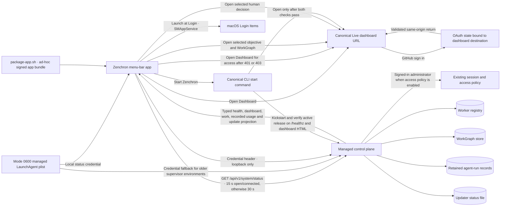

# macOS menu-bar companion

This partial native macOS companion attaches to the managed local installation. It does not launch a second control
plane, worker, dashboard, updater, or store. One per-user lock limits the process to one visible status item.

## Feature diagram



## Behavior

- The menu reports control-plane connectivity and release revision, online worker count, provider readiness reported
  by online workers, active and blocked graphs,
  queued/running/waiting/failed units, pending decisions, and the recorded updater state. When available, it also
  shows the candidate revision and current progress; blocked or failed updates include the recorded reason.
- Usage totals come only from the retained agent-run records. The menu shows how many retained runs reported token
  usage and cost; missing provider data and totals that cannot be represented safely remain unknown. These are not
  all-time totals and do not estimate provider billing.
- Dashboard availability is reported from the installed release's regular `index.html` file. Missing or older-server
  availability evidence is shown as unavailable/unknown and degrades the icon rather than implying the dashboard is
  healthy.
- The menu-bar icon distinguishes connected/idle, active work, action required, updating, degraded, and disconnected
  states from those same API fields. Update failure or worker loss cannot display as a healthy idle icon.
- When work is active, the menu offers the five most recently updated active WorkGraphs. Each opens its exact
  objective plan in the existing Live dashboard. It also offers up to five most recently recorded unresolved human
  decisions, linked to their exact objective, graph, and decision in the existing plan view. Aggregate counts still
  cover all graphs; cancelled graph decisions remain in history but are excluded from pending-action counts.
- `GET /api/v1/system/status` is read-only and `no-store`. The managed installer generates a local status credential
  in the mode-0600 LaunchAgent plist; the companion reads it and sends it in a request header. The endpoint also
  requires a loopback connection, so client-controlled Host and Origin headers alone cannot authorize a request.
  The control plane accepts the same credential from its process environment and reads the plist value when an
  already-running supervisor predates that environment entry. Re-running install repairs the plist without
  restarting the supervisor or interrupting active work.
  Configured authentication still requires a valid session, and access-policy installs still require an administrator;
  the local credential does not bypass either check. An unreadable access policy fails closed. A configured updater
  status file that cannot be read is reported as unavailable without exposing its path or raw error; work and worker
  status remain available.
- The menu distinguishes a missing session from missing administrator access and does not offer Start when either
  response means the local service is responding but its status is not authorized. It offers **Open Dashboard for
  access**, using the canonical local dashboard URL, so the operator can sign in there. The companion does not share
  the browser session; its own status remains unavailable until a secure session-sharing path exists. When a selected
  dashboard deep link prompts for GitHub sign-in, OAuth returns to the same-origin page and mode after sign-in.
  Invalid or oversized selections are omitted so one bad value does not discard valid navigation; the server still
  validates the final return path and binds it to the OAuth flow.
- Cancelled WorkGraphs remain in history but their unresolved decisions are excluded from actionable status counts and
  menu links. Blocked WorkGraphs still expose unanswered decisions.
- **Open Dashboard** uses the canonical URL returned by the control plane, after validating its host and port.
- When disconnected, the menu shows the disconnected condition and offers **Start Zenchron**, which invokes the
  existing `~/.local/bin/zenchron-engineering start` command. The CLI opens the dashboard only after `/healthz`
  reports the current active release revision and the root page returns HTML without redirecting. The CLI refreshes
  the active revision during readiness polling, so an update that activates while it is waiting is accepted. A stopped,
  unhealthy, or unrelated service on port 8080 is not opened. Quit exits only the menu-bar process.
- A process lock prevents another companion instance for the same user from adding a second icon.
- **Launch at Login** is opt-in and uses `SMAppService.mainApp`. The menu reflects macOS registration state, directs approval-required cases to System Settings, and reports registration errors. It never starts or stops the engineering services.
- The app polls every 15 seconds while its menu is open and connected, and every 30 seconds while closed or disconnected,
  so the visible icon can reflect loss of the local service without busy polling. Older network responses cannot
  overwrite a newer refresh.
  Decision rows include requester and decision ID so same-title decisions remain distinguishable.

## Build and run

Requires macOS 13 or newer and the Swift command-line tools:

```sh
swift test --package-path macos/ZenchronMenuBar
swift build -c release --package-path macos/ZenchronMenuBar
macos/ZenchronMenuBar/.build/release/zenchron-menubar
macos/ZenchronMenuBar/Scripts/package-app.sh "$HOME/Applications/builds"
open "$HOME/Applications/builds/Zenchron Menu Bar.app"
swiftc macos/ZenchronMenuBar/Sources/ZenchronStatusCore/SystemStatus.swift \
  macos/ZenchronMenuBar/Scripts/status-self-check.swift -o /tmp/zenchron-status-self-check
/tmp/zenchron-status-self-check
```

The package script refuses to overwrite an existing app bundle and ad-hoc signs the generated `.app`. Concurrent
packaging attempts can publish only one top-level bundle; a losing attempt reports the existing destination without
nested bundles. Move it to a
stable user-controlled location before enabling Launch at Login; registering a temporary build path would leave a
broken login item after the bundle moves. Quit exits only the menu-bar process.

## Release signing

The ad-hoc signature is for local packaging checks only. For distribution outside the Mac App Store, sign the app and
each executable with a **Developer ID Application** certificate. Apple's notarization guidance requires a Developer
ID signature, Hardened Runtime, and a secure timestamp; submit the finished app or distribution archive with
`notarytool`, wait for an accepted result, then staple and verify the ticket before release. The current package
script does not do those steps, and this repository has no verified notarized release. See Apple's [Developer ID
signing guidance](https://developer.apple.com/developer-id/) and [notarization requirements](https://developer.apple.com/documentation/security/notarizing-macos-software-before-distribution).

GitHub CI's macOS job runs the Swift tests and packages the app. It does not exercise the menu UI, Login Items,
Developer ID signing, notarization, or update/restart behavior.

## Limits

This is a partial #387 implementation. Authenticated installations currently require a signed-in administrator for
the menu status API, but the companion does not yet share the browser session; unauthenticated single-user local mode
works. The app bundle is locally ad-hoc signed, not Developer ID signed or notarized; the feature does not yet
install/update a stable managed app path or verify login-item approval, updater-generation reconnect, or CPU/memory.
Token/cost telemetry is limited to available retained run records. The control-plane API and app are macOS-local; CI
on non-macOS hosts does not exercise the menu UI.
No live restart/wake/update acceptance is claimed.
