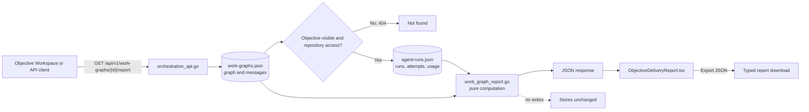

# Objective delivery report

The Objective Workspace exposes the read-only delivery report for an approved WorkGraph. It summarizes only recorded
plan, unit, agent, handoff, review, decision, integration, publication, duration, usage, and failure evidence.

## Feature diagram

## Behavior

- `GET /api/v1/work-graphs/{id}/report` returns a report from durable records only. It never reconciles or persists.
  An unknown graph id or a graph the caller may not read returns 404.
- Top-level `graph_id`, `objective_id`, `objective_title`, `plan_revision`, and `status` identify the graph and its
  objective and report the graph's plan revision and status.
- Top-level `units` is an array. Each unit has `key`, `kind`, `agent_name`, and `state`; `candidate` and `verdict` are
  omitted when empty; `run_ids` is always an array. `attempts` sums the `attempts` counter of its runs. A run id
  without a stored run adds nothing. `providers` is always an array of sorted distinct strings, each containing the
  run's provider and, when recorded, a space and its provider version.
- `approved_plan` records the approved revision, content hash, summary, approver, and approval time. Workflow identity
  and version come from the compiled plan and graph. Each execution reports the recorded profile and persona IDs,
  names and versions, provider, candidate commit, worker-reported verification, review verdict, publication state, PR
  link, attempts, and failures. Verification belongs to that run; it is not an independent assurance record.
  Handoffs, decisions and unresolved steps are shown from immutable WorkGraph messages and state.
- `unknown_evidence` names evidence the current records cannot establish: candidate tree SHA, publication authority,
  and current pull request state. A PR URL or recorded publication result does not establish whether GitHub still
  considers the PR open, merged, or closed.
- Top-level `measurements` contains:
  - `unit_count`: number of units.
  - `run_count`: number of all run ids, including ids without a stored run.
  - `attempt_count`: sum of unit attempt counts.
  - `failed_attempts`: finished attempts whose status is not `succeeded`.
  - `max_concurrency`: largest number of attempts overlapping in their half-open
    `[started_at, finished_at)` intervals. An unfinished attempt is open-ended.
  - `review_rounds`: number of run ids belonging to review units.
  - `findings`, `decisions_requested`, and `decisions_resolved`: counts of messages of type `finding`,
    `decision_request`, and `decision_resolution`, respectively.
  - `human_actions`: resolved decisions plus the recorded plan approval. `human_actions_complete` is false because
    the system does not record every human action.
  - `remediation_passes`: for each produce unit, each attempt after its first when a finding addressed to that unit
    was created between the previous attempt's start and its own start.
  - `input_tokens` and `output_tokens`: sums from runs that have usage; `runs_with_usage` shows coverage. Missing
    usage for some runs is listed in `measurements.unknown`.
  - `cost_usd`: sum from runs that reported a cost; `runs_with_cost` shows coverage. Missing cost for some runs is
    listed in `measurements.unknown`.
  - `wall_clock_seconds`: elapsed time from graph creation to update, present only when status is `completed`;
    otherwise it is omitted and listed in `measurements.unknown`.
  - `unknown`: always a sorted array. It includes unrecorded supervision duration and untracked human actions.
    Recorded values are not invented; unavailable or partial measurements are named here.
- Top-level `pull_request_url` is included when the integrate unit has one. Otherwise it is omitted and never listed
  in `measurements.unknown`.

## Verification

| Test | Proves |
|---|---|
| `TestWorkGraphReportMeasuresACompletedRun` | Measures a completed run. |
| `TestWorkGraphReportOmitsWhatWasNotRecorded` | Omits unrecorded measurements and lists them in `unknown`. |
| `TestWorkGraphReportIsHiddenFromOtherCallers` | A caller who may not read the graph receives no report. |
| `TestPlanPinsProfileConfigurationAndRejectsStaleApproval` | The approved report source keeps profile/persona versions through restart and edits. |

The Objective Workspace offers a typed JSON export. The browser validates its response shape before displaying or
exporting it; partial usage and human-action measurements remain explicitly qualified.

Commands: `go test ./cmd/zenchron -run 'TestWorkGraphReport|TestPlanPinsProfileConfiguration' -count=1`; the
focused Playwright acceptance lives in `dashboard/e2e/orchestration.spec.ts`.
