# Objective management

The Objectives screen follows the supplied planning mockup in one layout for both data modes
(`docs/architecture/dashboard-modes.md`). Mock shows the approved fixtures; Live lists, filters, creates, and updates
objectives through the control plane. It uses Mantine forms and controls, Zod validation, TanStack Query, Tabler
icons, and the installed AG Grid Community table.

## Feature diagram

```mermaid
flowchart LR
    User[Engineering user] --> Page["ObjectivesPage · objectives.tsx<br/>filters, views, create dialog"]
    Page --> Detail["ObjectiveDetail.tsx<br/>summary, tabs, editor, milestones"]
    Page -->|reads| Source{"ObjectivesSource · objectivesView.ts"}
    Detail -->|reads| Source
    Source -->|Mock| Mock["useMockObjectives · objective-preview.ts<br/>fixtures in useState, no requests"]
    Source -->|Live| Live["useLiveObjectives<br/>TanStack Query"]
    Page -->|"create(input) after Zod validation"| Source
    Detail -->|"update(id, input) after Zod validation"| Source
    Live -->|"GET /api/v1/objectives"| API[Go control plane]
    Live -->|"GET /api/v1/products"| API
    Live -->|"POST /api/v1/objectives"| API
    Live -->|"PATCH /api/v1/objectives/{id}"| API
    API --> Store[(Versioned JSON snapshot)]
    API --> Products[(products.json)]
    Products -->|Validate product id and resolve current name| API
    Page -->|Text, product, owner, status, due-quarter filters| Records[Filtered objective records]
    Records -->|Table| Grid[AG Grid list with numbered pager]
    Records -->|Cards, Kanban, Planning, Roadmap| Views[Objective cards]
    Grid -->|Select| Detail
    Views -->|Select| Detail
```

## Behavior

- `GET /api/v1/objectives` returns workspace objectives, newest first.
- `POST /api/v1/objectives` validates title, description, owner, an optional saved `product_id`, and optional
  `YYYY-MM-DD` due date; new objectives start `in_progress` at 0%.
- `PATCH /api/v1/objectives/{id}` accepts title, description, owner, due date, status, progress, and/or product assignment.
  It validates field lengths and date format; progress is limited to 0–100, and marking an objective `completed` sets
  progress to 100.
- Successful create and edit responses cancel any in-flight list read, update the cache from the returned record, then
  refetch the canonical list so a stale request cannot overwrite the selected details.
- The table reselects the active objective after row data refreshes, keeping the highlighted row and detail panel in
  sync after creates and edits.
- Only a person's choice in the table (a row click, checkbox, or keyboard selection) changes the selected objective.
  The table's delayed report of a selection the page made itself is ignored, so it cannot replace an objective that
  was created or chosen in the meantime and send a later edit to a different objective.
- The dashboard searches title, description, owner, and product, and filters by product, owner, status, and due-date
  quarter. The default is This Quarter; All due dates includes unscheduled objectives.
- The table uses a numbered footer pager that stays in sync with AG Grid, six rows to a page, in both modes.
- The Objective, Planning, and Roadmap tabs sit in a separate toolbar above the table card, with the table and capacity
  chart kept as distinct cards below it.
- Mock (local addresses only) shows the approved fixtures and never calls the objective or product APIs. Create, edit,
  and favorite change the fixtures in the browser tab only, and their confirmations end with "in this preview only".
- Live shows only control-plane data in the same frame. The KPI row reports the completed count, the completed share,
  and the status counts, without the fixture trend badges and graphics. Table IDs and the detail ID badge show the
  first eight characters of the objective ID.
- Parts of the design the objective API does not hold say so in Live: Approval and Workflows read "Unavailable" in the
  detail panel and "—" in the table; Blockers, Acceptance Criteria, Related PRs, Activity Feed, the Milestones,
  Related PRs, and Activity tabs, Milestone Progress, and the capacity chart show "Unavailable" with the reason; the
  favorite button is disabled with the reason. Plan Summary lists the target, created, and last-updated dates.
- A failed list request shows "Could not load objectives." with a retry and "—" in the KPI cards; fixtures are never
  shown in Live. Failed creates and edits show the server's message in the form.
- The detail header shows the objective ID as a badge beside the title and the due date beside the completion bar.
  Copy objective link copies a deep link (`?objective=<id>#objectives`) that selects that objective. The more-actions
  menu holds **Edit objective**, View related PRs, and View activity; overview card shortcuts and each table row menu
  open the matching tab.
- On a phone the status badge and the three header actions keep their full width; the title wraps instead.
- The search row above the table is hidden only in Mock at the approved desktop frame (1351px or wider and 840px or
  taller), which has no room for it; Live keeps search, the count, and retry visible at every size.
- Empty workspaces prompt the user to create the first objective. When filters hide all records, the table and toolbar say no objectives match instead of implying the workspace is empty.
- Table, Cards, and Kanban views render the same filtered records; selecting any record opens the read-only objective overview. The title, description, owner, due date, status, progress, and product editor replaces the tab body only after choosing **Edit objective** from the more-actions menu; **Cancel edit** or any tab closes it, and the panel keeps showing the saved record while editing. Kanban groups by the saved objective status.
- The overview, milestones, related pull requests, and activity tabs switch the detail panel. Tabs without supported data show an unavailable state.
- The detail tabs are a bordered segmented control with a filled selected tab.
- The overview lays out description, blockers, acceptance criteria, related pull requests, plan summary, and activity feed; fields absent from the current objective data are labeled unavailable rather than populated with sample records.
- Planning sorts the filtered objectives by due date, with undated records last. Roadmap groups those same records by calendar quarter and places missing or invalid dates under Unscheduled. Both views use saved objective data and open the overview panel when a card is selected.
- Product assignment uses the durable product ID; the control plane resolves the current product name in the objective
  response, so a product rename does not break the relationship or wait on a second dashboard query. Older free-text
  product values remain visible as unlinked legacy labels.
- Objective records survive API restarts. The control plane writes an atomic versioned JSON snapshot in its data
  directory.
- Invalid or unsupported state files stop startup; the API does not silently replace existing data with an empty store.
- Existing objective snapshots without `product_id` load as unlinked. Once a linked record is written, pre-feature
  binaries reject that new field; roll back only after unlinking those records or restoring a compatible snapshot.

## Verification

`go test ./cmd/zenchron` covers objective API updates, product linking, validation, and persistence. The focused E2E
suite covers the Mock frame with its KPI icons, overview shortcuts, row menus, and local-only create and edit; the Live frame with
honest unavailable parts, validation, and failed loads and saves; empty states, search and filters,
table/cards/Kanban/planning/roadmap views, full objective create/edit payloads, an edit that still reaches the
created objective when the table reports its first selection late, and responsive layouts. The mobile layout check asserts that every
milestone row remains inside the preview card:
`cd dashboard && npm run test:e2e -- e2e/objectives-views.spec.ts`.

Playwright review captures at the mock viewport are in `docs/screenshots/`.
