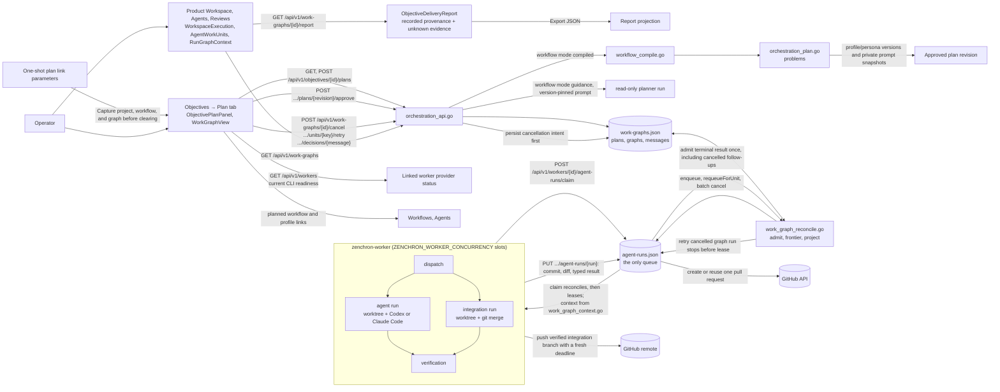

# Objective orchestration

From one objective, Zenchron proposes an engineering plan, validates it, and after approval coordinates the smallest
team of Codex CLI and Claude Code agents the plan names: independent producers run at the same time in separate
worktrees, their typed handoffs reach reviewers and the integrator automatically, findings go back to the producer that
owns them, the candidates are merged deterministically and verified together, and one pull request is published. Nobody
copies a prompt, a finding, or an answer between agents. The design, its six lifecycle diagrams, and the component
decisions are in [Objective orchestration: architecture and decisions](../architecture/objective-orchestration.md).

## Feature diagram

## Behavior

### Plans

- **Source check at approval.** Approving a plan for a GitHub repository first queues a source-check run on the
  plan's worker (`verify_source`; no provider, no worktree). The approve request answers 202 while it runs, and the
  dashboard asks again until it finishes. Approval then proceeds only on a check that succeeded within the last two
  minutes, and only when its commit equals the commit the plan's planner run read. The graph is created with that
  commit pinned as `base_commit` before any unit is dispatched. A failed check (stale, ahead, diverged, or origin
  unreachable) or a source that moved since planning refuses approval with both commits, and approving again starts a
  fresh check; a plan whose source moved must be proposed again. Plans for checkouts without a GitHub repository are
  not checked.
- **One base per graph.** The graph pins `base_commit` from its first successful root run, which the worker verified
  equals origin's default branch. Later root runs and integration start from that commit (see
  [Isolated worktrees](isolated-worktrees.md)), and a root run from another base fails its unit.
- `POST /api/v1/objectives/{id}/plans` records a new revision. The body names an online `project_id`, an optional
  `workflow_id`, and either a `plan` or a `planner_agent_id`. A planner must be an active Codex or Claude Code profile
  without `code.write`; it runs as an ordinary read-only run and its typed result is the proposal.
- A supplied manual plan cannot claim a saved workflow. Selecting a workflow with no planner compiles its saved,
  versioned definition into WorkUnits. Selecting a workflow with a planner instead pins the complete saved definition
  into that planner run's prompt as guidance; the planner still proposes the actual WorkUnits. Plans, WorkGraphs and
  delivery reports distinguish `compiled` from `guidance`. Legacy records without a mode are displayed as unknown.
  Planner guidance is limited to 4 KiB so it fits the existing bounded run prompt; larger definitions are rejected.
- When an objective belongs to a product, the dashboard limits repository choices to that product's linked checkouts
  with an online worker. Legacy objectives without a product keep the existing all-checkouts selection.
- A plan has 1 to 8 units of kind `produce`, `review`, or `integrate`, each with a key, title, instructions, acceptance
  criteria, dependencies, capabilities, and (for agent units) profile and persona IDs and versions; `max_parallel`
  ranges from 1 to 4 (default 2).
- A workflow plan is compiled from its saved, versioned definition. Supported nodes produce normal WorkUnits:
  Agent Task and Test Generator become producers, Code Reviewer becomes an independent reviewer, and Integrate and
  Publish becomes the existing deterministic integration unit. Unsupported visual nodes remain visible and make the
  workflow invalid for compilation.
- Plan revisions link to their selected workflow and assigned profiles. Their pinned configuration is labeled as planned;
  WorkGraph and delivery-report views show the recorded assignments and execution state.
- The plan stores a private snapshot of each assigned profile and persona. A profile or persona edit between proposal
  and approval makes the proposal stale and approval returns 409. After approval, queued runs and retries use the
  pinned effective configuration. The worker receives only composed instructions and the original profile tool
  allowlist; persona text cannot grant tools or weaken sandbox controls.
- In Live Objectives, the plan shows current CLI readiness for each assigned profile on the selected repository's
  worker. An unavailable CLI does not invalidate a structurally valid plan; its durable run stays queued until that
  worker reports the required provider ready. Planner runs show the same readiness before submission.
- The Plan tab keeps repository and workflow choices available while saved graph and plan history load; those
  histories display their own loading state.
- A plan is refused, with every problem listed, when: a key is malformed or repeated; a dependency is unknown or forms
  a cycle; there is no produce unit or not exactly one integrate unit; a produce unit never reaches the integrate unit; a produce unit
  builds on more than one produce unit; a produce unit's profile is missing, disabled, has no CLI adapter, cannot
  write code, or lacks a listed capability; a review unit does not review exactly one produce or integrate unit; a
  reviewer's profile may write code or produced the work it reviews; the integrate unit names an agent.
- A plan submitted in the body that is invalid is answered with 400 and stored nowhere. A planner's invalid plan is
  stored as an `invalid` revision with its problems.
- An objective keeps at most 20 plan revisions. Plans and graphs are returned only to callers who may see the
  objective and hold a grant for the plan's repository.
- Only the latest `proposed` revision can be approved. Approval is refused with 409 while another plan of the objective
  is executing; that graph must be cancelled first. Proposing a plan identical to the executing one returns the
  approved revision and creates nothing. Approving an approved revision returns its graph.

### WorkGraph

- An approved plan becomes a graph with a stable id and a revision that increases with every persisted change. Each
  unit keeps the ids of every run that executed it.
- Unit states are `waiting`, `queued`, `running`, `blocked`, `completed`, `failed`, and `cancelled`, with a reason for
  waiting and blocked units and a failure for failed ones. Graph status is `active`, `blocked`, `completed`, `failed`,
  or `cancelled`.
- A produce unit starts when everything it depends on is settled. It is completed only by an admitted handoff with a
  commit; a successful exit without one produces a finding against the unit and another attempt.
- A produce unit that depends on a produce unit starts from that unit's branch.
- A failed unit blocks the units that depend on it; other units finish. `POST .../units/{key}/retry` starts a fresh run
  for a failed unit; a retried producer continues from its previous branch.
- Requeueing remediation, decision-resolution, or publication clears the prior admission attempt. If that queued pass
  is cancelled before a worker leases it, reconciliation records the cancellation as a unit failure even though the
  run's attempt count has not advanced.
- `POST .../cancel` persists the graph intent before cancelling runs. Queued and running run changes share one
  atomic run-store write; a failed write leaves the graph cancelled and reconciliation retries before workers can lease
  more work, including after restart. A failed intent write leaves every run unchanged.
- After a restart the run store requeues interrupted attempts, and the graph adopts any run that was queued for a unit
  but not yet recorded on it, so no work is queued twice.

### Typed results and messages

- An agent ends its final message with one fenced `zenchron-result` block holding one JSON object: `handoff`
  (summary, notes), `review` (verdict `accept`, or `block` with 1 to 10 findings), `decision_request` (question,
  options), and optionally `collaboration_requests` and `state_updates`. The limits are 48 KiB for the block and
  bounded lengths per field; an unknown member rejects the result.
- Messages are `handoff`, `collaboration_request`, `finding`, `decision_request`, `decision_resolution`, and
  `state_update`. Each records its sender, recipients, run, attempt, and the commit the worker reported. Messages are
  never changed or removed.
- A run's context is rebuilt when it is claimed: the objective, the unit's acceptance criteria, the latest handoff of
  each dependency, requests addressed to the unit, findings and decisions since its own latest handoff, and for a
  review the candidate commit and its diff (up to 60 KiB).

### Delivery report

- `GET /api/v1/work-graphs/{id}/report` projects the approved plan revision, graph units, stored run attempts,
  handoffs, decisions, candidate identity, publication authorization, and observed GitHub PR/check state. It does not
  change graph state. JSON export downloads this report projection.
- A graph may retain a run ID whose durable run record is missing. The report keeps the reference and explicitly marks
  missing run details and the attempt, failed-attempt, concurrency, and producer-remediation totals that are incomplete.
- Worker-derived run output is redacted before it is recorded. Unavailable policy assurance, human supervision, partial
  provider usage, or GitHub observations remain unknown rather than inferred from successful execution or green checks.

### Review and remediation

- A review run starts from the branch of the unit it reviews and may not change files.
- A verdict is admitted only if the review ran on the unit's current candidate; otherwise it is discarded and a fresh
  review starts.
- Findings of a blocking review go to the reviewed producer. For a review of the integrated candidate they go to the
  producer the reviewer named, else the producer that changed the file, else the first producer.
- Remediation is the next attempt of the producer's run; the three-attempt limit of a run applies. A review or
  integrate unit may start six runs.

### Integration and publication

- The integrate unit starts when its dependencies are settled, with every produce unit's branch and admitted commit as
  inputs in plan order. Every producer must be settled, including producers reached only through transitive
  dependencies; an active retry cannot be paired with its previous candidate.
- The worker refuses inputs whose branch moved, aborts a conflicting merge and reports the branch and exact file
  paths, including paths with spaces, and otherwise commits the merges, runs the repository's verification commands on
  the result, and reports the commit.
- A conflict becomes a finding for the producer whose branch did not merge, and integration runs again after that
  producer hands off. Failed verification of the combined candidate fails the unit.
- With reviews of the integrate unit, the candidate is pushed and the pull request created only after they accept, by
  a second pass of the same run. The worker is told the reviewed commit and pushes nothing if the worktree produces
  another one; a push that fails is tried again while the run has attempts. Without GitHub credentials or a GitHub origin the
  unit completes with the candidate on its local branch.
- The pull request names the objective, the graph, and each unit with its agent and candidate. It is never merged.

### Decisions

- A producer that reports a decision request is blocked until a person answers through
  `POST /api/v1/work-graphs/{id}/decisions/{message}`. The caller must be able to see the objective, hold a grant for
  the repository, and be allowed to dispatch to the graph's worker; worker credentials cannot reach the route.
- The resolution is stored with who gave it, and the unit's run is requeued with the question and the answer.

### Dashboard

- Objectives has a Plan tab: propose (checkout, planning agent, optional workflow), every revision with its state and
  problems, approve, then the graph with each unit's state, reason, agent, candidate, verdict, run count, pull-request
  link, Cancel, Retry on failed units, open decisions with a form, and the messages.
- Product Workspace shows the graphs of the selected product's objectives on its Objectives tab. Agents lists the units
  assigned to the selected profile. Reviews labels a unit's run with its objective and unit and, for the integration
  run, shows the combined commits, review verdicts, and findings.
- Workflow Builder validates saved definitions and Objective Workspace compiles them into the same WorkGraph plan.
  It does not run a second workflow engine.
- Mock mode shows one sample graph with every operation disabled and sends nothing.

## Configuration

| Setting | Default | Meaning |
|---|---|---|
| `ZENCHRON_WORKER_CONCURRENCY` | 2 | Runs one worker executes at once, 1 to 8 |
| plan `max_parallel` | 2 | Units of one graph queued or running at once, 1 to 4 |

## Verification

Focused Go tests, through the HTTP API with a fake GitHub (`go test ./cmd/zenchron -run '<name>' -count=1`):

| Test | Proves |
|---|---|
| `TestObjectiveRunsParallelProducersThroughReviewRemediationIntegrationAndOnePullRequest` | Two producers leased together, exact-commit review, routed finding, remediation on the same run, stale verdict discarded, fresh review, exact merge inputs, publication only after the final review, one PR |
| `TestProducerIsNotCompleteWithoutAnAdmittedHandoff` | A successful exit is not completion; attempts bound the retries; dependents are blocked |
| `TestWorkGraphRecoversAfterRestartWithoutQueueingWorkTwice` | Restart recovery and adoption of an unrecorded run |
| `TestIntegrationConflictGoesToItsOwnerAndStaleInputsFailVisibly` | Conflict routing, re-integration, stale inputs, unit retry |
| `TestIntegrationWaitsForRetriedTransitiveProducer` | Integration waits while a retried transitive producer is queued and uses its new branch with its new admitted commit |
| `TestDecisionRequestBlocksItsUnitUntilAPersonResolvesIt`, `TestOnlyAnAuthorizedPersonCanResolveADecision` | Durable decisions, resume, and who may resolve |
| `TestCancellingAGraphStopsItsRunsAndFailedUnitsBlockTheirDependents`, `TestCancelledGraphFollowsItsRunningRunUntilItStops` | Cancellation and failure propagation |
| `TestPublicationPassIsBoundToTheReviewedCommitAndAFailedPushIsRetried` | Only the reviewed commit is published; a failed push is retried |
| `TestAdoptedReviewRunDoesNotInheritTheVerdictOfTheRoundBeforeIt` | A verdict from before a crash cannot approve a newer candidate |
| `TestPlanHistoryIsBoundedAndAPlanNeedsAProducer`, `TestPlansAndGraphsNeedTheRepositoryGrantNotOnlyTheObjective` | Bounded plan history; repository grant on every plan and graph read |
| `TestPlanIsRejectedBeforeAnythingRuns`, `TestChangedPlanCannotReplaceAnExecutingOneAndAnUnchangedPlanNeedsNoNewApproval`, `TestPlannerRunOnlyProposesAndItsPlanIsValidatedLikeAnyOther` | Plan validation, safe plan changes, planner output as a proposal |

Worker tests with a real Git repository and a fake CLI (`go test ./cmd/zenchron-worker -run '<name>' -count=1`):

| Test | Proves |
|---|---|
| `TestWorkerExecutesTwoRunsOfOneCheckoutAtTheSameTimeInSeparateWorktrees` | Real overlap: each provider process waits until it sees the other running |
| `TestWorkerWithOneSlotExecutesQueuedRunsOneAfterTheOther`, `TestRunConcurrencyIsConfigurableAndBounded` | The concurrency limit |
| `TestIntegrationRunMergesExactCandidatesVerifiesTheCombinationAndPublishesOnce` | Deterministic merge, verification of the combination, idempotent publication pass |
| `TestIntegrationRunReportsConflictsAndStaleInputsWithoutCombiningThem` | Exact conflict path with spaces, aborted merge, refused stale input |
| `TestTypedResultIsTheLastFencedResultBlockOfTheFinalMessage` | Result extraction |

Browser, real control plane and worker with the fake Codex CLI
(`cd dashboard && npm run test:e2e -- e2e/orchestration.spec.ts`): unit states and reasons at 1672×941 and 390×844
without horizontal scroll, decision resolution, retry and cancel requests, plan revisions with problems and a refused
approval, empty and failed loads, Mock without writes, the projections in Workspace, Agents, and Reviews, and one plan
approved in the page that runs through a decision, a blocking review, remediation, and integration.

## Live record

Live, on 2026-11-16, with a loopback control plane (`ZENCHRON_GITHUB_TOKEN` set), one worker with two slots,
Claude Code 2.1.322 and Codex CLI 0.167.0, and a dedicated clone of this repository on `feat/objective-orchestration`
whose worker configuration runs `go vet`, `go build`, the `gofmt` check, `go test ./cmd/zenchron`, and the file-size
check as verification. The objective was backlog issue #334, backend slice: a delivery report API for a WorkGraph.

| Step | What happened | Evidence |
|---|---|---|
| Objective | Created through the API with five agent profiles (two writers, two read-only reviewers, one read-only planner) | objective `ea0c9bacd5f9248f37f138d5beaf32e4` |
| Plan, revision 1 | The Claude Code planner proposed one producer; validation refused the plan because its instructions and acceptance criteria exceeded the limits, and approving it answered 409 | planner run `47ff903effce40613763ea836194ed52`; fixed in `c9887d0` (the contract now states the limits) |
| Plan, revision 2 | The operator added a staffing decision (two parallel producers) to the objective; the planner's five-unit plan exceeded the 16 KiB result limit and the worker dropped it | planner run `f152190f57e7073a61edc9604ef3ea43`; fixed in `28acb64` (limit 48 KiB) |
| Plan, revision 3 | Valid: `api` (Claude engineer), `docs` (Codex engineer), `review-api` (Codex reviewer), `integrate`, `review-all` (Claude reviewer); approved in the dashboard's Plan tab | planner run `5e9e88791e4066232c8f7e9dd1b14bc3`; graph `22bca11eeb7e82bfdb1df1bb04a4f28b` |
| Parallel producers | Claude Code and Codex ran at the same time in separate worktrees | `api` run `9e926b3aed9d9830134959479373e992` attempt 1, 08:06:02 to 08:09:55 UTC; `docs` run `2ef35490fc31bd7eae5b797aca29decf` attempt 1, 08:06:02 to 08:07:59 UTC |
| Inadmissible result | The first `api` attempt ended without an admissible typed result; Zenchron wrote a finding against the unit and the same run's second attempt handed off | candidate `01e6fdf118225a24e8d91f6f20dfea6621a9c9c8` |
| Independent review | Codex reviewed Claude's exact candidate and accepted it | review run `ebcaef22da79cce1ec1ddee739805ccc` |
| Integration and restart | The control plane was killed while the integration run was executing; its attempt 1 closed as `lease_expired` and attempt 2 merged both candidates with verification passed | integration run `5ec0e9b4f6d0cfa6ce8fe0fbf6900cee`, commit `35b1fcdab7` |
| Review finding | Claude reviewed the integrated commit and blocked it: the document's Mermaid edge label with an unquoted `{id}` does not parse. The finding was routed by file to `docs` | review run `c6b097bf304798e7be78968f804f42ff` |
| Remediation | Codex fixed it in attempt 2 of its own run | candidate `65f20dc4c0228ade0e159da1e8a6ddea3909f4d0` |
| Fresh integration and review | A new integration run merged the new candidates, verification passed, and a fresh Claude review accepted that commit | integration run `08e70ab84e6e1bafc781756b00d7a0b8`, commit `9ae5c9cd0d6d2e56f200b8c928069655e6e32169`; review run `69e75f0d55e8eefdfb1d2f7c8bddaf49` |
| Publication | The second pass of the integration run pushed the reviewed commit and one pull request was created, not merged | https://github.com/bogdaniel/zenchron-engineering-os/pull/376, head `9ae5c9c`, base `feat/objective-orchestration` |

Measured by the report endpoint that pull request adds, run against a copy of the live data: 5 units, 7 runs, 11
attempts of which 1 failed (the lease lost to the restart), 3 review rounds, 2 findings, 2 remediation passes, 0
decisions, 1 human action recorded by the graph (the approval), largest overlap of attempts 2, 645 s from approval to
completion, 1,295,087 input and 25,810 output tokens, and 3.29 USD reported by Claude Code; Codex reports no cost, and
human supervision time is not recorded anywhere. The three planning runs took another 643,113 input and 39,327 output
tokens and 4.61 USD.

Human actions in total: creating the profiles and the objective, adding the staffing decision, requesting a plan three
times (twice because of the two defects above), approving revision 3 in the dashboard, and killing the control plane
on purpose. No prompt, finding, handoff, or result was copied between agents by a person.

A second live objective was built to conflict (graph `b6303346a2dfd9a7fdcb3f6f91a523f4`, two producers creating the
same file): a cyclic variant of its plan was refused with 400; approving a changed plan while it executed answered
409; proposing the identical plan returned the approved revision; the integration run
`f7d945ef52122a30fd7795628307dd02` failed with `merge_conflict` and the aborted merge; the finding named the file and
went to the producer whose branch did not merge; and cancelling the graph cancelled that producer's queued
remediation. Nothing from it was published.

Two further live objectives, on the build with the review hardening, showed the decision path and a stale result:

| Step | What happened | Evidence |
|---|---|---|
| Decision request | A Codex producer whose wording was a product decision reported a `decision_request` with two options; the graph went `blocked` | graph `5a502b73e4be9fe95c27ebdac383c4f8`, run `0f877a29d92761b5d93591fc07c887b6` attempt 1 |
| Resolution and resume | The decision was answered in the dashboard's Plan tab; the same run was requeued and handed off commit `3ae80ee` | resolution by `local operator`, attempt 2 |
| Defect found | After a reviewer's change request the producer asked the same decision again: its context no longer carried it | fixed in `ce54a82` (a unit keeps every decision made for it); graph cancelled |
| Repeat on the fix | Decision, resolution in the dashboard, handoff `54c3c5c`; after a change request the third attempt applied it without asking again and handed off `ffc0a93` | graph `562f6eaf84b4025606fee931b1d6447f`, run `44facefa420f6eb2e03275b1d1d7c073` |
| Stale verdict | The Claude review had started on `54c3c5c` at 08:45:37 UTC; the candidate became `ffc0a93` at 08:46:15; the verdict arrived at 08:46:39 and was discarded, and a fresh review run started on the new commit | review run `fb12db85ef0791623bb712690635eac0` (base `54c3c5c`), fresh run `56f488f5282a2652e6e840d6a2453c78` |

Both graphs were cancelled before integration; nothing from them was published.

A fifth live objective ran against a clone of `main`, for backlog issue #368, with the worker's verification
extended by `npm ci`, typecheck, and build of the dashboard:

| Step | What happened | Evidence |
|---|---|---|
| Product and objective | A product linked to the `main` checkout and an objective in it | objective `5e957028580207318ca3bd442f123b8d` |
| Plan | The planner's five-unit plan was refused only because it listed capabilities on the integrate unit; the operator resubmitted it with that field emptied and approved it in the dashboard | planner run `c474320c019fc091254203d528425243`; contract fixed in `9ea762f`; graph `dd7d8db3c9bd2cfb59d2ba5648532577` |
| Parallel producers | Claude Code (`csv-module`) and Codex (`csv-spec`) overlapped from 08:55:28 to 08:57:33 UTC | runs `7344f819dfd22fdbc1459c8ddcd908d9`, `ae9d7283661630a35f84ef406e8292f9` |
| Review cycle 1 | Codex blocked the module for unverified validation; second pass; a fresh review accepted `9e0d000` | review runs `f8cc5d91dfc3521dedca519a428b4cb0`, `f691d09cf954972ec937d16af520fdc6` |
| Stale integration input | The operator added a commit to the admitted branch of `csv-spec`; the integration run refused it: "An input branch no longer points at its admitted commit"; unit and graph failed, the dependent review was blocked | integration run `fb9acba6bf171692fefe0810773cb291` |
| Unit retry | The operator restored the branch and retried the unit; a fresh integration run merged both candidates, verification passed | run `cd140323cd66db8c0b78454f95427c73`, commit `dd2f206` |
| Review cycle 2 | Claude blocked the integrated commit: the new spec downloaded before live data had loaded. Routed by file to `csv-spec`; Codex fixed it (`bf61d8d`); re-integration `cdcf073` passed verification and a fresh review | review runs `9295f076edd99230a4ccbcfd65c95fba`, `2beed47d85249ed9bc94c43fa23c8bf8`; integration run `e7a84978adc8214a413a901873683106` |
| Publication | One pull request against `main`, not merged | https://github.com/bogdaniel/zenchron-engineering-os/pull/377, head `cdcf073b4` |

From approval to completion it took 12 min 33 s. While GitHub was creating the pull request the unit showed
`blocked` for about a second; fixed in `c69a195`. Human actions: creating the product and objective, correcting and
resubmitting the plan, approving it, and the deliberate branch change, restore, and retry.

### Measurements and a single-agent baseline (#279)

The same task (issue #368, the objective text without the staffing decision) was also run once through the existing
single-agent path: one Claude Code run, `fcda18ab4fea1215743762b4a6f1c16a`, on the same `main` clone, with the same
worker verification and no publication. One sample of each; nothing here is a benchmark or supports a claim of
improvement.

| Measure | Orchestrated (graph `dd7d8db3…`) | Single run (`fcda18ab…`) |
|---|---|---|
| Wall clock | 753 s from approval to completion, plus 107 s of planning | 199 s |
| Runs and attempts | 9 runs, 12 attempts, 1 failed (the stale input provoked on purpose) | 1 run, 1 attempt |
| Agents and providers | Claude Code 2.1.322 and Codex CLI 0.167.0: 2 producers, 2 reviewers, 1 planner | Claude Code 2.1.322 |
| Largest overlap of attempts | 2 | 1 |
| Review rounds, findings, remediation passes | 4, 2, 2 | none: no review |
| Input and output tokens | 1,913,166 and 41,826, plus 185,855 and 11,060 for planning | 1,623,980 and 19,254 |
| Cost reported | 4.49 USD by Claude Code plus 1.39 USD for planning; Codex reports none | 2.19 USD |
| Human actions | 4 for delivery (create, correct plan, approve; the branch change, restore, and retry were a test) | 1 (queue the run) |
| Manual relay of prompts or findings | 0 | 0 |
| Worker verification | passed on the integrated commit | passed |
| Playwright specs | pass in GitHub CI on PR #377 | 11 passed when run locally in its worktree |
| Human supervision time | not recorded | not recorded |

On this small feature the single run was faster and cheaper and its result also passed. What the orchestrated run
added was two independent reviews by the other provider, which found one defect in the first integrated candidate
(the new spec downloaded before live data had loaded) before a person saw it. Whether that is worth the extra time
and cost on larger features is not measured.

After the live run an independent review of the orchestration code reported ten defects; nine were fixed with the
regression tests named above (publication bound to the reviewed commit, verdict cleared on adoption, repository
grant on plan and graph reads, responses encoded under the store lock, requests confined to producers and the diff
marked as task data, bounded plan history, Git failures no longer reported as conflicts, retried pushes, cancelled
graphs following their runs, plans without a producer refused). The tenth is by design: a run of a unit is visible
to every user with a grant for its repository, as all runs are. The first two live objectives predate these fixes; the decision probes and the `main`-based objective ran on them.
