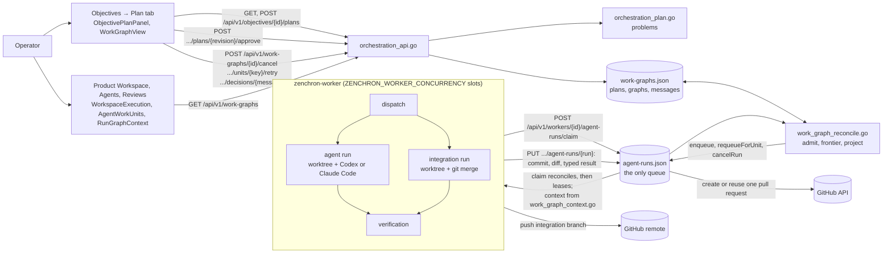

# Objective orchestration

From one objective, Zenchron proposes an engineering plan, validates it, and after approval coordinates the smallest
team of Codex CLI and Claude Code agents the plan names: independent producers run at the same time in separate
worktrees, their typed handoffs reach reviewers and the integrator automatically, findings go back to the producer that
owns them, the candidates are merged deterministically and verified together, and one pull request is published. Nobody
copies a prompt, a finding, or an answer between agents. The design, its six lifecycle diagrams, and the component
decisions are in [Objective orchestration: architecture and decisions](../architecture/objective-orchestration.md).

## Feature diagram

## Behavior

### Plans

- `POST /api/v1/objectives/{id}/plans` records a new revision. The body names an online `project_id`, an optional
  `workflow_id`, and either a `plan` or a `planner_agent_id`. A planner must be an active Codex or Claude Code profile
  without `code.write`; it runs as an ordinary read-only run and its typed result is the proposal.
- A plan has 1 to 8 units of kind `produce`, `review`, or `integrate`, each with a key, title, instructions, acceptance
  criteria, dependencies, and capabilities, and `max_parallel` from 1 to 4 (default 2).
- A plan is refused, with every problem listed, when: a key is malformed or repeated; a dependency is unknown or forms
  a cycle; there is not exactly one integrate unit; a produce unit never reaches the integrate unit; a produce unit
  builds on more than one produce unit; a produce unit's profile is missing, disabled, has no CLI adapter, cannot
  write code, or lacks a listed capability; a review unit does not review exactly one produce or integrate unit; a
  reviewer's profile may write code or produced the work it reviews; the integrate unit names an agent.
- A plan submitted in the body that is invalid is answered with 400 and stored nowhere. A planner's invalid plan is
  stored as an `invalid` revision with its problems.
- Only the latest `proposed` revision can be approved. Approval is refused with 409 while another plan of the objective
  is executing; that graph must be cancelled first. Proposing a plan identical to the executing one returns the
  approved revision and creates nothing. Approving an approved revision returns its graph.

### WorkGraph

- An approved plan becomes a graph with a stable id and a revision that increases with every persisted change. Each
  unit keeps the ids of every run that executed it.
- Unit states are `waiting`, `queued`, `running`, `blocked`, `completed`, `failed`, and `cancelled`, with a reason for
  waiting and blocked units and a failure for failed ones. Graph status is `active`, `blocked`, `completed`, `failed`,
  or `cancelled`.
- A produce unit starts when everything it depends on is settled. It is completed only by an admitted handoff with a
  commit; a successful exit without one produces a finding against the unit and another attempt.
- A produce unit that depends on a produce unit starts from that unit's branch.
- A failed unit blocks the units that depend on it; other units finish. `POST .../units/{key}/retry` starts a fresh run
  for a failed unit; a retried producer continues from its previous branch.
- `POST .../cancel` cancels the graph and its queued and running runs.
- After a restart the run store requeues interrupted attempts, and the graph adopts any run that was queued for a unit
  but not yet recorded on it, so no work is queued twice.

### Typed results and messages

- An agent ends its final message with one fenced `zenchron-result` block holding one JSON object: `handoff`
  (summary, notes), `review` (verdict `accept`, or `block` with 1 to 10 findings), `decision_request` (question,
  options), and optionally `collaboration_requests` and `state_updates`. The limits are 48 KiB for the block and
  bounded lengths per field; an unknown member rejects the result.
- Messages are `handoff`, `collaboration_request`, `finding`, `decision_request`, `decision_resolution`, and
  `state_update`. Each records its sender, recipients, run, attempt, and the commit the worker reported. Messages are
  never changed or removed.
- A run's context is rebuilt when it is claimed: the objective, the unit's acceptance criteria, the latest handoff of
  each dependency, requests addressed to the unit, findings and decisions since its own latest handoff, and for a
  review the candidate commit and its diff (up to 60 KiB).

### Review and remediation

- A review run starts from the branch of the unit it reviews and may not change files.
- A verdict is admitted only if the review ran on the unit's current candidate; otherwise it is discarded and a fresh
  review starts.
- Findings of a blocking review go to the reviewed producer. For a review of the integrated candidate they go to the
  producer the reviewer named, else the producer that changed the file, else the first producer.
- Remediation is the next attempt of the producer's run; the three-attempt limit of a run applies. A review or
  integrate unit may start six runs.

### Integration and publication

- The integrate unit starts when its dependencies are settled, with every produce unit's branch and admitted commit as
  inputs in plan order.
- The worker refuses inputs whose branch moved, aborts a conflicting merge and reports the branch and files, and
  otherwise commits the merges, runs the repository's verification commands on the result, and reports the commit.
- A conflict becomes a finding for the producer whose branch did not merge, and integration runs again after that
  producer hands off. Failed verification of the combined candidate fails the unit.
- With reviews of the integrate unit, the candidate is pushed and the pull request created only after they accept, by
  a second pass of the same run that must produce the same commit. Without GitHub credentials or a GitHub origin the
  unit completes with the candidate on its local branch.
- The pull request names the objective, the graph, and each unit with its agent and candidate. It is never merged.

### Decisions

- A producer that reports a decision request is blocked until a person answers through
  `POST /api/v1/work-graphs/{id}/decisions/{message}`. The caller must be able to see the objective, hold a grant for
  the repository, and be allowed to dispatch to the graph's worker; worker credentials cannot reach the route.
- The resolution is stored with who gave it, and the unit's run is requeued with the question and the answer.

### Dashboard

- Objectives has a Plan tab: propose (checkout, planning agent, optional workflow), every revision with its state and
  problems, approve, then the graph with each unit's state, reason, agent, candidate, verdict, run count, pull-request
  link, Cancel, Retry on failed units, open decisions with a form, and the messages.
- Product Workspace shows the graphs of the selected product's objectives on its Objectives tab. Agents lists the units
  assigned to the selected profile. Reviews labels a unit's run with its objective and unit and, for the integration
  run, shows the combined commits, review verdicts, and findings.
- Workflows states that the canvas does not execute and that a plan can name a workflow as guidance.
- Mock mode shows one sample graph with every operation disabled and sends nothing.

## Configuration

| Setting | Default | Meaning |
|---|---|---|
| `ZENCHRON_WORKER_CONCURRENCY` | 2 | Runs one worker executes at once, 1 to 8 |
| plan `max_parallel` | 2 | Units of one graph queued or running at once, 1 to 4 |

## Verification

Focused Go tests, through the HTTP API with a fake GitHub (`go test ./cmd/zenchron -run '<name>' -count=1`):

| Test | Proves |
|---|---|
| `TestObjectiveRunsParallelProducersThroughReviewRemediationIntegrationAndOnePullRequest` | Two producers leased together, exact-commit review, routed finding, remediation on the same run, stale verdict discarded, fresh review, exact merge inputs, publication only after the final review, one PR |
| `TestProducerIsNotCompleteWithoutAnAdmittedHandoff` | A successful exit is not completion; attempts bound the retries; dependents are blocked |
| `TestWorkGraphRecoversAfterRestartWithoutQueueingWorkTwice` | Restart recovery and adoption of an unrecorded run |
| `TestIntegrationConflictGoesToItsOwnerAndStaleInputsFailVisibly` | Conflict routing, re-integration, stale inputs, unit retry |
| `TestDecisionRequestBlocksItsUnitUntilAPersonResolvesIt`, `TestOnlyAnAuthorizedPersonCanResolveADecision` | Durable decisions, resume, and who may resolve |
| `TestCancellingAGraphStopsItsRunsAndFailedUnitsBlockTheirDependents` | Cancellation and failure propagation |
| `TestPlanIsRejectedBeforeAnythingRuns`, `TestChangedPlanCannotReplaceAnExecutingOneAndAnUnchangedPlanNeedsNoNewApproval`, `TestPlannerRunOnlyProposesAndItsPlanIsValidatedLikeAnyOther` | Plan validation, safe plan changes, planner output as a proposal |

Worker tests with a real Git repository and a fake CLI (`go test ./cmd/zenchron-worker -run '<name>' -count=1`):

| Test | Proves |
|---|---|
| `TestWorkerExecutesTwoRunsOfOneCheckoutAtTheSameTimeInSeparateWorktrees` | Real overlap: each provider process waits until it sees the other running |
| `TestWorkerWithOneSlotExecutesQueuedRunsOneAfterTheOther`, `TestRunConcurrencyIsConfigurableAndBounded` | The concurrency limit |
| `TestIntegrationRunMergesExactCandidatesVerifiesTheCombinationAndPublishesOnce` | Deterministic merge, verification of the combination, idempotent publication pass |
| `TestIntegrationRunReportsConflictsAndStaleInputsWithoutCombiningThem` | Aborted conflicting merge, refused stale input |
| `TestTypedResultIsTheLastFencedResultBlockOfTheFinalMessage` | Result extraction |

Browser, real control plane and worker with the fake Codex CLI
(`cd dashboard && npm run test:e2e -- e2e/orchestration.spec.ts`): unit states and reasons at 1672×941 and 390×844
without horizontal scroll, decision resolution, retry and cancel requests, plan revisions with problems and a refused
approval, empty and failed loads, Mock without writes, the projections in Workspace, Agents, and Reviews, and one plan
approved in the page that runs through a decision, a blocking review, remediation, and integration.

## Live record

Live, on 2026-11-16, with a loopback control plane (`ZENCHRON_GITHUB_TOKEN` set), one worker with two slots,
Claude Code 2.1.322 and Codex CLI 0.167.0, and a dedicated clone of this repository on `feat/objective-orchestration`
whose worker configuration runs `go vet`, `go build`, the `gofmt` check, `go test ./cmd/zenchron`, and the file-size
check as verification. The objective was backlog issue #334, backend slice: a delivery report API for a WorkGraph.

| Step | What happened | Evidence |
|---|---|---|
| Objective | Created through the API with five agent profiles (two writers, two read-only reviewers, one read-only planner) | objective `ea0c9bacd5f9248f37f138d5beaf32e4` |
| Plan, revision 1 | The Claude Code planner proposed one producer; validation refused the plan because its instructions and acceptance criteria exceeded the limits, and approving it answered 409 | planner run `47ff903effce40613763ea836194ed52`; fixed in `c9887d0` (the contract now states the limits) |
| Plan, revision 2 | The operator added a staffing decision (two parallel producers) to the objective; the planner's five-unit plan exceeded the 16 KiB result limit and the worker dropped it | planner run `f152190f57e7073a61edc9604ef3ea43`; fixed in `28acb64` (limit 48 KiB) |
| Plan, revision 3 | Valid: `api` (Claude engineer), `docs` (Codex engineer), `review-api` (Codex reviewer), `integrate`, `review-all` (Claude reviewer); approved in the dashboard's Plan tab | planner run `5e9e88791e4066232c8f7e9dd1b14bc3`; graph `22bca11eeb7e82bfdb1df1bb04a4f28b` |
| Parallel producers | Claude Code and Codex ran at the same time in separate worktrees | `api` run `9e926b3aed9d9830134959479373e992` attempt 1, 08:06:02 to 08:09:55 UTC; `docs` run `2ef35490fc31bd7eae5b797aca29decf` attempt 1, 08:06:02 to 08:07:59 UTC |
| Inadmissible result | The first `api` attempt ended without an admissible typed result; Zenchron wrote a finding against the unit and the same run's second attempt handed off | candidate `01e6fdf118225a24e8d91f6f20dfea6621a9c9c8` |
| Independent review | Codex reviewed Claude's exact candidate and accepted it | review run `ebcaef22da79cce1ec1ddee739805ccc` |
| Integration and restart | The control plane was killed while the integration run was executing; its attempt 1 closed as `lease_expired` and attempt 2 merged both candidates with verification passed | integration run `5ec0e9b4f6d0cfa6ce8fe0fbf6900cee`, commit `35b1fcdab7` |
| Review finding | Claude reviewed the integrated commit and blocked it: the document's Mermaid edge label with an unquoted `{id}` does not parse. The finding was routed by file to `docs` | review run `c6b097bf304798e7be78968f804f42ff` |
| Remediation | Codex fixed it in attempt 2 of its own run | candidate `65f20dc4c0228ade0e159da1e8a6ddea3909f4d0` |
| Fresh integration and review | A new integration run merged the new candidates, verification passed, and a fresh Claude review accepted that commit | integration run `08e70ab84e6e1bafc781756b00d7a0b8`, commit `9ae5c9cd0d6d2e56f200b8c928069655e6e32169`; review run `69e75f0d55e8eefdfb1d2f7c8bddaf49` |
| Publication | The second pass of the integration run pushed the reviewed commit and one pull request was created, not merged | https://github.com/bogdaniel/zenchron-engineering-os/pull/376, head `9ae5c9c`, base `feat/objective-orchestration` |

Measured by the report endpoint that pull request adds, run against a copy of the live data: 5 units, 7 runs, 11
attempts of which 1 failed (the lease lost to the restart), 3 review rounds, 2 findings, 2 remediation passes, 0
decisions, 1 human action recorded by the graph (the approval), largest overlap of attempts 2, 645 s from approval to
completion, 1,295,087 input and 25,810 output tokens, and 3.29 USD reported by Claude Code; Codex reports no cost, and
human supervision time is not recorded anywhere. The three planning runs took another 643,113 input and 39,327 output
tokens and 4.61 USD.

Human actions in total: creating the profiles and the objective, adding the staffing decision, requesting a plan three
times (twice because of the two defects above), approving revision 3 in the dashboard, and killing the control plane
on purpose. No prompt, finding, handoff, or result was copied between agents by a person.

A second live objective was built to conflict (graph `b6303346a2dfd9a7fdcb3f6f91a523f4`, two producers creating the
same file): a cyclic variant of its plan was refused with 400; approving a changed plan while it executed answered
409; proposing the identical plan returned the approved revision; the integration run
`f7d945ef52122a30fd7795628307dd02` failed with `merge_conflict` and the aborted merge; the finding named the file and
went to the producer whose branch did not merge; and cancelling the graph cancelled that producer's queued
remediation. Nothing from it was published.

Not shown live: a review verdict arriving for a candidate that had already changed, a stale integration input, a
decision request, and a unit retry. No agent produced those situations in the live runs; they are covered by the
focused tests above and, for restart and the whole lifecycle, by a rehearsal with the real binaries and a fake CLI.
A webhook, a hosted control plane, and more than one worker were not part of this run.
