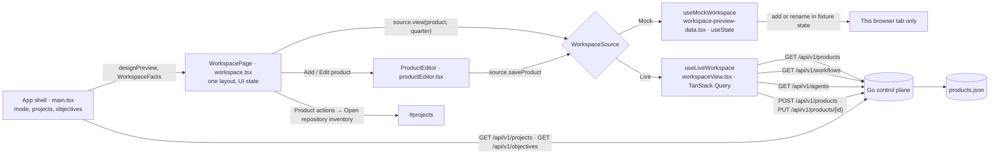

# Product workspace

The Product Workspace manages durable products and links them to repositories reported by local workers. It has one
layout, the approved design, in both data modes (see `docs/architecture/dashboard-modes.md`): a product directory, a
product heading with actions, four metric cards, six section tabs, and nine cards (roadmap, objectives, repositories,
workflows, files, stakeholders, release streams, decisions, delivery metrics). **Mock** fills it from fixtures and
keeps every change in the browser tab. **Live** fills it from the control plane and says "Unavailable" where the
control plane records nothing.

## Feature diagram



## Behavior

Both modes:

- The directory lists products with a search box, a status filter, and "All Products (N)", which clears both. Below
  1050px the directory is hidden, as in the design; the Product actions (⋯) menu lists the products under "Switch
  product" so selection stays reachable.
- "＋ New Workspace", "＋ Add Product", and "Add another product" open the product editor; "Edit product" in the
  Product actions menu opens it for the selected product. The editor validates the name (required, at most 100
  characters) and description (at most 2000) and shows a save error in place.
- "Open repository inventory" in the Product actions menu goes to the Projects page.
- Tabs narrow the cards: Objectives (roadmap and all objectives), Repos (all repositories and workflows), Files,
  Decisions (decisions and stakeholders), Templates (workflow and agent templates, release streams).
- The roadmap has Roadmap and Timeline views and a "Quarterly" menu that chooses the first quarter shown.
- A card with no rows shows one line saying why; failed requests are announced with `role="alert"`.

Mock:

- Shows the approved fixtures; selecting a product rewrites the fixture names for that product. Favorites, added
  products, and edits are held in `useState`. The editor says products stay in the preview only and disables the
  repository picker. No protected API request is sent.

Live:

- Products come from `GET /api/v1/products`; create and edit use `POST` and `PUT /api/v1/products/{id}` and select the
  saved product. The editor links repositories from the worker inventory.
- A product's health is `Healthy` when at least one linked repository's worker is online, `Offline` when linked
  repositories are reported but none is online, `No repos` when nothing is linked, and `Unavailable` when no linked
  repository is in the current inventory. It appears as the directory badge, the status filter, the heading line
  ("N of M repositories online"), and the Product Health card.
- "Open Objectives" counts the selected product's objectives that are not completed. The objectives card lists up to
  five of them with status and owner; the Objectives tab lists all of the product's objectives.
- The roadmap shows up to four of the product's earliest objectives due on or after the first quarter shown, across
  five quarters starting at the earliest due quarter. A bar runs from the objective's creation date to its due date and
  is coloured by status; it is not an estimate of when work starts. Today is marked when it falls in the quarters
  shown. Objectives without a valid due date stay in the objectives card.
- Repositories show name, worker, worker status, and branch. A linked repository missing from the inventory stays
  linked and is shown as unavailable.
- "Available Workflows" lists workflow definitions with their status. They are workspace-wide, not linked to a
  product. The Templates tab adds agent profiles.
- Unavailable, with the reason on the card: files and evidence, stakeholders, release streams, decisions, delivery
  metrics (card and metric), recent decisions (metric), and all trend graphics. The favorite star and the delivery
  range are disabled with a reason. Sharing shows the page link and says no invitation is sent.
- While the worker inventory or the product list loads, the directory says so; a failed product list shows "Product
  list unavailable." Fixtures are never used as a fallback.

## Data boundaries

- Products, descriptions, and repository ID links persist in `products.json`; product names are unique without regard to
  case.
- Repository IDs are stable for a worker identity and checkout path. Names, branches, worker names, and heartbeat state
  come from current worker inventory; local paths remain on the worker. Only repository names and worker IDs are shared
  with the control plane.
- A worker restart does not erase product configuration. Moving a checkout changes its ID and requires relinking.
- Objectives link to products by ID. Unlinked and legacy free-text objectives remain visible on the Objectives page.
- File search, evidence artifacts, decisions, stakeholder membership, release streams, and delivery history require
  integrations or records that are not implemented yet.

## Verification

Focused Go tests cover product validation, create/update/list, and restart persistence. The E2E checks cover the Live
layout with isolated API fixtures, the create flow against the real control plane, and the Mock layout:

```sh
go test ./cmd/zenchron -run 'TestProducts|TestPersistentMuxRestoresObjectivesAndWorkflows'
cd dashboard && npm run test:e2e -- e2e/workspace.spec.ts e2e/workspace-preview.spec.ts
cd dashboard && npm run test:e2e -- e2e/home.spec.ts --grep 'Product Workspace groups live repositories'
```
