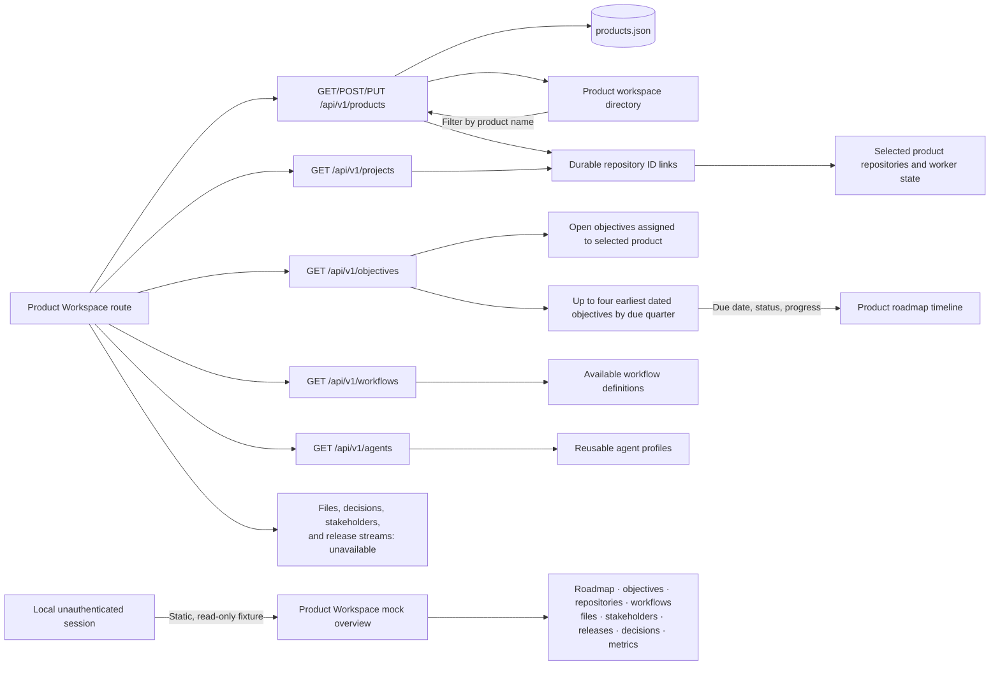

# Product workspace

The Product Workspace manages durable products and links them to repositories reported by local workers. Its directory
shows full product names in 12px medium text, wrapping within the 260px rail; repository counts remain secondary at 10px.
Search filters products by name; creating a workspace uses the existing product record and editor. Objectives can be
assigned to products by stable ID; reusable workflow and agent definitions remain workspace-wide. Files, decisions,
stakeholders, and release streams remain unavailable without their source services.

An unauthenticated localhost session renders the supplied Product Workspace overview at `/#workspace` in the existing
dashboard shell. Its product list, roadmap, objective progress, connected services, people, releases, decisions, and
delivery metrics are illustrative and read only; this state makes no protected product, objective, workflow, agent, or
repository requests. Its Add Product control remains disabled but keeps the reference's primary-button appearance.

## Feature diagram



## Data boundaries

- Products, descriptions, and repository ID links persist in `products.json`; product names are unique without regard to
  case.
- Repository IDs are stable for a worker identity and checkout path. Names, branches, worker names, and heartbeat state
  come from current worker inventory; local paths remain on the worker.
- A linked repository missing from current inventory stays linked and is shown as unavailable, so a worker restart does
  not silently erase product configuration. Moving a checkout changes its ID and requires relinking.
- Objectives link to products by ID and appear in that product's open-objective metric and Objectives tab. Unlinked and
  legacy free-text objectives remain visible in the workspace Objectives screen.
- The product overview roadmap shows up to four earliest due-dated objectives linked to the selected product. Quarter
  markers represent due dates, and colors reflect objective status; it does not imply an estimated start date or
  duration. Objectives without valid due dates remain available in the Open Objectives panel and Objectives tab.
- Workflow definitions and agent profiles are listed as reusable configurations, not as project assignments or runs.
- File search, evidence artifacts, decisions, stakeholder membership, and release streams require integrations or
  records that are not implemented yet.
- The repository inventory route remains available for worktree preparation.

## Verification

Focused Go tests cover product validation, create/update/list, and restart persistence. The focused E2E check verifies
the product directory and objective roadmap using isolated API fixtures, then exercises product search and selection:

```sh
go test ./cmd/zenchron -run 'TestProducts|TestPersistentMuxRestoresObjectivesAndWorkflows'
cd dashboard && npm run test:e2e -- e2e/workspace.spec.ts
```

The mock overview has its own read-only route check:

```sh
cd dashboard && npm run test:e2e -- e2e/workspace-preview.spec.ts
```
