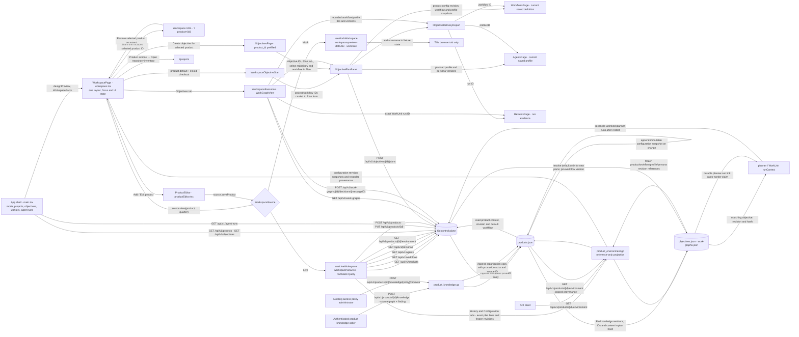

# Product workspace

The Product Workspace manages durable products and links them to repositories reported by local workers. The approved
layout has a product directory, a product heading with actions, four metric cards, and shared section tabs/cards.
**Mock** keeps its browser-local fixture behavior. **Live** reads product-scoped WorkGraph and configuration history
from the control plane and says "Unavailable" where that runtime has not recorded a fact.
Mock does not show the Configuration tab; it does not fabricate durable revisions or actors.

## Feature diagram



## Integration boundaries

| KEEP | CONNECT | EXTEND | REMOVE |
|---|---|---|---|
| Existing product/repository records, agent profiles, workflow definitions, objective plans, WorkGraphs, report API, dashboard shell, and Mock/Live boundary. | Product → repository/objective; workflow → compiled plan; persona → profile/run snapshot; objective → WorkGraph/report; workspace cards → authoritative APIs. | Reusable personas and eligibility reasons; supported workflow compilation; objective delivery report and safe export. | Any second scheduler, execution store, prompt truth, or evidence store; Live claims that unsupported visual nodes execute. |

## Behavior

Both modes:

- The directory lists products with a search box, a status filter, and "All Products (N)", which clears both. Below
  1050px the directory is hidden, as in the design; the Product actions (⋯) menu lists the products under "Switch
  product" so selection stays reachable.
- "Workspace focus" narrows navigation and Overview cards for Product owner, Engineer, Designer, Security reviewer,
  or Platform operator. It changes only the dashboard projection; it does not grant permissions or hide data from
  APIs. Missing role-owned data remains visibly unavailable in its relevant view.
- "＋ New Workspace", "＋ Add Product", and "Add another product" open the product editor; "Edit product" in the
  Product actions menu opens it for the selected product. The editor validates the name (required, at most 100
  characters) and description (at most 2000) and shows a save error in place.
- "Open repository inventory" in the Product actions menu goes to the Projects page.
- The Share dialog's link includes the selected product ID, and opening it restores that product.
- Tabs narrow the cards: Objectives (roadmap and all objectives), Repos (all repositories and workflows), Files,
  Decisions (decisions and stakeholders), Configuration (product revision history), Templates (workflow and agent templates, release streams).
- At phone widths, section tabs use three columns and the workspace-focus selector occupies a full row so labels stay
  readable and do not overlap.
- The roadmap has Roadmap and Timeline views and a "Quarterly" menu that chooses the first quarter shown.
- A card with no rows shows one line saying why; failed requests are announced with `role="alert"`.

Mock:

- Shows the approved fixtures; selecting a product rewrites the fixture names for that product. Favorites, added
  products, and edits are held in `useState`. The editor says products stay in the preview only and disables the
  repository picker. No protected API request is sent.

Live:

- The History tab shows the product's durable WorkGraph references in newest-first order. Each opens the exact
  objective plan and graph. The row exposes plan hash/revision, graph revision, frozen workflow and assignment
  revisions, run IDs, handoffs, and findings; it does not copy run evidence. The Mock preview keeps its existing
  layout and does not invent WorkGraph history.

- Products come from `GET /api/v1/products`; create and edit use `POST` and `PUT /api/v1/products/{id}` and select the
  saved product. The editor links repositories from the worker inventory and can store a default saved workflow. A
  product default fills an omitted workflow choice when a plan is compiled or delegated to a planner. An explicit
  manual plan stays independent of that default; workflow identity and version are pinned only when selected.
- A product's health is `Healthy` when at least one linked repository's worker is online, `Offline` when linked
  repositories are reported but none is online, `No repos` when nothing is linked, and `Unavailable` when no linked
  repository is in the current inventory. It appears as the directory badge, the status filter, the heading line
  ("N of M repositories online"), and the Product Health card.
- "Open Objectives" counts the selected product's objectives that are not completed. The objectives card lists up to
  five of them with status and owner; the Objectives tab lists all of the product's objectives.
- If the objective list fails before product scope is known, the execution panel reports that WorkGraph scope is
  unknown instead of claiming the product has no approved plan. Existing cached objective IDs remain usable while
  their refresh error is shown on the objective card.
- The roadmap shows up to four of the product's earliest objectives due on or after the first quarter shown, across
  five quarters starting at the earliest due quarter. A bar runs from the objective's creation date to its due date and
  is coloured by status; it is not an estimate of when work starts. Today is marked when it falls in the quarters
  shown. Objectives without a valid due date stay in the objectives card.
- Repositories show name, worker, worker status, and branch. A linked repository missing from the inventory stays
  linked and is shown as unavailable.
- "Available Workflows" lists workflow definitions with their version and status. A workflow can be selected in an
  objective's Plan tab, where the saved graph is compiled into inspectable WorkUnits. Workflows remain workspace-wide,
  not linked to a product. The Templates tab lists agent profiles with their linked persona, provider, model, and
  current local worker readiness; profile and workflow names open the saved records. Definitions remain workspace-wide,
  while executed assignments are associated with the product through its objectives and WorkGraphs.
- In Live, "Create objective" on the selected product opens the existing objective form with that product selected.
  Optional repository and workflow choices are carried into the Plan tab after creation. Only online linked checkouts
  are offered; the Plan form checks the selected IDs against its scoped options before enabling proposal. Selecting a
  saved workflow does not certify it as executable: existing compilation/validation still rejects unsupported semantics.
- Regression evidence: `orchestration.spec.ts` creates an objective through this Product Workspace entry point,
  reloads the retained selection, approves the compiled plan, and follows real backend/fake CLI decision, review,
  remediation and integration through delivery-report JSON export. This is deterministic regression evidence;
  installed CLI and GitHub publication acceptance is recorded separately.
  The Plan tab then offers only online repository checkouts linked to that product; legacy objectives without a product
  keep the existing all-checkouts choice.
- The Objectives tab projects each linked objective's current WorkGraph, pending decisions, findings, review and
  integration states, and observed pull-request link from existing product-environment records. Its WorkGraph view
  resolves a pending decision against that exact graph and request through the existing governed API action. Opening
  an objective shows its plan and delivery report. Unrecorded measurements remain unknown in that report.
- WorkGraph-linked run IDs are joined to the app shell's agent-run records to show provider-reported token totals and
  cost with explicit run coverage. Providers that do not report cost remain unknown; budgets are not recorded here.
- The selected product's environment projection supplies the pending-decision count, decision links, current
  WorkGraph/handoff/finding counts, observed PR-link count, and a newest-first list of its historical WorkGraphs.
  History entries reference the durable graph, plan hash/revision, product configuration revision, graph revision, run IDs, status and timestamps;
  evidence bodies remain in their owning graph. These are recorded facts, without a time trend or implied merge state.
  A failed projection shows an error, and a missing product shows an empty explanation.
- Delivery report workflow and profile links open the referenced saved record using
  `/?workflow=<id>&mode=live#workflows` and `/?profile=<id>&mode=live#agents`. The Live mode parameter keeps local
  navigation from switching to Mock.
  The report retains the executed versions; the editor shows the current saved configuration.
- Execution links use `?run=<id>#reviews` to open that run's Evidence tab, including review runs without a diff.
- Product objective rows and execution headings open that objective's Plan tab. Each historical WorkGraph lists its
  recorded workflow version and profile/persona assignments with links to the saved records. Current provider/model
  and profile status are labeled as current configuration, distinct from the executed versions. These relationships
  come from the product's objectives and WorkGraphs; workspace-wide definitions remain available separately.
- Live WorkGraph units link each recorded run ID directly to its Reviews evidence. Mock execution fixtures do not
  create Live run links.
- Plan revisions link to their selected workflow and assigned profiles, with profile/persona versions labeled as
  planned configuration. Cross-page links preserve Live mode on local dashboards.
- A planner and each WorkUnit receive the linked product description captured when the plan revision was proposed.
  The snapshot is part of the plan hash and does not change when the current product description is edited; it is
  passed as user-supplied task data, not as instructions. Unlinked objectives receive no product context.
- Planner runs receive workflow guidance from the same pinned plan. A planner run cannot be claimed until its link is
  durable; after restart, an unlinked planner run is cancelled before workers can claim it.
- Unavailable, with the reason on the card: files and evidence, stakeholders, release streams, and time-series
  delivery trends. The favorite star and the delivery range are disabled with a reason. Sharing shows the page link
  and says no invitation is sent.
- While the worker inventory or the product list loads, the directory says so; a failed product list shows "Product
  list unavailable." Fixtures are never used as a fallback.

## Data boundaries

- Products, descriptions, default workflow IDs, configuration revisions, and repository ID links persist in `products.json`; product names are
  unique without regard to case.
- Repository IDs are stable for a worker identity and checkout path. Names, branches, worker names, and heartbeat state
  come from current worker inventory; local paths remain on the worker. Only repository names and worker IDs are shared
  with the control plane.
- New fields are additive: prior products without a default workflow, profile records without personas, and plans
  without configuration snapshots load
  with their previous behavior. The strict state reader rejects unknown fields, so rolling back after personas, pinned
  plans, product-context snapshots/default workflows, or workflows with the `integrate` node have been saved requires
  restoring pre-upgrade copies of `agents.json`, `products.json`, `work-graphs.json`, and `workflows.json`; retain a
  local data-directory backup before a downgrade.
- A worker restart does not erase product configuration. Moving a checkout changes its ID and requires relinking.
- Objectives link to products by ID. Unlinked and legacy free-text objectives remain visible on the Objectives page.
- File search, evidence artifacts, decisions, stakeholder membership, release streams, and delivery history require
  integrations or records that are not implemented yet.

## Verification

Focused Go tests cover product validation, create/update/list, default-workflow plan pinning, and restart persistence.
The E2E checks cover the Live layout with isolated API fixtures, the default workflow carried into objective creation,
the create flow against the real control plane, and the Mock layout:

```sh
go test ./cmd/zenchron -run 'TestProducts|TestProductDefaultWorkflow|TestPersistentMuxRestoresObjectivesAndWorkflows'
cd dashboard
npm run test:e2e -- e2e/workspace.spec.ts e2e/workspace-preview.spec.ts
npm run test:e2e -- e2e/workspace.spec.ts --grep 'local Live product navigation stays Live when opening objective creation'
npm run test:e2e -- e2e/home.spec.ts --grep 'Product Workspace groups live repositories'
```

`workspace.spec.ts` checks that an inline Product Workspace decision submits the selected graph ID, request ID, and
resolution to the existing action endpoint. The multi-WorkUnit provider and publication journey remains partially
verified; deterministic fake-CLI coverage lives in `orchestration.spec.ts`.

## Product environment

`GET /api/v1/products/{id}/environment` returns the engineering world of one product by reference: its repository
ids and current configuration revision; each objective linked to it with its status, the number of plan revisions,
and the id, status, plan revision,
handoff and finding counts, and pull-request URL of its newest work graph; every visible WorkGraph in newest-first
history order with its plan hash/revision, product configuration revision, graph revision, run IDs, status and timestamps, workflow identity/version,
and each assigned unit's agent profile/persona identity and frozen revision; and every decision asked in those graphs
with the unit that asked, the question, and who resolved it.

- It is a projection of the product, objective, plan, and work-graph records and stores nothing.
- Historical work survives a control-plane restart through the existing durable WorkGraph store; history entries
  point to the graph and run records rather than copying their evidence bodies.
- Workflow and agent/persona references come from the approved plan snapshot recorded in each WorkGraph. Editing a
  current profile or workflow does not change the historical reference. The product environment does not own product
  defaults or copy configuration contents.
- A plan revision snapshots the linked product description and includes it in the plan hash. Planning runs and
  WorkUnit attempts use that same text across retries; editing a product affects only later plan revisions. The text
  is user-supplied task data and does not grant authority or change the result contract.
- Planner workflow guidance is persisted with its plan revision and delivered separately from the bounded run prompt.
  A planner's durable plan link gates worker claim, and reconciliation cancels any planner run left unlinked after a
  crash between the run-store and plan-store writes.
- Configuration revision advances when product name, description, default workflow, or repository links change. Each
  plan pins the revision alongside its product context and the environment projection associates that revision with
  the historical WorkGraph. Older product records without the field read as revision 1.
- Product knowledge is a human-curated reference to an exact recorded WorkGraph finding. The authenticated caller
  must be able to read that graph, and its objective must still belong to the selected product. Agent output is never
  promoted automatically. Entries retain the source product, objective, graph, plan hash, finding, run, unit, and
  candidate when recorded.
- Product knowledge is isolated by default. When an access policy is enabled, only its administrator can explicitly
  promote a product entry; with policy disabled, the existing unrestricted local workspace requires a signed-in,
  recorded actor. Promotion appends an immutable organization-scoped copy with its source entry ID, actor, and time.
  Repeating the same promotion returns the existing copy. Promotion uses the current access policy; it adds no role,
  approval engine, audit store, or second knowledge store.
- The product environment returns both knowledge revisions and provenance. Source identifiers are redacted when the
  viewer cannot read the exact source graph, while explicitly promoted organization content remains available.
- A new plan freezes product and organization knowledge revisions, entry IDs, source graph/finding IDs, and curated
  content into the existing product-context snapshot and plan hash. WorkUnits receive that pinned text as bounded
  task data marked as untrusted instructions; edits and later promotions affect new plans only. At most eight recent
  entries per scope, each bounded to 400 bytes, are included in a plan context.
- Product updates append immutable configuration snapshots to the existing `products.json` record. The Live
  Configuration tab shows each recorded revision, its values, timestamp, and actor only when the request had a
  recorded signed-in actor. Repository IDs outside the current caller's grants are redacted. Older records with no
  history show the latest known snapshot and mark history incomplete when earlier revisions cannot be recovered;
  their actor remains unrecorded.
- Configuration history belongs to the product store; it is not a second environment or evidence store. Updating
  current product values does not alter the product context or revision frozen into existing plans or WorkGraphs.
- Configuration and knowledge fields are additive in `products.json`. A downgrade to a binary that predates these
  fields can read the file, but its next product write will discard configuration history, product and organization
  knowledge, and promotion provenance; back up the data directory before downgrading across this change.
- Only objectives whose `product_id` is this product appear, so two products that share a repository share no work.
- A product the caller may not see answers 404. Objectives, plans, and graphs the caller may not see are left out.
- Product and organization knowledge are appended to the existing `products.json` store; old files load with empty
  knowledge and no migration. Organization promotion uses the configured administrator role, or the existing
  authenticated unrestricted-local mode when no role policy is configured. This does not
  add repository-intelligence, policy, or team/architecture owners. Architecture/team references and organization
  policy promotion remain unsupported because their authoritative owners are not present in this runtime.

Verified by `go test ./cmd/zenchron -run 'Test(ProductEnvironment|ProductConfigurationHistorySurvivesRestartWithoutInventingActors|ProductKnowledge|WorkUnitContextIncludesOnlyItsLinkedProduct|PlannerReceivesLinkedProductDescription)' -count=1`,
including product isolation, configuration and knowledge history across restart, administrator-only auditable promotion, exact-source validation, and frozen knowledge delivery to WorkUnits. The Playwright E2E uses route fixtures to verify the Configuration view at desktop and mobile sizes, including unknown actors, empty product history, tab layout, and Mock/Live separation.
