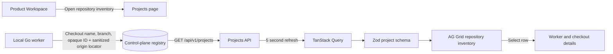

# Project inventory

The Projects page turns the local worker's Git checkout heartbeat into a searchable repository inventory. It follows the
repository list and detail pattern in the supplied Product Workspace mockup, is reached from Product Workspace, and uses
the installed AG Grid Community package.

## Feature diagram

## Behavior

- The page lists checkouts and current branch names discovered by connected local workers and refreshes through the existing five-second projects query.
- Search matches repository and worker names; selecting a row shows its worker heartbeat and opaque identities.
- The worker reads the current branch from bounded `.git/HEAD` metadata; it does not execute Git commands during each heartbeat.
- The worker sends checkout names, branch names, opaque IDs, and the `origin` host/repository path with URL credentials and query strings removed. Local filesystem paths remain on the worker machine and are not returned by the API.
- Empty and API-error states are explicit. The inventory stays local-checkout focused; live GitHub issues and pull
  requests appear in Reviews for supported `github.com` remotes.

## Verification

`go test ./cmd/zenchron -run 'TestWorkerHeartbeat|TestValidGitRemote'` verifies API validation and listing. `go test ./cmd/zenchron-worker -run 'TestRepositoryLocator|TestGitRemoteScrubsCredentials'` verifies URL forms and credential/path scrubbing. `cd dashboard && npm run test:e2e -- e2e/home.spec.ts --grep 'Projects page shows'` verifies the locator reaches the live dashboard without credentials.
