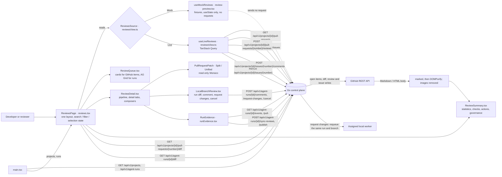

# Review workspace

The Reviews page has one layout, the approved review-workspace frame: metric strip, section navigation, review queue,
detail pane with the review pipeline and six detail tabs, and a summary pane with change statistics, required checks,
review actions, and merge governance. Two data sources feed it ([One dashboard, two data modes](../architecture/dashboard-modes.md)).
**Live** lists the open GitHub pull requests and issues of a connected GitHub.com checkout, loads the selected pull
request's diff, and lists agent runs with the bounded diff of their isolated branch. Reviewers comment on, close, or
reopen issues, submit a pull-request comment or request changes through the control plane, comment on an agent run,
request a follow-up attempt on the same branch, cancel an active run, and read a run's evidence. **Mock** shows the
approved fixtures and changes only this tab's state. Approval, merge, inbound GitHub reviews, checks on GitHub items,
and policy results are not available from the control plane, and Live says so.

## Feature diagram

## Behavior

Both modes:

- **Layout.** Six metric cards, the title row, the section bar, and a three-pane workspace. On desktop the queue,
  detail, and summary panes start at 24/52/24 percent and resize with drag handles or arrow keys; the workspace fills
  the viewport below the section bar. Below 1150px the panes stack vertically with the same keyboard-accessible
  separators, the detail tabs scroll in one row on phones, and the stacked workspace is lengthened while a run's
  Evidence is open.
- **Section bar.** Queue tabs change the queue and start it unfiltered on Code changes. The Code Review, Evidence, Merge
  Governance, Policies, and Trusted-main tabs open the matching detail tab of the selected item. The date range,
  repository, and overflow controls sit at the right edge and stay reachable by scrolling the bar on phones; the
  overflow menu resets search and the queue filter.
- **Queue.** Pull requests and issues are selectable cards with number, state, title, author, branch, and update date.
  Search matches number, title, author, and (for pull requests) source branch in the loaded list; the chips filter it.
  The pager states that there is one page.
- **Detail.** The header shows the item, its state, and for a pull request the bookmark, copy-link, and overflow
  actions. A copied link carries `?pull=<number>` and opens that pull request. The diff bar names the file (or the
  number of files), the added and removed line counts, and the Split / Unified switch. A one-file patch omits its Git
  file headers; a patch that spans files keeps them. The unified gutter shows old and new source line numbers from the
  hunks, additions are tinted green and removals red, and the minimap is shown. A diff without a unified hunk shows a
  no-readable-patch state.
- **Summary.** The description renders as sanitized Markdown/HTML with external images removed. Four lines are
  reserved for it; a longer one scrolls and shows every line while hovered or focused. Review actions are ordered
  Approve / Request changes, Merge, Export evidence. Request changes and (for an issue) Add comment open the
  Conversations composer.

Live only:

- **Queues.** Pull Requests, Issues, and Local branches, each with its count. The repository menu chooses among
  connected GitHub.com checkouts and is disabled when there is at most one; with none the label reads "GitHub not
  connected" and the queue says to connect a checkout. Pull-request chips are All / Open / Draft, issue chips are All /
  Open / Closed. Loading, empty, no-match, and failed states are shown in the queue; a failed load is reported and
  never replaced by fixtures.
- **Metrics.** Pull Requests is the number of open pull requests listed, In Review the open ones that are not drafts,
  and Review Queue the agent-run branches with a captured diff. Avg. Review Time, Merge Success Rate, and Policy Gate
  Pass are Unavailable, and no trend graphics are drawn.
- **Pull request.** Files Changed, Lines Added, and Lines Removed are counted from the loaded diff; Commits, Risk
  Score, Evidence Completeness, Required checks, Merge strategy, and Policy are Unavailable; Target branch is the
  pull request's base. The pipeline shows Open or Draft under Code review and Unavailable for the other stages. The
  six context cards and the AI Suggestions, Evidence, Checklist, and Approvals tabs state what is not synchronized.
  "Open pull request on GitHub" is in the overflow menu. Conversations submits a comment or a request for changes;
  feedback on a Zenchron pull request is attached to its run, and an eligible request for changes queues a follow-up.
- **Issue.** Labels, the link to GitHub, and the description; Conversations comments on the issue and closes or
  reopens it.
- **Local branch.** Agent runs in an AG Grid. The detail shows the run's diff in read-only Monaco with its commit, the
  128 KiB truncation notice, and the pull-request link or publication state; counts come from the loaded diff and are
  lower bounds when it is truncated. Each run stores up to ten comments of 1,000 bytes. Comments and request-changes
  are available on terminal runs with diffs; the latter requires an online worker with model runtime and `code.write`
  permission and a remaining attempt. "Cancel run" is enabled while the run is queued or running. The Evidence tab
  shows `RunEvidence` ([Issue to pull request](issue-to-pull-request.md)).
- **Disabled with the reason.** New PR, Approve, Merge to protected branch, Export evidence, the bookmark, the date
  range, and Auto-merge. Nothing in Live simulates a merge.

Mock only:

- One queue, Pull Requests, with five sample pull requests on a single sample page, their categories, review states,
  risk / evidence / CI / comment signals, and reviewer counts; trend badges and sparklines on the metrics; the inline
  discussion over the diff (at most 210px wide and clear of the minimap on desktop, a full-width card on phones).
- New PR, Approve, Request changes, Merge to Trusted-main, Export evidence, the bookmark, Auto-merge, the Last 7 / 14 /
  30 Days and All Repos / Nova Platform menus, and "Apply" on the sample suggestion change this tab's state only. The
  Approve and Merge confirm with "in this preview only", a requested change is marked "simulated locally for this
  preview", and the New PR dialog is titled "preview only". The GitHub composer is disabled. No API request other
  than the session check is sent.

## Verification

- `cd dashboard && npm run test:e2e -- e2e/github-reviews.spec.ts`: the frame in Live with real counts and honest
  Unavailable values, disabled controls, queue filters, search by branch, the reset menu, safe Markdown rendering, the
  pull-request diff and its statistics, a multi-file patch in Unified and Split, issue comment / close / reopen, both
  review actions with their run-sync messages and the exact write requests, the repository menu, a copied `?pull=`
  link, a failed GitHub load without fixtures, and the phone layout without overflow.
- `cd dashboard && npm run test:e2e -- e2e/reviews-preview.spec.ts`: the same frame in Mock with every local action,
  the Unified minimap, coloured change rows, Split view, the phone layout, and no API traffic beyond the session check.
- `cd dashboard && npm run test:e2e -- e2e/home.spec.ts --grep 'Reviews'`: the approved frame geometry, the
  not-connected state, local branch diffs and statistics, comments, request-changes, disabled merge, and resizing.
- `cd dashboard && npm run test:e2e -- e2e/z_run_evidence.spec.ts e2e/z_agents.spec.ts`: run evidence at desktop and
  phone size, review import, publish retry, and request changes, cancel, and evidence against a real worker.
- The approved build and this build's Mock were pixel-compared at 1672×941, 1672×749, 1512×874, 1440×900, 1280×800,
  1024×768, and 390×844 and are identical.
- `go test ./cmd/zenchron -run 'TestGitHub|TestAgentRunQueuePersistsAndFencesClaims'` checks review
  validation/submission, persistence, runtime gating, same-run requeue, feedback prompts, and diff retrieval. The
  focused worker test checks follow-up execution on the existing worktree. `npm run typecheck` validates the dashboard
  types.
