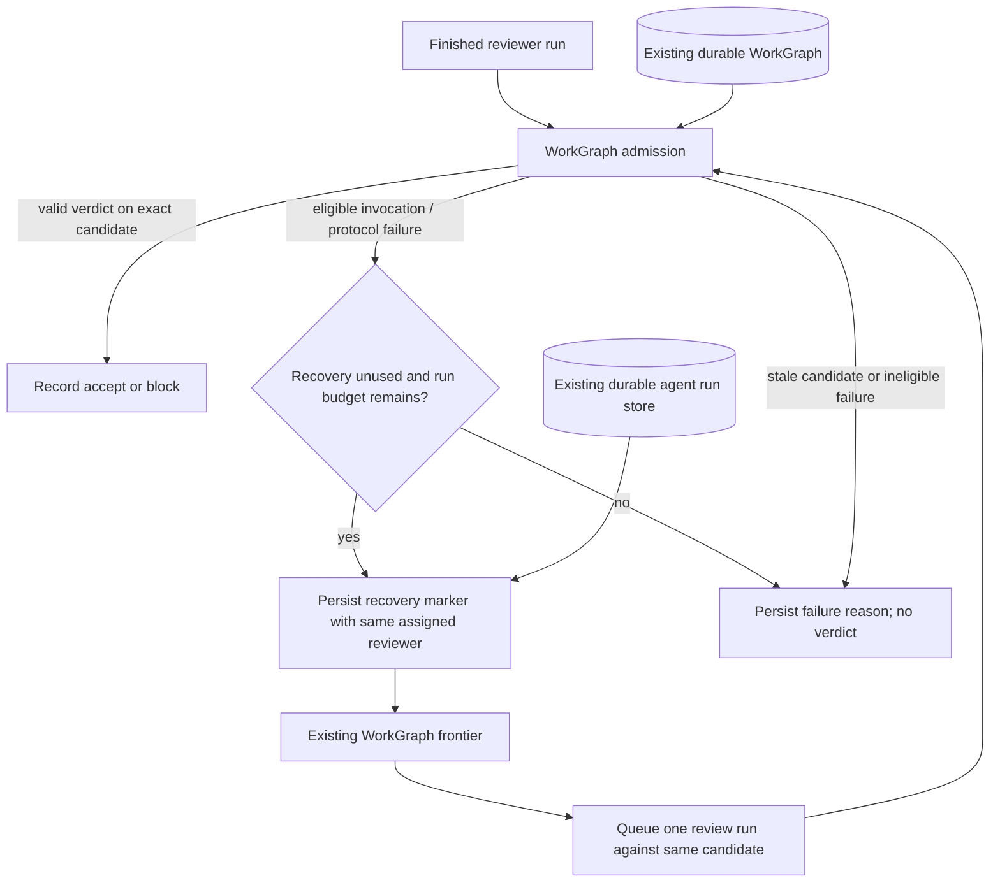

# Reviewer stage recovery

WorkGraph review units keep independent reviewer identity and candidate binding. A failed invocation or malformed
review result is not an independent rejection. For a timeout, provider exit, or invalid/missing result, the control
plane may queue one additional stage run using the same frozen assignment and candidate, within the existing run cap.
The run record marks that recovery durably so reconciliation after a crash cannot duplicate it. A second failure,
non-recoverable termination, stale candidate, or exhausted run cap leaves a truthful unit failure and no verdict.

## Feature diagram

## Verification

`go test ./cmd/zenchron -run 'TestReviewerInvocationRecoveryKeepsAssignmentCandidateAndSurvivesRestart|TestReviewerRecoveryExhaustionReportsFailureWithoutInventingVerdict|TestReviewerProtocolFailureGetsOnlyOneRecovery' -count=1`
checks same-assignment candidate binding, restart durability, and the single-retry bound for invocation and protocol
failures.
