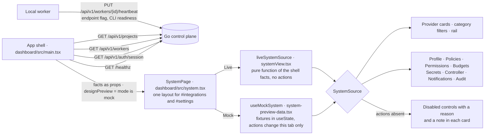

# Settings and integrations

The dashboard exposes Integrations and Settings routes over one page with one layout, the approved design. The layout
is fed by one of two sources with the same shape (`SystemSource` in `dashboard/src/systemView.tsx`): **Mock** shows the
approved fixtures and changes them only in the browser tab; **Live** shows what the control plane knows and states
everything else as not connected or unavailable. See `docs/architecture/dashboard-modes.md` for how a mode is chosen.
The dashboard development server forwards `/api/` requests, including mutation methods, to the configured control plane
before static-file handling.

## Feature diagram



## Behavior

- **One layout.** Both modes render the same markup, class names, and responsive rules: the page heading and tabs, the
  configuration rail, the provider card grid with category filters, eight settings cards, and the Discard / Test
  Connections / Save row. `#settings` hides the provider grid and marks Organization Profile in the rail. The rail
  filters provider groups or scrolls to the related settings card in both modes.
- **Live provider cards.** Twelve cards. Six report real state: Control plane API (`/healthz`, online or offline),
  Local workers (heartbeat counts and which coding CLIs are ready on online workers), GitHub (github.com checkouts
  detected, read-only sync), Model endpoint (the worker-reported OpenAI-compatible endpoint flag; workers that have not
  sent the field are shown as needing an update, never guessed), OpenAI and Anthropic (the Codex and Claude Code CLIs
  signed in on online workers). Storage / Evidence is always "Not configured". GitLab, Slack, Linear / Jira,
  Docker / Registry, and Google (Vertex AI) say "Not connected" and "Not integrated with the control plane." Category
  counts are computed from these cards. A card's switch reflects its status and is disabled.
- **Card status in full.** A card's link line is one line and truncates. Its options menu has "View status", which
  opens the full sentence in a dialog; the line also carries it as a tooltip.
- **Live settings cards.** The control plane persists no organization settings, so the Live source has no actions:
  profile fields read "Unavailable" and are disabled; Policies, Secrets, Notification Rules, and the audit table are
  empty; Budgets reads "Unavailable" with "Not tracked" rows; Permissions shows the one real access rule (allowlisted
  GitHub users, or the local workspace) with members unavailable. Each card carries a note saying why. Controller
  Configuration shows the API status and the real facts as read-only rows: dashboard auth, state storage, online
  workers, local checkouts, and configured model endpoints; version, run limits, and its switches are disabled.
- **Live writes nothing.** Add Integration, Add Policy, Add Secret, Add Rule, Audit log, Import / Export, Activity &
  audit, View Full Audit Log, Discard, Test Connections, and Save are disabled with a reason. The page sends no
  request of its own; it reuses the shell's health, session, worker, and project queries. While those are loading or
  have failed it shows zero counts and "Unavailable" statuses, never fixtures.
- **Mock.** Category filters, connection switches, secret reveal labels, provider menus, Add Integration, profile
  edits, policy and secret list changes, notification rules, Test Connections, Save, and Discard change fixture state
  in the tab only and say "preview" in their labels. Audit log opens the fixture events and Import / Export downloads
  them as JSON. The audit range is a fixed sample label, not a filter. Discard restores the last local save; a reload
  resets the fixtures. No request other than the session check is sent.
- **Authority.** A sanitized `github.com/owner/repository` locator enables issue and PR sync in Reviews. PR review
  submission requires control-plane GitHub authentication with Pull requests write permission; GitHub records the app
  or token actor. The dashboard session identifies an allowlisted OAuth user, but organization roles are not enforced.
  The worker reports only whether its model endpoint is configured; the endpoint and credentials stay on that worker.
  GitHub App credentials or the `ZENCHRON_GITHUB_TOKEN` fallback are configured in the control-plane environment,
  never in the worker or dashboard.
- **Layout details.** At tablet widths the page title and status/actions stack so the system-health badge and
  provider status controls stay readable. Provider descriptions stay fully readable on the desktop mock. A
  switched-off connection is grey, not green.

## Verification

`dashboard/e2e/system.spec.ts` covers Live: navigation to both routes and direct hash changes, the approved rail, grid,
and card geometry, real worker, checkout, model-endpoint, and session state, "Not connected" for services that are not
integrated, every disabled control, the rail filter and "View status" dialog, the phone layout, and that the page
sends no write request. Run it with:

```sh
cd dashboard && npm run test:e2e -- e2e/system.spec.ts --grep "settings and integrations"
```

`dashboard/e2e/z_run_evidence.spec.ts` ("Settings reports which coding CLIs are ready on online workers") checks the
coding-CLI sentence on the Local workers card.

`cd dashboard && npm run test:e2e -- e2e/integrations-preview.spec.ts` verifies Mock uses frontend data without
protected reads or writes, checks category filtering, local connection updates and the switched-off colour, the status
dialog, preview key labels, adding a placeholder integration, editing settings, local policy/secret/rule actions,
Save/Discard, connection testing, and viewing/exporting audit fixture data, then checks provider descriptions and links
at desktop, provider link and badge visibility at 682 px, title-case Connected badge text and label styling, and
status-dot alignment without badge/toggle overlap. The desktop check also keeps the lower settings row within 152 px
and aligns Notification Rules with the supplied mock.
Set `ZENCHRON_E2E_DASHBOARD_PORT` to a free port to force Playwright to start a fresh dashboard instead of reusing
a running preview.
