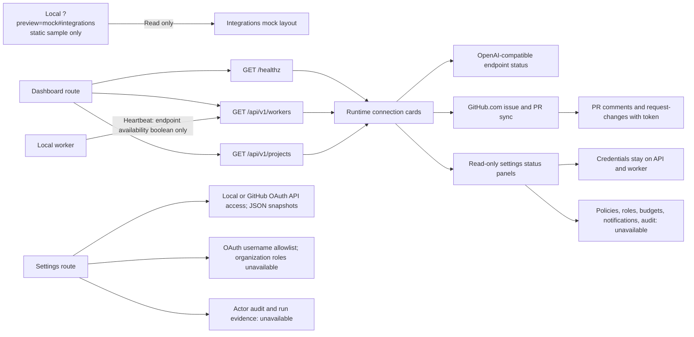

# Settings and integrations

The dashboard exposes separate Integrations and Settings routes over one system-status view. Integrations shows the
live API, worker, local-checkout, Git provider, and worker-side OpenAI-compatible endpoint state. The mockup's profile,
policy, permission, budget, notification, and audit panels are read-only status summaries; unavailable capabilities are
labelled instead of shown as configured. GitHub.com repositories support open issue and pull-request sync, plus
top-level pull-request comments and request-changes when a control-plane token has Pull requests write permission.
Workers that have not sent the endpoint-status field are shown as needing an update; their configuration is not guessed.
The local `?preview=mock#integrations` route uses the same dashboard shell with a static, read-only sample of the supplied
Integrations mock; it does not query protected provider settings or save changes.

## Feature diagram



## Authority and empty states

- API and worker status reuse the overview's live TanStack Query results; the page does not create a second data source.
- A sanitized `github.com/owner/repository` locator enables issue and PR sync in Reviews. PR review submission requires
  control-plane GitHub authentication with Pull requests write permission; GitHub records the app or token actor. The
  dashboard session identifies an allowlisted OAuth user, but organization roles are not enforced.
- The worker reports only whether its model endpoint is configured; the endpoint and credentials stay on that worker.
- Settings report the current API security configuration and versioned JSON state boundary. They do not expose write controls for
  settings the service cannot persist or enforce.
- The Integrations overview uses the mockup's configuration rail and settings-panel layout and the shared dashboard
  panel typography. Its rail uses icon-led category labels; connection status stays in the main cards instead of
  repeating in the navigation. Panels remain read-only where no backing API exists.
- GitHub App credentials or the `ZENCHRON_GITHUB_TOKEN` fallback are configured in the control-plane environment,
  never in the worker or dashboard. Public repository reads work without credentials; private reads and PR review
  submissions require repository permissions.

## Verification

The focused dashboard E2E test checks navigation to both routes, direct hash changes, live worker/check-out status,
integration layout, and unavailable states. Run it with:

```sh
cd dashboard && npm run test:e2e -- e2e/system.spec.ts --grep "settings and integrations"
```

`cd dashboard && npm run test:e2e -- e2e/integrations-preview.spec.ts` verifies the local mock uses frontend data
without protected reads or writes.
