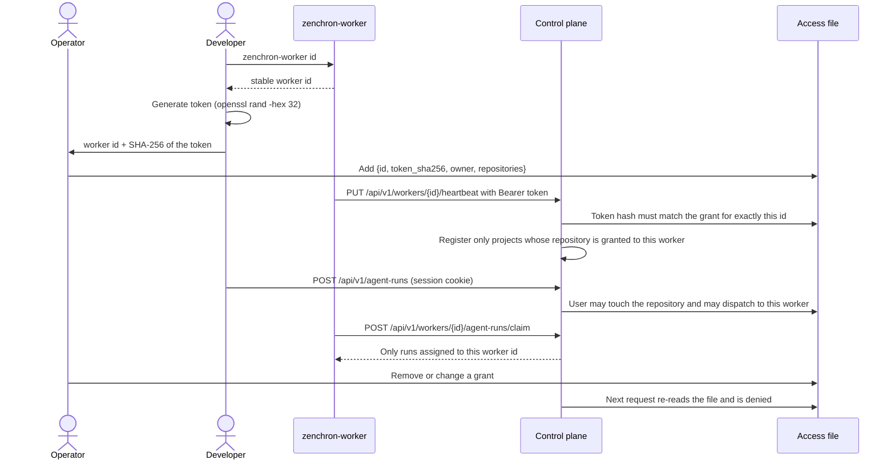

# Worker enrollment and project access

When the control plane is given an access file, every worker has its own revocable credential bound to its id, and
users and workers can only see and act on the repositories they were granted. This is the minimum boundary for a
control plane in a private cloud serving developers with different project access. It is enforced on the server; the
dashboard hiding a project is never the control.

## Feature diagram



## Access file

`ZENCHRON_ACCESS_FILE` points to a JSON file maintained by the operator:

```json
{
  "workers": [
    {
      "id": "3e8b90682340009a68a3bb631a30dedd",
      "token_sha256": "<sha256 of the worker token, hex>",
      "owner": "alice",
      "repositories": ["github.com/acme/project-a", "github.com/acme/project-b"]
    }
  ],
  "users": {
    "alice": ["github.com/acme/project-a", "github.com/acme/project-b"],
    "bob": ["github.com/acme/project-c"]
  }
}
```

Enroll a worker:

1. On the worker machine run `zenchron-worker id` with the environment the worker will use.
2. Generate a token: `openssl rand -hex 32`. Compute its hash: `printf %s "$TOKEN" | shasum -a 256`.
3. The operator adds the worker entry with the id, the hash, the owning GitHub username, and the repositories.
4. Start the worker with `ZENCHRON_WORKER_TOKEN` set to the token and `ZENCHRON_CONTROL_PLANE_URL` set to the HTTPS
   origin of the control plane.

An empty `owner` marks a shared execution machine. Users are GitHub usernames and must also be in
`ZENCHRON_GITHUB_ALLOWED_USERS` to sign in.

## Behavior

- A worker token is accepted only on worker endpoints for the id it was enrolled with. A valid token sent with another
  worker's id is rejected, so a worker cannot heartbeat, claim, report, or finish as another worker.
- The control plane stores only the SHA-256 of each token.
- With an access file, the shared `ZENCHRON_WORKER_TOKEN` is not accepted by the control plane at all.
- A worker's heartbeat registers only projects whose repository is in its grant. Other checkouts it reports, and
  checkouts without a remote, are ignored.
- A signed-in user sees only projects, runs, worktree requests, and workers for repositories they are granted. A user
  without an entry sees none. A run or project outside the user's access returns the same response as a missing one.
- A user can start runs and worktree requests, and queue a follow-up pass with a change request, only on a worker
  they own or on a shared worker, even when they have access to the repository. Feedback without a follow-up pass can
  still be recorded.
- A queued run is not handed to a worker whose grant for the run's repository has since been removed.
- A project id belongs to the first worker that registers it; another worker cannot register the same id.
- A worker only ever receives runs assigned to its own id, and those runs can only be created for projects it
  registered.
- The file is checked on every request. Removing or changing a grant takes effect immediately, without a restart. If
  the file is missing or invalid, every API request is refused until it is fixed.
- A control plane on a non-loopback address refuses to start without an access file, GitHub sign-in, and an HTTPS
  public URL.
- GitHub writes made with the control plane's credential (issue creation and comments, reviews) are allowed for a
  remote client only when the access policy authorizes the caller for that project; otherwise they remain limited to
  loopback clients.

On the worker:

- All connections are outbound to the control plane. Remote control-plane URLs must use HTTPS and require a token.
- The worker executes only in checkouts it discovered under `ZENCHRON_PROJECTS_ROOT`, and with a worker configuration
  only in repositories listed there.
- It creates, commits to, and pushes only the branch `zenchron/agent-run/<run id>` for the run it claimed, after
  checking that `origin` is the project's repository.
- Commands it runs on its own behalf come only from the operator's worker configuration. No field of a control-plane
  request selects a command, and model names that could be read as CLI options are rejected.
- Project paths never leave the worker; events and output are redacted for credentials and local paths before sending.

## Security assessment

| Property | State |
|---|---|
| Worker identity authenticated, scoped, revocable | Implemented with the access file |
| Worker cannot act as another worker | Implemented and tested |
| Server-side project access for users | Implemented for projects, GitHub project routes, runs, worktree requests, workers |
| Workers receive only work in their approved repositories | Implemented |
| No inbound connection to workstations | Holds by design |
| Dashboard request cannot become arbitrary shell execution | Verification commands are worker-local; provider permissions are fixed by the worker |
| Credentials stay on their side | GitHub API credential on the control plane; Git and provider sign-ins on the worker |

Not covered, and blocking multi-organization or untrusted deployment:

- Agent profiles, objectives, workflows, and products are visible to every signed-in user; they are not
  project-scoped.
- Grants are edited in a file by an operator. There are no organizations, teams, roles, self-service enrollment, or
  audit records.
- User sessions are signed cookies valid for eight hours; removing a user from the allowlist blocks them, but there is
  no server-side session list.
- Worker tokens are static until the operator replaces the hash. There is no automatic rotation or mutual TLS.
- A worker executes repository code (tests) with the developer's own permissions. Verification is not sandboxed; the
  provider sandboxes isolate only what the agent runs during execution.
- Probed on 2026-11-11: Codex 0.167.0 in its stock `workspace-write` mode read a file in the home directory, so the
  worker now runs Codex under its own permission profile; with it, and with the worker's Claude Code sandbox
  settings, the same file was refused. Files outside the home directory that the worker's user can read (for example
  under `/etc`) remain readable by both, and redaction of events is pattern-based. These sandboxes are the CLIs' own
  and were verified by hand on macOS only.
- The control plane trusts the commit and verification result the enrolled worker reports. A compromised worker can
  misreport its own work; GitHub CI on the pull request is the independent check.

## Verification

- `go test ./cmd/zenchron -run 'TestWorkerTokenIsBound|TestWorkerRegistersOnlyApproved|TestRunsAreScoped|TestUsersDispatchOnly|TestRepositoryAccessAlone|TestWorkerCannot|TestRevokingAGrant|TestAccessFileRejects|TestRunRejectsRemoteListener' -count=1`
  covers impersonation, the shared token, unapproved repositories, cross-user reads and writes on runs and projects,
  cross-worker claims and results, personal versus shared workers, revocation without restart, an invalid policy
  denying everything, malformed grants, and the non-loopback startup requirement.
- `go test ./cmd/zenchron-worker -run 'TestRunRejectsBranchOtherThanItsOwnRunBranch|TestRunRejectsModelNames|TestProviderEnvironment|TestWorkerConfig|TestPushAgentBranch' -count=1`
  covers the worker-side refusals.

Live on 2026-11-11, with the real binaries on loopback and authentication plus an access file enabled: the enrolled
worker registered its granted repository; its token was refused for another worker id and on the dashboard API; a
user without the grant saw no projects or workers and got not-found for the project's issues; removing the worker's
grant made its next heartbeat fail with HTTP 401 without a restart. The same day the control plane was started on an all-interfaces listener: it refused to start with only the shared
worker token and with an `http` public URL, the worker refused a plain-HTTP non-loopback URL, and with the access file
the enrolled worker, the two users, an authorized GitHub write, a foreign-origin write, and a revocation behaved as
described above. Requests were made from the same machine; a TLS-terminating proxy, a worker on another host, and a
real OAuth sign-in were not part of the check, and the issue-to-pull-request runs used loopback without the policy.
