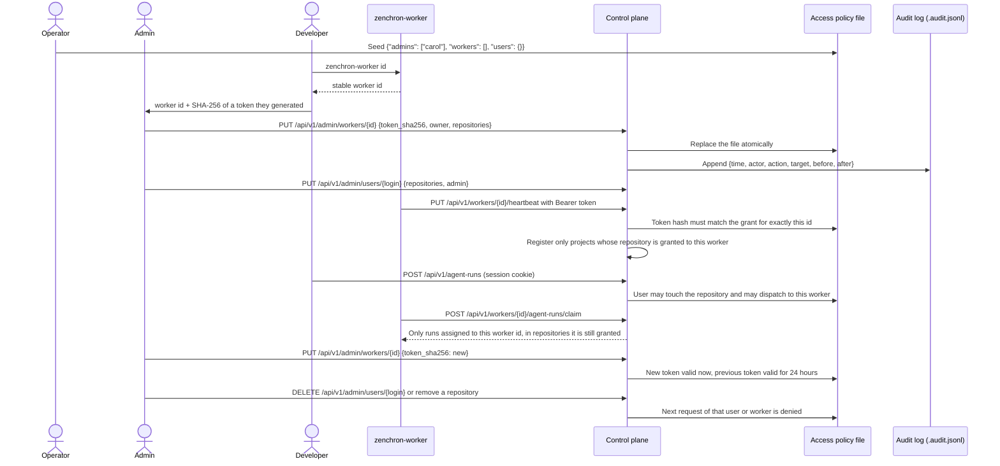
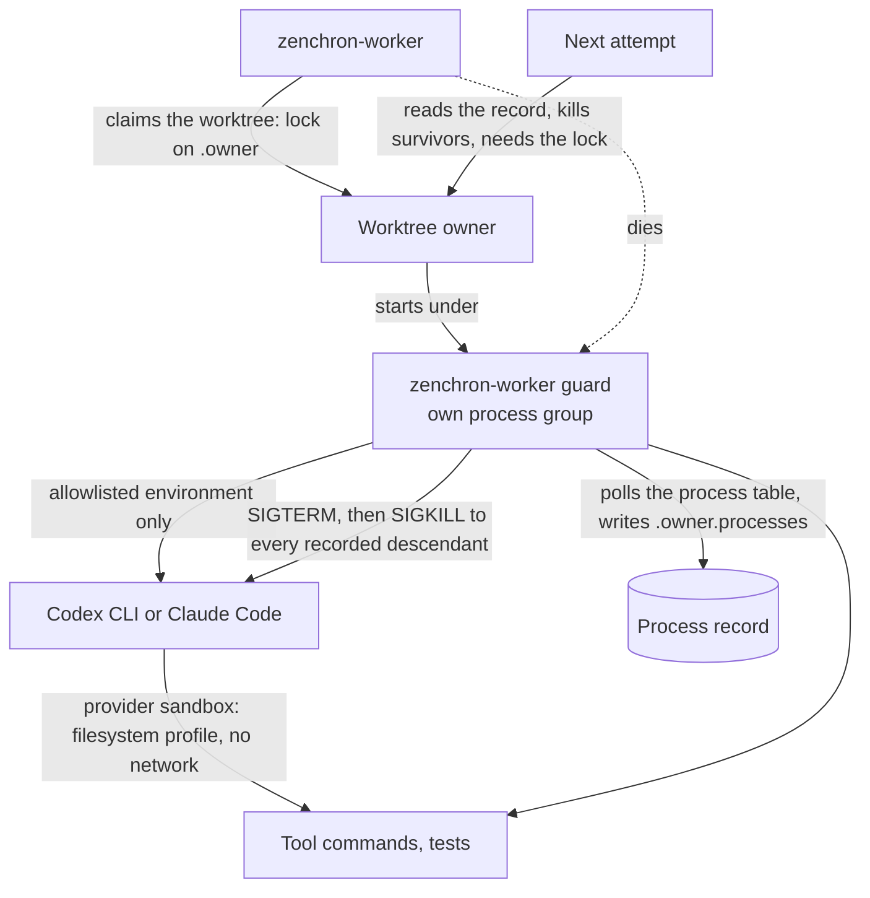

# Worker enrollment and project access

When the control plane is given an access policy, every worker has its own revocable credential bound to its id,
users and workers can only see and act on the repositories they were granted, and administrators manage those grants
through an audited API. This is the boundary for a control plane in a private cloud serving developers with different
project access. It is enforced on the server; the dashboard hiding something is never the control.

## Feature diagram



## Access model

There are two roles and one unit of authorization.

- **Repository** (`github.com/owner/name`) is the unit. A grant gives a user or a worker a repository.
- **Developer**: a GitHub login with repository grants.
- **Administrator**: a login listed under `admins`. Administrators manage the policy and may read and change
  everything it protects. They are still bound by worker ownership: an administrator cannot dispatch work to another
  person's personal worker without first changing its owner, which is audited.

| Data | Who may read it | Who may change it |
|---|---|---|
| Projects (worker checkouts), their GitHub issues, pull requests, history | Users granted the repository | Users granted the repository (GitHub writes) |
| Workers | Users granted a repository the worker serves | Administrators (enrollment) |
| Agent runs, their events, diff, evidence, pull-request state | Users granted the run's repository | Same; starting or re-queueing a run also requires that the worker is the user's own or shared |
| Products | Creator, administrators, users granted one of the product's repositories | Same; a product may only link projects its author may access |
| Objectives | As their product; without a product: creator and administrators | Same |
| Agent profiles, workflows | Every signed-in user | Creator and administrators |
| Access policy, audit log | Administrators | Administrators, through `/api/v1/admin` |

Agent profiles and workflows are organization-wide definitions: they name no repository, and a profile must be
readable by whoever runs it. Do not put project secrets into a system prompt. Records created before a policy was
enabled have no creator; they stay readable as above and can be changed only by an administrator. A product saved
without a policy records no repositories and is visible only to administrators once a policy is enabled, until an
administrator saves it again.

A run, a project, a product, or an objective outside the caller's access is answered exactly like one that does not
exist, and the product-name uniqueness check only compares with products the caller can see.

## Access policy file

`ZENCHRON_ACCESS_FILE` points to a JSON file. The operator creates it once with the first administrator; after that it
is changed through the admin API. The control plane must be able to write the file and its directory.

```json
{
  "admins": ["carol"],
  "workers": [
    {
      "id": "3e8b90682340009a68a3bb631a30dedd",
      "token_sha256": "<sha256 of the worker token, hex>",
      "owner": "alice",
      "repositories": ["github.com/acme/project-a", "github.com/acme/project-b"]
    }
  ],
  "users": {
    "alice": ["github.com/acme/project-a", "github.com/acme/project-b"],
    "bob": ["github.com/acme/project-c"]
  }
}
```

An empty `owner` marks a shared execution machine. The file is read on every request, so a hand edit also takes
effect at once, but only changes made through the API are audited.

## Admin API

All routes require a signed-in administrator; a developer gets 403 and a worker token gets 401. Token hashes are never
returned.

| Method and path | Purpose |
|---|---|
| `GET /api/v1/admin/access` | Users with their role and repositories; workers with owner, repositories, and rotation state |
| `PUT /api/v1/admin/users/{login}` | Set `{repositories, admin}` for a GitHub login |
| `DELETE /api/v1/admin/users/{login}` | Remove a user |
| `PUT /api/v1/admin/workers/{id}` | Enroll or update `{owner, repositories, token_sha256?, revoke_previous_token?}` |
| `DELETE /api/v1/admin/workers/{id}` | Remove a worker |
| `GET /api/v1/admin/audit?limit=N` | Newest audit records first (default 100, at most 500) |

`GET /api/v1/auth/session` reports `admin: true` for an administrator.

Enroll a worker:

1. On the worker machine run `zenchron-worker id` with the environment the worker will use.
2. Generate a token: `openssl rand -hex 32`. Compute its hash: `printf %s "$TOKEN" | shasum -a 256`.
3. An administrator sends the id, the hash, the owning GitHub login, and the repositories to
   `PUT /api/v1/admin/workers/{id}`.
4. Start the worker with `ZENCHRON_WORKER_TOKEN` set to the token and `ZENCHRON_CONTROL_PLANE_URL` set to the HTTPS
   origin of the control plane.

Rotate a worker token: generate a new token, send its hash with the same `PUT`. The new token works immediately and
the previous one keeps working for 24 hours, so the worker can be restarted at any time in that window. Send
`"revoke_previous_token": true` to end the previous token at once, for example after a leak.

## Behavior

- A worker token is accepted only on worker endpoints for the id it was enrolled with. A valid token sent with another
  worker's id is rejected, so a worker cannot heartbeat, claim, report, or finish as another worker. The one exception
  is the readiness probe `GET /api/v1/workers/healthz`, which has no worker id and accepts any enrolled worker's token.
- Rotating, revoking, or removing one worker's credential does not affect any other worker.
- A repository grant must equal the remote the worker reports, character for character (`github.com/owner/name`, with
  the host lower-cased and no `.git` suffix; the path keeps its case). A project whose remote is not granted is left
  out of the worker's registration and the heartbeat still returns 200, so a grant that differs only in case or suffix
  shows up as a missing project, not as an error.
- The control plane stores only the SHA-256 of each token. With an access policy, the shared `ZENCHRON_WORKER_TOKEN`
  is not accepted at all.
- A signed-in user sees only projects, runs, and workers for repositories they are granted. A user without an entry
  sees none.
- A GitHub login may sign in when the operator listed it in `ZENCHRON_GITHUB_ALLOWED_USERS` or the policy names it.
  Removing a user from the policy ends their session at the next request unless the operator also allowlisted them.
- A user can start runs, and queue a follow-up pass with a change request, only on a worker they own or on a shared
  worker, even when they have access to the repository. Feedback without a follow-up pass can still be recorded.
- A queued run is not handed to a worker whose grant for the run's repository has since been removed. A worker that
  loses the grant while running is refused at its next progress report, which stops the attempt, and its result is
  not accepted or published.
- A follow-up queued by a GitHub webhook runs on the authority of the user who started the run, as the policy stands
  when the review arrives. See [GitHub webhooks](github-webhooks.md).
- Every applied policy change appends one line to `<access file>.audit.jsonl` with the time, the administrator, the
  action (`user.set`, `user.delete`, `worker.set`, `worker.delete`), the target, and the state before and after. A
  token rotation is recorded as `token_changed`; hashes are not written. If the record cannot be written the change is
  undone and the request fails. The last administrator cannot be removed or demoted.
- A project id belongs to the first worker that registers it; another worker cannot register the same id.
- If the policy file is missing or invalid, every API request is refused until it is fixed.
- A control plane on a non-loopback address refuses to start without an access policy, GitHub sign-in, and an HTTPS
  public URL.
- GitHub user sign-in (OAuth, `read:user`) only identifies the person. GitHub API calls use the control plane's own
  App or token credential, and Git pushes use the worker's local credentials. None of the three is derived from
  another.

On the worker:

- All connections are outbound to the control plane. Remote control-plane URLs must use HTTPS and require a token.
- The worker executes only in checkouts it discovered under `ZENCHRON_PROJECTS_ROOT`, and with a worker configuration
  only in repositories listed there.
- It creates, commits to, and pushes only the branch `zenchron/agent-run/<run id>` for the run it claimed, after
  checking that `origin` is the project's repository.
- Commands it runs on its own behalf come only from the operator's worker configuration. No field of a control-plane
  request selects a command, and model names that could be read as CLI options are rejected.
- Project paths never leave the worker; events and output are redacted for credentials and local paths before sending.

## Provider isolation on the worker

What an agent can reach is decided by four mechanisms. Redaction of events is the last of them, not the boundary.



**Processes.** One attempt holds an exclusive lock on a file beside the worktree, and every process it starts inherits
the locked descriptor. Providers and verification commands run under `zenchron-worker guard`, which records every
descendant it sees, including commands that Codex starts as their own session. When the provider exits, when the run
is cancelled, or when the worker process dies for any reason, the guard stops all of them. A new attempt first kills
whatever the record names (matched by pid and start time) and then needs the lock; if something still holds it, the
attempt fails instead of running beside it. Two attempts therefore never write the same worktree.

**Environment.** Provider and verification processes inherit only named variables (`PATH`, `HOME`, `USER`, locale,
`TMPDIR`, proxy and certificate settings, XDG directories, `CODEX_HOME`, `CLAUDE_CONFIG_DIR`) plus what the operator
lists under `environment` in the worker configuration. Tokens in the developer's shell do not reach an agent.

**Filesystem.** Both providers get the same rules from the worker: the worktree is writable (read-only without
`code.write`), the temporary directory is writable, and these are unreadable: every home directory (`/Users`, `/home`,
`/root`), mounted volumes (`/Volumes`, `/mnt`, `/media`, `/srv`), every checkout the worker serves, and the directory
holding all run worktrees. The run's own worktree, the repository's Git metadata, and operator `read_paths` are
re-allowed inside them. Network access is off for model-run commands.

| | Codex CLI | Claude Code |
|---|---|---|
| File reads and writes by the agent itself | Through sandboxed commands only | File tools are limited to the worktree by Claude Code's permission layer; outside paths are refused |
| Commands (tests, builds) | Always sandboxed by Codex with the worker's permission profile | Only for profiles with `code.write` and `tests.run`, inside Claude Code's sandbox with `failIfUnavailable`, so a missing sandbox stops the run instead of running the shell unconfined |
| How the boundary is established on a machine | At worker start a self-test runs a command under `codex sandbox` with the run's profile; Codex is reported not ready (`reason: sandbox self-test failed`) unless a denied file is unreadable, an outside write fails, and a workspace write succeeds | The shell is offered only where the backend exists: Seatbelt on macOS, bubblewrap and socat on Linux; otherwise the provider reports `sandboxed_commands: false` and edits files without running anything |
| macOS (tested: Codex 0.167.0, Claude Code 2.1.322) | Verified by the self-test, by `codex sandbox` tests, and by a live adversarial run | Verified by a live adversarial run for both the file-tool and the sandboxed-shell profile |
| Linux | The self-test decides at worker start; not exercised by this project's tests | Backend detection and `failIfUnavailable` apply; not exercised by this project's tests |
| Windows | Not supported: the worker's process control is POSIX-only | Not supported |

Still readable by a sandboxed command, by design or by limitation, and therefore not to be treated as confidential on
a worker machine: system directories such as `/etc` and `/usr`, other directories outside the denied roots (for
example `/opt` and `/Library`), and the system temporary directory, which is shared by all runs on the worker. With `ZENCHRON_WORKTREES_ROOT` placed inside the temporary directory, a Claude Code shell
could write, though not read, other runs' worktrees; keep the default location.

Verification commands are not sandboxed. They are the operator's own commands, run with the reduced environment under
the guard, but they execute repository code, including code the agent just wrote, with the developer's filesystem
permissions. Run workers for untrusted repositories on a dedicated machine or account.

## Security assessment

| Property | State |
|---|---|
| Worker identity authenticated, scoped, rotatable, revocable | Implemented and tested |
| Worker cannot act as another worker | Implemented and tested |
| Server-side access for users to projects, runs, products, objectives; ownership for profiles and workflows | Implemented and tested with two developers, two workers, and disjoint grants |
| Grants changed through an authenticated admin API with audit records | Implemented and tested |
| Workers receive only work in their approved repositories, and lose a run when the grant is removed | Implemented and tested |
| Providers and their tool commands do not outlive the worker, a cancellation, or the attempt | Implemented and tested, including a killed guard and commands that leave the process group |
| Providers cannot read home directories, other checkouts, other runs, or the worker's environment | Verified on macOS with both CLIs; decided by a self-test for Codex elsewhere |
| No inbound connection to workstations | Holds by design |
| Dashboard request cannot become arbitrary shell execution | Verification commands are worker-local; provider permissions are fixed by the worker |
| Credentials stay on their side | GitHub API credential on the control plane; Git and provider sign-ins on the worker |

Not covered, and blocking multi-organization or untrusted deployment:

- One control plane serves one organization. There are no organizations or teams, and no self-service enrollment.
- The policy is one file changed by one control-plane instance. Hand edits are not audited, and the audit log is a
  local file an operator with host access can alter.
- User sessions are signed cookies valid for eight hours. Removing a user from the policy ends them; there is no list
  of active sessions and no single-session revocation.
- Worker tokens are bearer secrets; there is no mutual TLS and no automatic rotation.
- Verification runs unsandboxed, as described above.
- Descendant processes are found by polling. A process that detaches from an already finished parent between two
  polls (half a second) is missed.
- The control plane trusts the commit and verification result the enrolled worker reports. A compromised worker can
  misreport its own work; GitHub CI on the pull request is the independent check.

## Verification

- `go test ./cmd/zenchron -run 'TestAdmin|TestWorkerToken|TestProductsAndObjectives|TestProfilesAndWorkflows|TestWorkerIsStopped' -count=1`
  covers the admin API (refusals for developers and worker tokens, grants, removal, the last administrator, audit
  records without token hashes), token rotation overlap, immediate revocation, an expired previous token, another
  worker being unaffected, product and objective scoping with negative cases, profile and workflow ownership, and a
  worker losing its grant mid-run.
- `go test ./cmd/zenchron -run 'TestWorkerTokenIsBound|TestWorkerRegistersOnlyApproved|TestRunsAreScoped|TestUsersDispatchOnly|TestRepositoryAccessAlone|TestWorkerCannot|TestRevokingAGrant|TestAccessFileRejects|TestRunRejectsRemoteListener' -count=1`
  covers impersonation, the shared token, unapproved repositories, cross-user reads and writes on runs and projects,
  cross-worker claims and results, personal versus shared workers, revocation without restart, an invalid policy
  denying everything, malformed grants, and the non-loopback startup requirement.
- `go test ./cmd/zenchron-worker -run 'TestGuard|TestNextAttempt|TestAttemptFailsClosed|TestRecordedProcess|TestRunLeaves|TestGuardedRun' -count=1`
  kills a stand-in worker and its guard and checks that provider processes, including one that left the process group
  and dropped the lock, are stopped by the guard or by the next attempt, that an attempt fails closed while something
  it cannot stop holds the worktree, and that a reused pid is not killed.
- `go test ./cmd/zenchron-worker -run 'TestConfinement|TestProviderIsNotReady|TestInstalledCodex|TestConfidentialRoots|TestProviderArguments|TestProviderEnvironment' -count=1`
  covers the self-test against sandboxes that do not confine, the not-ready status, the installed Codex sandbox
  against a home-directory file, another checkout, and another run's worktree (skipped where Codex is not installed),
  and the arguments and environment both providers receive.
- `ZENCHRON_LIVE_PROVIDER_TESTS=1 go test ./cmd/zenchron-worker -run TestLive -count=1 -v` runs the installed,
  signed-in CLIs with a real model through the worker's adapter code and asks the agent to read a file in the home
  directory, in another checkout, and in another run's worktree, to write outside its worktree, to print a secret from
  the worker's environment, and to keep a command running through a cancellation. On 2026-11-14, on macOS with Codex
  0.167.0 and Claude Code 2.1.322, all five tests passed: every outside read and write was refused, the control file
  inside the worktree was read, and no process remained after cancellation. These tests use provider quota and do not
  run in CI.
