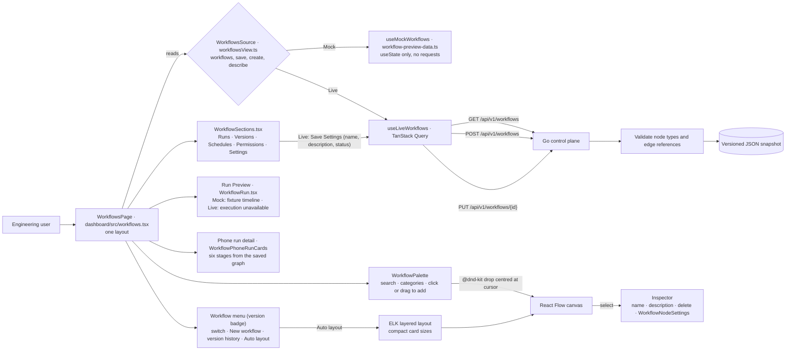

# Workflow Builder

The Workflows page has one layout, taken from the supplied node-editor mockups, and two data sources. **Live** shows
the workflows saved in the control plane and keeps them fully editable: an xyflow canvas with ELK auto-layout,
component properties, graph validation, and save. **Mock** (local addresses only) shows the approved fixture workflow
with its illustrative run, schedules, permissions, and settings. See `docs/architecture/dashboard-modes.md` for the
mode rules.

The control plane stores a workflow's name, description, status, version, and graph. It does not execute, schedule,
version, or share workflows, so in Live every part of the design that needs those says "Unavailable" or is empty, and
its controls are disabled with the reason. Nothing in Live simulates a run.

## Feature diagram



## Behavior

### Both modes

- One frame: page heading with the status badge, the workflow menu, Validate / Run / Save / Publish, the six section
  tabs, the component palette, the canvas with its tool and zoom groups, the Execution Flow card, the resizable Run
  Preview, and the inspector. Desktop reference size is 1672×941; the editor is desktop and tablet only.
- The workflow menu opens from the version badge. It lists every workflow (the open one is marked), then "New
  workflow…", "Open version history", and "Auto layout".
- The palette groups all node types the control plane accepts. Search filters names and descriptions; the All, Agents,
  Actions, Control, and Integrations chips narrow the list; group headings collapse, and Integrations starts
  collapsed. A component is added by clicking it or by dragging its handle onto the canvas, where it is centred under
  the cursor. "Custom Block" adds an Agent Task named Custom Block.
- The canvas supports dragging nodes, connecting ports, select and pan modes, fit, fullscreen, zoom, and a mini-map
  toggle. Node icons and accent colours follow the component type; connectors take the colour of the component they
  lead to and are dashed around a Loop.
- The inspector shows the selected component's name, read-only type, and description. Its overflow menu resets the
  selection to the Agent Router or deletes the component with its connectors; closing the inspector gives the canvas
  its width, and selecting a node opens it again. Opening a workflow selects its Agent Router; a graph without one
  opens unselected.
- Validate checks that the graph has a Trigger and that every edge joins existing nodes. A failed validation, save,
  layout, or fullscreen request is shown in the alert colour and wraps instead of being clipped.
- The `react-resizable-panels` separator adjusts the canvas and Run Preview heights with the pointer or arrow keys.
- On phones the page is the run-detail view: back / brand / overflow header, the four in-page tabs, the six-stage
  overview graph, and the Run Status, Task Progress, and Approvals cards. The builder toolbar, section tabs, editor,
  and the shell header are hidden there, as in the mockup.

### Live

- `GET /api/v1/workflows` fills the menu and the canvas. While it loads the page says so; a failed request shows the
  error and an empty list says "No workflows available". Fixtures are never used as a fallback.
- Save sends `PUT /api/v1/workflows/{id}` with the name, description, status, nodes, and edges, and confirms with the
  new version. "New workflow…" sends `POST /api/v1/workflows` and opens the result; a rejected create is reported in
  the dialog, a rejected save in the Execution Flow card or the section note.
- A saved graph is arranged by ELK when it opens, using the compact card sizes from 1051px up and the full cards
  below. Auto-layout preserves model order, so Code Reviewer stays above Test Generator and Coverage Analyzer.
- The Settings tab edits the saved name, description, and status in the General card; "Save Settings" is the same
  save. Repository, target branch, execution limits, connected services, and notifications are Unavailable.
- The version badge reads `v<version> (<Status>)`. Versions lists the one saved version with its save time; there is
  nothing to compare, restore, or publish.
- Run and Publish are disabled ("Runner not connected", "Workflow publishing is not connected"). Run Preview says
  execution is unavailable and gives the graph's component and connection counts; its tabs and the Simulate Run switch
  are disabled. No component carries a passed-step marker.
- The inspector's Prompt, Variables, and Advanced tabs are disabled; Routing Parameters, Budgets & Limits, Retry
  Rules, and Execution Conditions read Unavailable because only a component's name and description are stored.
- Runs, Schedules, and Permissions show their headings with "Unavailable" values, an empty state that gives the reason,
  and disabled controls.
- On phones, Run Status shows the component and connection counts and "Not run", Task Progress lists the stages
  derived from the saved graph as "Not run", and Approvals lists each Human Approval component as "Not requested".

### Mock

- Uses the fixture workflow (`designPreviewWorkflow`) at hand-arranged positions and sends no workflow request.
- Save acknowledges the draft locally, Publish marks only the preview, "New workflow…" adds a workflow "in this
  preview only", and added blocks are local. Run shows the illustrative PR #4827 timeline; the Simulate Run switch
  hides and restores it. Green check markers on the cards belong to that illustrative run.
- The inspector is read-only and shows the fixture's routing rules, budgets, retry rules, execution conditions, and
  labelled illustrative prompt and variables; added rules and switches change local state only.
- Runs, Versions, Schedules, Permissions, and Settings show fixture data marked "CONCEPT · ILLUSTRATIVE DATA". Their
  actions answer "previewed · no workflow changes were saved"; Export logs downloads a sample log. The phone shows
  sample run #8821 at 78% with its tasks and approvals.
- Layout proportions asserted for the mockups: Runs keeps 397px history / detail panels at 0.88:1 with 32px metric
  values and 159px primary actions; Versions splits 43 / 57 with 160px compare frames; Schedules splits 32 / 68 with
  90px trigger cards and 144px calendar days; Permissions splits 1.6:1 and fits the 941px frame.

### Control plane

- The control plane returns a starter PR review and release graph with parallel Code Reviewer, Test Generator, and
  Coverage Analyzer branches. Node type, node and edge counts, IDs, labels, positions, status, and edge references
  are validated before saving; saving increments the version.
- Workflow definitions survive API restarts through an atomic versioned JSON snapshot. The control plane does not
  execute workflows.

## Outstanding

- Workflow execution, run history, schedules, per-workflow permissions, version history, publishing, and component
  settings beyond name and description have no API; their parts of the page stay Unavailable in Live.
- The workflow menu is a plain list without a filter field.
- On phones a workflow cannot be switched or edited; the page shows the first saved workflow's run detail.

## Verification

```sh
go test ./cmd/zenchron -run 'TestWorkflow|TestPersistentMuxRestoresObjectivesAndWorkflows' -count=1
cd dashboard && npm run test:e2e -- e2e/workflows-live.spec.ts
cd dashboard && npm run test:e2e -- e2e/workflows.spec.ts
cd dashboard && npm run test:e2e -- e2e/workflow-mobile-preview.spec.ts
```

`workflows-live.spec.ts` covers the frame in Live against the test control plane: the workflow menu, the automatic
layout, honest unavailable parts on every tab, add, rename, delete, drag placement, save and its request body,
create, the Settings rename, resizing, and the phone view; and, with stubbed responses, failed loads, an empty list,
and rejected saves and creates. `workflows.spec.ts` and `workflow-mobile-preview.spec.ts` cover the same frame in Mock
with local-only actions and no workflow requests.
