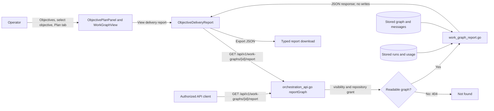

# WorkGraph delivery evidence quickstart

Use the delivery report to inspect what the control plane has recorded for one WorkGraph. It is a read-only API
response assembled from the stored graph and its stored runs. The **Objective Workspace displays this report**
in Live mode and supports a typed JSON export. Recorded facts remain distinct from unavailable evidence.

## Open the graph and request its report

1. Start the local dashboard, switch to **Live**, open **Objectives**, select the relevant objective and its
   **Plan** tab. The panel displays the latest graph for that objective, including status, unit states, run counts,
   candidates, verdicts, handoffs, decisions and any recorded pull-request link.
2. Under **Delivery evidence**, choose **View delivery report**. The dashboard calls
   `GET /api/v1/work-graphs/{id}/report` and renders the recorded execution, review, integration and measurement
   details. Choose **Export JSON** to download the validated report for that graph.
3. Alternatively, request the report directly using your authenticated control-plane session or local access mode:

```http
GET /api/v1/work-graphs/{id}/report
```

The `id` is the selected WorkGraph's ID, **not** its objective ID. If querying the API directly, find matching
`objective_id` records in `GET /api/v1/work-graphs` and select the intended graph/revision; do not blindly pick
another objective's run. The report endpoint returns `404` for an unknown graph and for one the caller is not
allowed to read. The report read does **not** reconcile the graph or persist changes; the graph-list request may
reconcile unfinished graphs. Worker credentials do not grant access to the report.

## Read recorded and unavailable values

The top-level `graph_id`, `objective_id`, `objective_title`, `plan_revision`, and `status` identify the graph and its
current state. `workflow_id` and `workflow_version` identify a selected definition; `workflow_mode` distinguishes
`compiled` plans from planner `guidance` and is absent on legacy records. `approved_plan` records the revision,
content hash and approval details. `units` contains each graph unit's `key`, `kind`, `agent_name` and `state`,
plus `run_ids`, summed stored-run `attempts`, sorted distinct `providers` and per-run `executions`. Executions
include recorded profile/persona versions, provider, candidate commit, worker-reported verification, review verdict,
publication, and PR link where available. `candidate` and `verdict` are present only when recorded. A run ID
remains listed if its run record is missing; that missing record contributes no attempt/provider data.
`handoffs`, `decisions`, and `outstanding_steps` preserve recorded progress and unresolved work.
The top-level `pull_request_url` is present only when the integrate unit has a recorded URL; it does not establish
a PR's merged state. `unknown_evidence` names missing candidate-tree, policy-backed assurance, publication-authority
and external-PR-state evidence, rather than inventing it. Worker-reported verification and GitHub check runs are not
treated as independent assurance authority.

`measurements` has counts derived from graph or attempt records and optional values derived from run usage or graph
timestamps:

| Measurement | How to interpret it |
|---|---|
| `unit_count`, `run_count`, `attempt_count` | Counts of graph units, all unit run IDs (including IDs with no stored run), and summed stored-run attempt counters. |
| `failed_attempts`, `max_concurrency` | Finished attempts whose status was not `succeeded`, and the peak overlap among recorded attempt intervals. An unfinished attempt has no end time. |
| `review_rounds`, `findings`, `decisions_requested`, `decisions_resolved` | Review-unit run IDs and graph messages of the corresponding types. |
| `remediation_passes` | Later produce-unit attempts preceded by a finding addressed to that unit, between the previous and current attempt start times. |
| `human_actions`, `human_actions_complete` | Resolved decisions plus one for plan approval; `human_actions_complete` is false because other human actions are not fully recorded. This is not supervision time. |
| `wall_clock_seconds` | Emitted only for a `completed` graph: elapsed time from graph creation to its last update. Otherwise omitted and named in `unknown`. |
| `input_tokens`, `output_tokens`, `runs_with_usage` | Token sums cover only runs that reported usage; `runs_with_usage` records coverage. Missing usage for some runs is explicitly named in `unknown`. With no recorded usage, token fields are omitted. |
| `cost_usd`, `runs_with_cost` | Sum of reported costs only (recorded zero counts), with `runs_with_cost` showing coverage. Missing cost for some runs is explicitly listed in `unknown`; when no run reports cost, the cost field is omitted. |
| `supervision_minutes` | Always named in `unknown` and never emitted as a value; the stored data does not measure time spent supervising work. |

`measurements.unknown` is a sorted list. An omitted measurement listed there is unavailable, not zero. Recorded
zeroes remain zeroes. When usage or cost coverage is incomplete, `unknown` includes
`input_tokens_for_some_runs`/`output_tokens_for_some_runs` or `cost_usd_for_some_runs`; coverage counts show
how many runs reported data, not which ones were missing. Treat partial sums as partial. The report does not
establish complete provider costs, human supervision time, publication authority, or live GitHub PR state.

## Feature diagram



## Related documentation

- [Objective orchestration](objective-orchestration.md) explains plan approval, graph lifecycle, units, and messages.
- [Objective delivery report](objective-delivery-report.md) documents the report fields and their computation in detail.

## Source checks

The endpoint and access check are in `cmd/zenchron/orchestration_api.go`; report calculations are in
`cmd/zenchron/work_graph_report.go`. The dashboard path is in `dashboard/src/ObjectiveDetail.tsx`,
`dashboard/src/ObjectivePlanPanel.tsx`, and `dashboard/src/orchestration.ts`.

Focused checks in `cmd/zenchron/work_graph_report_test.go` cover a completed report, omitted measurements, and
access control: `TestWorkGraphReportMeasuresACompletedRun`, `TestWorkGraphReportOmitsWhatWasNotRecorded`, and
`TestWorkGraphReportIsHiddenFromOtherCallers`. Browser acceptance for the Live report display, unknown fields,
provenance and JSON export is in `dashboard/e2e/orchestration.spec.ts`.
