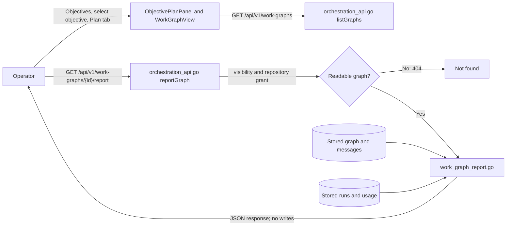

# WorkGraph delivery evidence quickstart

Use the delivery report to inspect what the control plane has recorded for one WorkGraph. It is a read-only API
response assembled from the stored graph and its stored runs. The dashboard shows graph status and unit details, but
does not display this report.

## Open the graph and request its report

In the dashboard, switch to **Live** mode, open **Objectives**, select an objective, and open **Plan**. The Plan panel
shows the graph's status, unit states, run counts, candidates, verdicts, messages, and any pull request link. It shows the number of
runs for each unit, not their IDs. This view loads graphs from
`GET /api/v1/work-graphs` and polls while the panel is open. That graph-list request reconciles unfinished graphs and may
update their stored state.

For the delivery report, use the same control-plane session or local access mode to make an authorized request:

```http
GET /api/v1/work-graphs/{id}/report
```

Match the selected objective to its graph in `GET /api/v1/work-graphs`, then use the newest graph for that objective.
Replace `{id}` with that graph’s `id` field. The report endpoint returns
`404` both for an unknown graph and for a graph the caller cannot read. Reading the report does not reconcile the
graph or persist changes. Worker credentials do not grant access to it.

## Read recorded and unavailable values

The top-level `graph_id`, `objective_id`, `objective_title`, `plan_revision`, and `status` identify the graph and its
current state. `units` contains each graph unit's `key`, `kind`, `agent_name`, and `state`, plus its `run_ids`, summed
stored-run `attempts`, and sorted distinct `providers`. `candidate` and `verdict` are present only when recorded. A
run ID remains listed if its run record is missing; that missing record contributes no attempts or provider data.
`pull_request_url` is present only when the integrate unit has a recorded URL. It does not indicate that a pull
request was merged.

`measurements` has counts derived from graph or attempt records and optional values derived from run usage or graph
timestamps:

| Measurement | How to interpret it |
|---|---|
| `unit_count`, `run_count`, `attempt_count` | Counts of graph units, all unit run IDs (including IDs with no stored run), and summed stored-run attempt counters. |
| `failed_attempts`, `max_concurrency` | Finished attempts whose status was not `succeeded`, and the peak overlap among recorded attempt intervals. An unfinished attempt has no end time. |
| `review_rounds`, `findings`, `decisions_requested`, `decisions_resolved` | Review-unit run IDs and graph messages of the corresponding types. |
| `remediation_passes` | Later produce-unit attempts preceded by a finding addressed to that unit, between the previous and current attempt start times. |
| `human_actions` | Resolved decisions plus one for the plan approval that created the graph. This is a record count, not supervision time. |
| `wall_clock_seconds` | Emitted only for a `completed` graph: elapsed time from graph creation to its last update. Otherwise omitted and named in `unknown`. |
| `input_tokens`, `output_tokens` | If any stored run has usage, these are sums across runs that reported usage. Missing usage on other runs is not estimated, so these totals may be partial. If no run reports usage, both fields are omitted and named in `unknown`. |
| `cost_usd` | Sum of costs reported by runs. A recorded zero is included. When only some runs report cost, the sum may be partial; there is no completeness marker. If no run reports a cost, the field is omitted and named in `unknown`. |
| `supervision_minutes` | Always named in `unknown` and never emitted as a value; the stored data does not measure time spent supervising work. |

`unknown` is a sorted list. An omitted measurement listed there is unavailable, not zero. Emitted numeric zeroes are
recorded zeroes. Partial token or cost sums are emitted without a marker that says which runs were missing data, so
do not treat them as complete totals. The report does not establish provider-cost completeness, human supervision
time, or pull request merge status.

## Feature diagram



## Related documentation

- [Objective orchestration](objective-orchestration.md) explains plan approval, graph lifecycle, units, and messages.
- [Objective delivery report](objective-delivery-report.md) documents the report fields and their computation in detail.

## Source checks

The endpoint and access check are in `cmd/zenchron/orchestration_api.go`; report calculations are in
`cmd/zenchron/work_graph_report.go`. The dashboard path is in `dashboard/src/ObjectiveDetail.tsx`,
`dashboard/src/ObjectivePlanPanel.tsx`, and `dashboard/src/orchestration.ts`.

Focused checks in `cmd/zenchron/work_graph_report_test.go` cover a completed report, omitted measurements, and
access control: `TestWorkGraphReportMeasuresACompletedRun`, `TestWorkGraphReportOmitsWhatWasNotRecorded`, and
`TestWorkGraphReportIsHiddenFromOtherCallers`.
